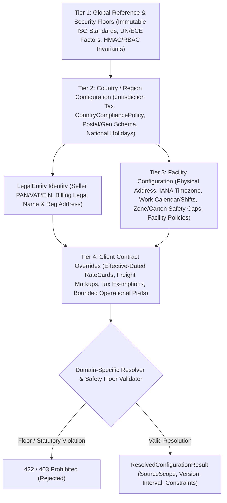

# Nexus3PL — Global Master Data, Localization & Logistics Configuration: Pre-Implementation Specification

**Document Status:** Revision 2 — Independent Architecture Review Corrections Applied (Submitted for `MDM-0` Review Gate)  
**Authorization Gate:** Discovery & Pre-Implementation Specification Only (`MDM-0` implementation **Held** pending review sign-off)  
**Workstream Identifier:** **MDM Track (`MDM-0` – `MDM-6`)** *(Project **Phase 8** remains strictly reserved for Deployment & Production Readiness)*  
**Branch:** `feature/phase-7-enterprise-frontend`  
**Accepted Phase 7.4 Baseline SHA:** `8af4474efde676413dae487928ecebcde3f29059`  
**Companion Gap Audit:** [Global_Master_Data_And_Configuration_Gap_Audit.md](Global_Master_Data_And_Configuration_Gap_Audit.md)  
**Date:** November 24, 2026  

---

## 1. Architectural Mandate & Core Design Principles

This specification defines the **Nexus3PL Global Master Data, Localization & Logistics Configuration (`MDM`)** architecture across all **seven master-data modules**, directly addressing every finding from the [Gap Audit](Global_Master_Data_And_Configuration_Gap_Audit.md) and the Independent Architecture Review.

### Non-Negotiable Architectural Rules
1. **Preserve Project Phase 8 Deployment Roadmap:** All master-data and localization stages use **`MDM-0` through `MDM-6`**. Existing Project **Phase 8 (Deployment & Production Readiness)** and closed Phase 7.4 invariants remain untouched.
2. **Reuse & Complete Existing Masters — Zero Parallel Duplicate Tables:** Expose and extend existing entities (`Facility`, `WarehouseZone`, `Location`, `DockDoor`, `PackagingMaterial`, `HandlingUnit`, `Client`, `Customer`, `Supplier`, `Item`, `ItemCategory`, `PackagingUnit`, `RateCard*`, `StorageBillingPolicy`, `CarrierRateAgreement`, `ClientFreightAgreement`, `InvoiceSequence`, `AllocationPolicy`, `PutawayStrategyRule`, `SlottingPolicy`, `InventoryAgingPolicy`, `AbcClassificationPolicy`, `ProductAffinityPolicy`, `MonitoringRule`, `CarrierContractualSlaPolicy`, `PublicTrackingShare`).
3. **Separate Legal Identity, Physical Facility, Reference Standards, Mutable Config & Historical Facts:**
   - **Issuing Legal Entity (`LegalEntity`) vs. Physical Warehouse (`Facility`):** Seller legal identity, billing entity name, tax registrations (`PAN`, `VAT`, `EIN`), and invoice issuer ownership belong to `LegalEntity` — **never** implicitly equating a physical warehouse facility address with the legal seller on tax invoices.
   - **Immutable Global Reference Standards** (ISO 3166-1/3166-2, ISO 4217 minor units, IANA `tzdb`, UN/ECE Rec 20 conversion ratios, verified Bikram Sambat month calendar data) — platform-governed, never overridden by tenants.
   - **Mutable Effective-Dated Business Configuration** (`TaxRateRule`, `CountryCompliancePolicy`, `FxRateRecord`, `RateCardSchedule`, policies) — versioned, effective-dated (`EffectiveFromUtc`..`EffectiveToUtc`), backed by persisted PostgreSQL revision tracking.
   - **Immutable Historical Transaction Snapshots** (`OutboundOrder`, `OutboundOrderLine`, `Shipment`, `BillOfLading`, `ShippingLabel`, `ProofOfDelivery`, `Invoice`, `InvoiceLine`, `CreditNote`) — freeze resolved legal identity, tax/VAT breakdown, unit conversions, FX, and compliance state at execution commit time.
4. **Fail-Closed Safety & Statutory Honesty:** Client overrides **never** weaken platform security, statutory compliance, carrier/warehouse weight limits, or cold-chain safety floors. Manual user entry of a statutory reference (e.g., typed VCTS code) or a queued e-billing payload **must never be presented as independent proof of governmental verification**.

---

## 2. Formal Configuration Resolution Contract & Precedence Model

Configuration domains do **not** undergo one generic blind merge. Instead, each configurable setting specifies its authoritative domain resolver and returns a strongly-typed **`ResolvedConfigurationResult<T>`** envelope.

### 2.1 Explicit `ResolvedConfigurationResult<T>` Contract

Every backend configuration resolver returns (and snapshots where transactional) the following metadata contract:

```csharp
public enum ConfigResolutionState
{
    ExplicitValue = 1,   // Explicitly set at SourceScope
    Inherited = 2,       // Inherited cleanly from a higher tier
    ExplicitNull = 3,    // Intentionally cleared/unset at SourceScope (stops inheritance)
    Disabled = 4,        // Feature/rule exists but explicitly turned off at SourceScope
    Prohibited = 5       // Blocked by mandatory safety, security, or statutory floor
}

public sealed record ResolvedConfigurationResult<T>(
    T? EffectiveValue,
    ConfigResolutionState ResolutionState,
    ConfigScope SourceScope,             // Global | Country | LegalEntity | Facility | Client | ClientCategory
    Guid? SourceEntityId,
    int EffectiveVersion,
    DateTimeOffset EffectiveFromUtc,
    DateTimeOffset? EffectiveToUtc,
    DateTimeOffset ResolvedAtUtc,
    IReadOnlyList<string> AppliedConstraints, // e.g., ["Floor:ColdChainMinDaysBeforeExpiry=14"]
    string? StatutorySourceRef,          // e.g., "ird.gov.np / VAT Act Standard Rate"
    string? ApprovalStatus               // "VerifiedApproved" | "SystemDefault" | null
);
```

- **Null vs. Inherit Distinction:** Database entities distinguish **absent/not-overridden** (`HasOverride == false` -> inherit from parent tier) from **`ConfigResolutionState.ExplicitNull`** (deliberately cleared value such as removing an optional secondary charge rule) and **`Disabled`** (e.g., turning off an optional SLA alert at facility level).
- **Fail-Closed Gate:** If a mandatory setting resolves to `Prohibited` on mutation (e.g., Client sets `MinDaysBeforeExpiry = 5` below Facility floor `14`), mutation returns **`422 Unprocessable Entity`**. If a mandatory operational lookup (e.g., active `TaxRateRule`, active `FxRateRecord`, Facility address for shipping) resolves without a valid active record at runtime, execution aborts fail-closed (`422`), never falling back silently to `"USD"`, `"USA"`, or `0%`.

### 2.2 Per-Domain Precedence & Applicability Matrix



| Domain / Setting | Resolver Pattern | Applicable Tiers (Ordered) | Explicit Non-Overridable Rules |
| :--- | :--- | :--- | :--- |
| **1. ISO Country / Currency / UN-ECE UOM Ratios** | Immutable Lookup | `Tier 1 (Global)` only | No Country, Facility, or Client override permitted (`1 kg = 2.2046226218 lb` fixed). |
| **1. Display UOM (`kg`/`lb`) & Locale** | Preference Cascade | `User/Client` -> `Facility` -> `Country` -> `Global` | Presentation only; DB storage & weight caps execute strictly in canonical SI metric (`kg`, `cm`, `cm³`). |
| **1. Document Sequence & Fiscal Reset** | Statutory Sequence Resolver | `Country (Calendar)` + `LegalEntity` + `Facility` + `Client` | Statutory fiscal reset (e.g., `NP` Shrawan 1) locked at Country; issued numbers immutable. |
| **2. Facility Address, Timezone, Calendars, Zones** | Facility Authority | `Country (National Holidays)` -> `Facility` | **No Client override.** `ShippingLabelService` & `BOL` read real `Facility` address & timezone. |
| **2. Carton `MaxWeightKg` & Zone `TempMaxC`** | Hard Safety Bound | `Facility` (+ Client-branded `PackagingMaterial` spec) | Client cannot relax `MaxWeightKg` or cold-chain `TempMaxC` (`PackingExecutionService` 0% overweight ceiling). |
| **3. Carrier Registry, Services & Zones** | Enablement Intersection | `Global Adapter` ∩ `Country` ∩ `Facility` ∩ `Client Allowlist` | Client can narrow allowlist only; cannot activate disabled carriers or bypass facility cutoffs. |
| **3. Dispatch Compliance (`NP` VCTS, Custody, POD)** | Rule Predicate + Floor | `CountryCompliancePolicy` + `Facility` -> `Client (Strict-Only)` | Client **may strengthen** POD (require photo), **never bypass** applicable `CountryCompliancePolicy` or driver custody. |
| **4. Item Catalog, Multi-UOM, HSN & Customer Book** | Client-Owned + Country Catalog Validation | `Client Catalog` validated against `Country Tariff/Tax Category` | Item dimensions/weight & category tax validation enforced before packing/invoicing. |
| **5. Seller Legal Identity & Tax / VAT / e-Billing** | **Jurisdiction & LegalEntity Resolver** | `Country TaxJurisdiction/TaxRateRule` + `LegalEntity` + `ClientTaxProfile` | **Jurisdiction-locked:** Client cannot pick arbitrary VAT rate (`0%`/exempt only via verified `ClientTaxProfile` + `TaxRateRule`). |
| **5. Commercial Rate Cards, Storage & Freight Markup** | Contract Precedence | `(Client + Facility + EffectiveDate)` -> `(Client + Default + EffectiveDate)` | Facility fallback prohibited if contract mandates facility-specific pricing; fails closed (`422`) if absent. |
| **6. Operations Policies (Allocation, Putaway, Wave, Tolerances)** | Bounded Policy Cascade | `(Client + Category + Facility)` -> `(Client + Facility)` -> `Facility Baseline` constrained by `Global/Facility Floors` | Client cannot lower `MinDaysBeforeExpiry` below category/facility floor or exceed `MaxOverReceiveRatio`. |
| **7. Integration Credentials & Outbound Webhooks** | Strict Scoped Secret Lookup | `(Facility? + Client? + Provider)` isolated by vault boundary | Client integration admins access **only** own `ClientId` external channels; never carrier/statutory platform keys. |

---

### 2.3 Issuing Legal Entity vs. Physical Facility Separation

To ensure compliant multi-country billing across `US`, `NP`, and multi-warehouse 3PL contracts:
- **`LegalEntity` Master (`OperatingCompany`):** Holds `LegalName`, `RegistrationNumber`, `CountryCode`, `TaxIdentifierType` (`PAN`/`VAT`/`EIN`), `TaxRegistrationNumber`, `RegisteredAddress`, `IsCbmsMandated`, `IroSoftwarePermitRef`, `DefaultCurrencyCode`.
- **`Facility` Binding:** Each `Facility` references `DefaultLegalEntityId` (representing the warehouse operator entity at that physical site), while retaining its own physical dock/ship-from address (`Facility.AddressLine1..PostalCode..CountryCode`).
- **Transaction Separation:**
  - `BillOfLading` & `ShippingLabel` stamp **Physical Shipper Origin** from `Facility` (`ShipperName`, `ShipperAddressSnapshot`), plus carrier/customs legal party from `LegalEntity` where required.
  - `Invoice` & `CreditNote` stamp **Seller Tax Identity** (`SellerLegalName`, `SellerTaxIdSnapshot`, `SellerAddressSnapshot`) from the contract's resolved **`LegalEntity`**, **Buyer Identity** from `Client` + `ClientTaxProfile`, and **Service Location** from `FacilityId`.

---

### 2.4 Database-Backed Multi-Instance Cache Consistency Contract

Simple post-commit cache/epoch writes in an in-memory `ConcurrentDictionary` or fire-and-forget Redis calls **cannot synchronize independent API server instances** if a DB transaction commits and cache notification fails. Nexus3PL adopts a **four-layer DB-authoritative consistency model**:

1. **Persisted Revision & Monotonic Epoch State in PostgreSQL:**
   - Every mutable configuration table includes `ConfigRevision` (`bigint`, incremented on every update).
   - A lightweight PostgreSQL table `ConfigurationScopeEpochs` stores monotonic revision counters per scope (`Global`, `Country:{Code}`, `Facility:{Id}`, `Client:{Id}`).
2. **Transactional Invalidation Outbox (`ConfigurationInvalidationEvent`):**
   - Inside the **exact same EF Core/PostgreSQL transaction** that commits any configuration change, `ApplicationDbContext` increments the relevant `ConfigurationScopeEpochs` row(s) and inserts an immutable `ConfigurationInvalidationEvent` outbox record.
3. **Distributed Redis Synchronization + Short Bounded Fallback TTL:**
   - A post-commit dispatcher (plus a background outbox sweeper every `5s` + PostgreSQL `LISTEN/NOTIFY` optional accelerator) pushes updated epoch numbers to Redis (`IDistributedCache`), ensuring failed post-commit Redis calls automatically self-heal within seconds via the transactional outbox.
   - Local L1 `IMemoryCache` entries are capped at a **short bounded TTL (`<= 30s`)** even when Redis is offline.
4. **Zero Silent Stale-Read Rule for Critical Decisions:**
   - **Critical paths — Tax/VAT rate selection, `CountryCompliancePolicy` enforcement, `InvoiceSequence` allocation, Safety Floor validation (`MinDaysBeforeExpiry`, `MaxWeightKg`), and RBAC/Facility authorization** — **MUST NOT silently consume unverified stale L1 cache**. They either read inside the transaction against PostgreSQL directly (`AsNoTracking` indexed lookup) or verify their cached bundle's `ConfigRevision` against the lightweight `ConfigurationScopeEpochs` row in PostgreSQL (returning fail-closed error if Redis/DB verification disagrees or DB is unreachable).
   - Verification requirement: `MDM-1` / `MDM-3` PostgreSQL test harness must simulate **2 concurrent application/cache contexts**, mutate tax/policy rules in Context A, kill/skip Redis propagation, and prove Context B immediately rejects/reloads rather than serving stale tax or safety config.

---

### 2.5 Conditional, Source-Verified Nepal Regulatory Engine (`CountryCompliancePolicy`)

Regulatory obligations (VCTS, CBMS, VAT exemptions, BS calendar boundaries) vary by taxpayer registration, annual turnover notices, business classification, and cargo type. They are modeled via a versioned **`CountryCompliancePolicy`** entity rather than hardcoded booleans.

#### A. `CountryCompliancePolicy` Schema & Semantics
- **Fields:** `PolicyId`, `CountryCode` (`"NP"`), `PolicyCode` (e.g., `NP-DRI-VCTS`, `NP-IRD-CBMS`, `NP-IRD-VAT`), `Version`, `StatutorySourceRef` & `OfficialNoticeCitation` (e.g., `dri.gov.np VCTS FAQ`, `ird.gov.np VAT Act & Electronic Invoice Procedure`), `ApplicabilityPredicateJson` (machine-evaluated predicates: `BusinessClassification`, `OrderCategory`, `TaxpayerTurnoverMandateFlag`, `CargoClass`), `EnforcementMode` (`MandatoryFailClosed`, `ConditionalRequired`, `AdvisoryWarning`), `EffectiveFromUtc`, `EffectiveToUtc`, `ApprovalStatus` (`Draft` -> `VerifiedApproved` -> `Superseded`), `ApprovedByUserId`, `ApprovedAtUtc`.
- **Fail-Closed Execution:** When applicability predicates evaluate `true` for a verified active policy and required compliance data cannot be captured or validated, the operation **fails closed (`422 Unprocessable Entity`)** with diagnostic `PolicyCode` and `StatutorySourceRef`.

#### B. Verified Applicability Rules & Honest Evidence States
1. **DRI VCTS (`NP-DRI-VCTS`, ref `dri.gov.np` FAQ):**
   - Applies conditionally to covered **wholesale traders, importers, manufacturers, transport/logistics entities, and bulk/commercial cargo movements**. Small-scale retail operators (*खुद्रा*) and personal/non-commercial parcels fall outside mandatory VCTS scope.
   - Applicability inputs: `Client.BusinessClassification` (`Wholesale` / `Importer` / `Manufacturer` / `RetailMicro` / `DirectConsumer`), `OutboundOrder.OrderType`, and `CarrierMaster.TransportMode`.
   - **Compliance State Honesty:** A user-entered VCTS consignment number at dispatch sets `VctsComplianceStatus = ManualReferenceRecorded` (operator-declared reference + `RecordedByUserId` + timestamp). It is **never labeled `AuthorityVerified`** unless verified via an approved DRI integration (`MDM-5`).
2. **IRD Electronic Billing / CBMS (`NP-IRD-CBMS`, ref `ird.gov.np`):**
   - Applies **only** to issuing `LegalEntity` entities subject to IRD electronic-billing/CBMS official turnover/sector notices (holding an IRO software-listing permit, `LegalEntity.IsCbmsMandated` or voluntary enrollment). Does **not** treat all Nepal entities uniformly.
   - When CBMS applies: issued tax invoices/credit notes lock permanently against modification/deletion (`Invoice` immutable once `Issued`) and emit a `CbmsSubmissionRecord` (`ComplianceStatus = QueuedForPortalSync` when offline/pending -> `AuthorityAcknowledged` only after IRD CBMS API receipt/acknowledgment). Queued payloads trigger alert monitoring if unacknowledged past SLA and **never** assert independent statutory completion.
3. **Nepal Postal Codes (`giwmscdnone.gov.np` / Nepal Post):**
   - `NP` address schema supports **locality- and ward-based 5-digit and 7-digit postal codes as primary**, alongside **legacy 5-digit district/GPO codes (e.g. `44600`)** for compatibility, with District/Palika/Ward/Landmark structured fields.
4. **Effective-Dated VAT & Finance Act Amendments (`NP-IRD-VAT`):**
   - `TaxRateRule` supports effective-dated `Standard` (`13%`), `ZeroRatedExport` (`0%`), `Schedule1Exempt`, special excise/sector overrides, and prospective Finance Act effective dates (`EffectiveFromUtc` tied to Shrawan 1 / statutory notice dates) — never a hardcoded constant `0.13m`.
5. **Authoritative Bikram Sambat Calendar (`BikramSambatCalendarMonth`):**
   - Because BS month durations (`29–32` days) change non-algorithmically, persist an immutable seeded `BikramSambatCalendarMonth` lookup table (`BsYear`, `BsMonth 1..12`, `DaysInMonth`, `GregorianStartDate`, `GregorianEndDate`) sourced from official Nepal Panchanga / Department of Survey / Nepal Gazette publications, covered by Shrawan 1 / Ashadh-end (`2082/83`, `2083/84`, leap/32-day Ashadh) boundary unit tests.

---

## 3. Resolution Examples & Consolidated Bounded-Context Architecture

### 3.1 Example A — Kathmandu Facility (`FAC-KTM1`, `NP`) Conditional VCTS & CBMS Evaluation
- **Wholesale B2B Tenant (`HIMAL-WHOLESALE`):** `LegalEntity("3PL Nepal Pvt Ltd", PAN="601234567", IsCbmsMandated=true)` dispatches bulk goods from `FAC-KTM1` (`NP`, `Asia/Kathmandu`) to Pokhara (`Gandaki`, `Kaski`, `Pokhara-08`, postal `33700` or 7-digit locality code).
  1. `NP-DRI-VCTS` resolves `MandatoryFailClosed`: Dispatch requires VCTS consignment reference -> stored as `ManualReferenceRecorded` (audit-logged, **not** marked externally verified).
  2. `BillingRun` selects `LegalEntity` PAN `601234567`, reads `BikramSambatCalendarMonth` -> `2083/84`, applies `TaxRateRule("NP", "STANDARD_VAT", @InvoiceDate)` = `13%`, allocates locked `INV-2083/84-...`, and creates `CbmsSubmissionRecord(QueuedForPortalSync)` under `NP-IRD-CBMS`.
- **Exempt Small-Retail / Domestic Document Tenant (`MICRO-SHOP`):** `NP-DRI-VCTS` predicate matches `ExemptSmallRetail` (`NotApplicable`), `IsCbmsMandated = false` -> dispatch & standard non-CBMS tax invoicing proceed without false regulatory blockers, recording `NotApplicable (Policy NP-DRI-VCTS v1)`.

### 3.2 Example B — Chicago Facility (`FAC-ORD1`, `US`) Client Override Rejection
- `APEX-001` sets UI unit preference `Imperial (lb/in)` (**`ExplicitValue`**, valid presentation conversion from stored canonical SI `kg`/`cm`, rounded per carrier/invoice rules) and attempts `MinDaysBeforeExpiry = 5` on `ColdPharma` (Facility floor `14`): rejected fail-closed (`422`, `Prohibited`).

### 3.3 Core Bounded-Context ER Overview

```mermaid
erDiagram
    COUNTRY_PROFILE ||--o{ ADMINISTRATIVE_DIVISION : "hosts"
    COUNTRY_PROFILE ||--o{ COUNTRY_COMPLIANCE_POLICY : "enforces conditionally"
    COUNTRY_PROFILE ||--o{ TAX_JURISDICTION : "governs"
    COUNTRY_PROFILE ||--o{ HOLIDAY_CALENDAR : "publishes"
    COUNTRY_PROFILE ||--o{ SHIPPING_ZONE : "defines"
    LEGAL_ENTITY ||--o{ FACILITY : "operates (DefaultLegalEntityId)"
    LEGAL_ENTITY ||--o{ INVOICE : "issues as Legal Seller"
    FACILITY ||--o{ FACILITY_CALENDAR : "schedules"
    FACILITY ||--o{ CLIENT_FACILITY_ACCESS : "authorizes (existing)"
    CLIENT ||--o{ CLIENT_TAX_PROFILE : "registers PAN/VAT/Exemption"
    CLIENT ||--o{ RATE_CARD : "contracts (existing)"
    CARRIER_MASTER ||--o{ CARRIER_SERVICE : "offers"
    CARRIER_MASTER ||--o{ CARRIER_RATE_AGREEMENT : "rates (existing +CarrierId)"
    CARRIER_MASTER ||--o{ DRIVER_PROFILE : "associates"
    CARRIER_MASTER ||--o{ VEHICLE_FLEET : "operates"
    INTEGRATION_CONNECTION ||--o{ VAULTED_CREDENTIAL : "secures via KMS/SecretsMgr"
```



---

## 4. API Lifecycle Rules, Carrier/Vault Contracts & `/api/v1/storage/download` Security

### 4.1 Non-Uniform API Lifecycle Rules (No Generic `PUT` / `DELETE`)
Master entities must expose lifecycle transitions matching regulatory and referential immutability—never unrestricted `PUT` or hard `DELETE`:

| Master Category | Examples | Allowed Operations | Forbidden Operations (`405`/`409`) |
| :--- | :--- | :--- | :--- |
| **Immutable Reference Catalogs** | `CountryProfile`, `AdministrativeDivision`, `CurrencyMaster`, `UomDefinition`, `BikramSambatCalendarMonth` | `GET` (list/detail), platform-signed `Seed/Deprecate` revision | No client/facility mutation; no hard `DELETE` or arbitrary `PUT`. |
| **Statutory, Tax & Financial Rules** | `TaxRateRule`, `CountryCompliancePolicy`, `FxRateRecord`, `RateCardSchedule` (once active), `Invoice`, `InvoiceSequence` (consumed) | `GET`, `POST` new version/revision (`Supersede`), `POST {id}/void` or `deactivate` (with active-use checks) | Retroactive `PUT` on active/used effective windows and `DELETE` strictly forbidden (`409 Conflict`). |
| **Operational Warehouse & Transport Masters** | `Facility`, `WarehouseZone`, `Location`, `DockDoor`, `PackagingMaterial`, `CarrierMaster`, `ClientContact` | `GET`, `POST`, scoped `PUT` (immutable codes blocked on update), `PATCH {id}/status` (`Activate`/`Deactivate`/`Archive`) | `Deactivate` blocked (`409`) if active `StockOnHand`, pending `PickTask`/`PackingSession`, or unclosed `Shipment` references the entity. |

### 4.2 Hardened `/api/v1/storage/download` Endpoint Contract (`MDM-0.2`)
`PrivateObjectStorageService` currently generates signed URLs (`PrivateObjectStorageService.cs:281`) and validates `(GET, objectKey, expiry)` HMAC signatures (`ValidatePreSignedToken`, `L292-347`), but lacks a controller and tenant authorization binding. The repaired `StorageController` (`GET /api/v1/storage/download`) enforces **all five controls**:
1. **Production Key Fail-Closed Startup:** Remove runtime fallback on the hardcoded `ObjectStorageOptions.SigningSecretKey` (`ObjectStorageOptions.cs:16`) in non-Development environments (startup fails if secret not provisioned cleanly).
2. **Short Bounded Expiry & HMAC-SHA256 Validation:** Token lifetime clamped `[1, 60]` minutes; constant-time HMAC signature check (`CryptographicOperations.FixedTimeEquals`); reject expired/tampered tokens (`403 Forbidden`).
3. **Canonical Object-Key Namespace Restriction:** Normalize keys and strictly allowlist permitted prefixes (`pod/`, `labels/`, `bol/`, `returns/`) — reject `..`, backslashes, or non-allowlisted prefixes (`400`/`403`).
4. **Authenticated Evidence Authorization Boundary:** Require `[Authorize]` (or dedicated time-limited public share flow only if explicitly linked to `PublicTrackingShare` non-PII artifacts) and verify caller `UserType`/`TenantId`/`AssignedFacilityId` matches the linked `ProofOfDelivery` / `Shipment` / `ReturnShipment` owner (plus `Driver` allowed only for own assigned shipment POD uploads). A leaked/valid HMAC token belonging to Client A **must return `403`** when requested by Client B.
5. **Response Headers & Audit Trail:** Force `X-Content-Type-Options: nosniff`, sanitized `Content-Disposition: attachment`, validated content-type from stored `.meta.json`, and security-audit log every rejected (`401`/`403`/`404`) attempt.

### 4.3 Canonical Metric Storage, Precision & Dim-Weight Formula (`D3`)
- All physical weights & dimensions remain stored in canonical metric: `WeightKg` (`decimal(18,4)`), `LengthCm`/`WidthCm`/`HeightCm` (`decimal(18,2)`), `VolumeCm3` (`decimal(18,2)`).
- Conversion ratios (`UN/ECE Rec 20`: `1 kg = 2.2046226218 lb`, `1 in = 2.54 cm`) apply at presentation (`formatters.ts`) and carrier integration serialization only, keeping full-precision intermediate math and rounding final display/billing outputs with `MidpointRounding.AwayFromZero` (`decimal(18,4)` for billing lines, `decimal(18,2)` for currency invoice totals / carrier rate charges where configured).
- **Provider-Specific Dimensional Weight:** Replace hardcoded `5000m` (`CartonizationService.cs:389`, `Package.cs:42`) with `CarrierService.DimWeightDivisor` + `CarrierRateAgreement.DimensionalWeightDivisor` (e.g., `5000` cm³/kg metric, `139` in³/lb US domestic air/ground, or agreement custom divisor) + `WeightRoundingIncrement` (`0.5 kg` vs `1.0 lb` ceiling rounding).

### 4.4 External Secrets & Production Vault Boundary (`D4`)
- **Explicit Boundary:** ASP.NET Core `IDataProtectionProvider` (backed by DB keyring) is **not** equated with a production secrets manager.
- **Target Architecture:** Define `ICredentialVaultService` backed by **AWS Secrets Manager / Azure Key Vault / HashiCorp Vault** in Production (`VaultProvider` configuration), using envelope encryption/DataProtection keyring **strictly** as local/Development adapter.
- Mandate: key rotation tracking (`SecretVersion`, `Primary`/`Secondary` dual-secret overlap window for zero-downtime webhook rotation), encrypted backups/DR key recovery procedures, zero secret material in logs or API responses (masked last-4 preview only), and immutable `SecretAccessAuditLog` entries on every read/rotation.

---

## 5. Legacy Data Migration & Historical Compatibility Rules

1. **No Blanket `"USA"` Backfill on Unknown Origins:**
   - Replace naive `"USA"` default backfills with an explicit deterministic SQL/code normalization migration:
     - Map exact normalized matches (`"USA"`, `"U.S.A."`, `"UNITED STATES"` -> `"US"`; `"NEPAL"`, `"NPL"` -> `"NP"`).
     - Where `CountryCode` is blank/null, inspect verified parent context (`Facility.CountryCode` / known domestic postal+state pattern) **only when unambiguous**.
     - Record any genuinely ambiguous legacy row with **`CountryNormalizationStatus = PendingNormalization`** (flagged in admin migration diagnostics, never silently stamped `"US"` or `"NP"`).
2. **Additive Non-Breaking Column Rollout:** New legal-entity, tax, and snapshot columns on `Invoice`, `OutboundOrderLine`, `Shipment`, and `BillOfLading` deploy nullable with explicit backfill scripts matching historical records (`FiscalYearLabel = FiscalYear.ToString()`), preserving 100% compatibility with closed Phase 7.4 PostgreSQL records.
3. **Pre-Cutover Migration Guard:** Fail-closed check verifies no duplicate active `TaxRateRule` or `InvoiceSequence` fiscal overlaps exist before enabling unique constraints (following Phase 7.4.5's `Phase745PodIdempotencyAndAuditColumns` guard pattern).

---

## 6. Formal Decisions (`D1`–`D5`) — Review Rulings Reflected

| ID | Decision | Architectural Ruling | Mandatory Implementation Conditions |
| :-: | :--- | :--- | :--- |
| **D1** | **Stabilization & Cleanup Scope** | **Approved with Changes** | Retain all confirmed cleanup items (`ShippingLabelService` facility origin, `FacilityDto`, `/api/v1/storage/download`, `InvoiceSequence` locking, policy wiring, `P746-N01`/`N02`), **split into independent test-gated `MDM-0.1`–`MDM-0.5` units** under `MDM` numbering (preserving Phase 8 Deployment). |
| **D2** | **Nepal Statutory Mode** | **Conditionally Approved** | Implement manual reference capture (`VCTS`) & conditional CBMS readiness/queueing first with explicit `ComplianceStatus` enum; **never** mark manual/queued state as externally verified; gate live portal APIs on official IRD/DRI specifications. |
| **D3** | **Canonical Metric Storage** | **Approved** | Store canonical `kg`/`cm`/`cm³`; document explicit precision (`18,4`/`18,2`), `MidpointRounding.AwayFromZero`, conversion factors, and carrier/agreement-specific dim-weight divisors (`5000` vs `139`). |
| **D4** | **Credential Vault Strategy** | **Conditional** | Require production KMS/Secrets Manager (`Azure Key Vault` / `AWS Secrets Manager` / `Vault`) adapter, rotation, DR key recovery, and access auditing; do not treat app DataProtection keyring as a complete production vault. |
| **D5** | **Initial Nepal Courier Partners** | **Deferred** | First finalize & approve generic `CarrierMaster` + `ICarrierAdapter` contract (`MDM-4`); select live Nepal couriers only after commercial agreements and verified API/COD specs are supplied. |

---

## 7. Revised Implementation Sequence (`MDM-0` through `MDM-6`)

*(Project **Phase 8** remains strictly reserved for Deployment & Production Readiness unless changed by a separate roadmap decision.)*

| Workstream | Sub-Units & Reconciled Deliverables | Independent Acceptance & Verification Gate |
| :---: | :--- | :--- |
| **`MDM-0`** *(Stabilization & Baseline Hardening — split per D1)* | • **`MDM-0.1`**: Fix `ShippingLabelService` origin from `Facility` + complete `FacilityDto` fields.<br>• **`MDM-0.2`**: Implement hardened `StorageController` (`/api/v1/storage/download`) + remove non-Dev hardcoded fallback signing key.<br>• **`MDM-0.3`**: Add PostgreSQL `FOR UPDATE` / advisory locking to `InvoiceSequence`.<br>• **`MDM-0.4`**: Wire `AllocationPolicy.PreferFullHandlingUnits`, `AllocationExecutionService.strategyOverride`, and `PutawayStrategyRule.PreferConsolidation`.<br>• **`MDM-0.5`**: Resolve Phase 7.4.6 deferred UI items (`P746-N01` portable `AUDIT_REPO_DIR` + `P746-N02` 320px horizontal-scroll hint). | Each sub-unit merges/verifies independently with targeted unit, security/ownership HTTP, live PostgreSQL concurrency, and Playwright regression suites; baseline `1,375+` .NET + `102+` Vitest + `17+` Playwright green. |
| **`MDM-1`** *(Global References, Localization & Consistency Engine)* | `CountryProfile` (`US` + `NP` locality/ward & legacy postal validation), `AdministrativeDivision`, `LegalEntity`, `CurrencyMaster`, `FxRateRecord` (+ NRB multi-unit interface), `UomConversion`, `BikramSambatCalendarMonth` lookup table + Shrawan 1 boundary rules, `FacilityCalendar`/`HolidayCalendar`, `CountryCompliancePolicy`, DB-backed `ConfigRevision` + `ConfigurationInvalidationEvent` cache consistency, legacy `USA`/`US` source-context normalization migration, and frontend `formatters.ts`. | Concurrent `US` & `NP` multi-country PostgreSQL tests + multi-instance cache stale-read recovery tests + zero silent `"USD"`/`"USA"` defaults. |
| **`MDM-2`** *(Warehouse, Client, Operations Policies & `ADR-007` v2 Admin)* | Expose `Facilities`, `Zones`, `Locations`, `DockDoors`, `PackagingMaterials`, `Customers`, `ClientContacts`, `ClientFacilityAccess`, `Items`/`Categories`/`PackagingUnits`, `AllocationPolicies`, `ProductAffinity`, and `Wave`/`Replenishment`/`CycleCount` CRUD APIs obeying §4.1 lifecycle rules; upgrade `SchemasController` tenant overlays (`GET /api/v1/schemas`) and decouple `DynamicEntityPage`/`DynamicForm`/`DynamicList` (`date`/`datetime`/numeric/repeater/lookup fixes). | RBAC pruning + cross-facility Staff isolation (`403`) + Client `TenantId` isolation + safety-floor rejection (`422`) + Vitest metadata UI suite passing. |
| **`MDM-3`** *(Financial Masters, Taxation, Rate Cards & Billing)* | Expose 11 existing `Services/Billing/*` services via `BillingController`/`RateCardsController`/`InvoicesController`/`PaymentsController`; add `TaxJurisdiction`, `TaxRateRule`, `ClientTaxProfile` (`PAN`/VAT), `LegalEntity` seller tax identity snapshots, conditional CBMS queue tracking, immutable snapshots on `Invoice`/`OrderLine`/`Shipment`/`BOL`, and replace UI `/app/billing` placeholder. | Live PostgreSQL billing runs in both `NP` (`13%` effective VAT, `2083/84` locked sequence, conditional CBMS state) and `US`, plus mutating-master historical snapshot immutability checks. |
| **`MDM-4`** *(Carrier, Service, Zone, Rate & Fleet Masters)* | Implement `CarrierMaster`, `CarrierService` (custom dim-weight divisors), `ShippingZone`/`ShippingZoneRule`, `DriverProfile`, `VehicleFleet`, `DispatchPolicy`, `CarrierRateAgreement` CRUD; replace global `SimulatedCarrierService` singleton with `ICarrierAdapterFactory`; connect live rate quoting to `CarrierRateAgreement` + `ShippingZones`; wire `PublicTrackingShare`; capture conditional `VCTS` reference (`ManualReferenceRecorded`). | Contract-tariff rate shopping tests across `NPR`/`USD` zones, VCTS applicability predicate tests (exempt small retail vs covered wholesale), and driver/fleet RBAC tests. |
| **`MDM-5`** *(Integration Hub, Credential Vault & Approved Connectors)* | Implement `IntegrationConnection`, production KMS/Secrets Manager `VaultedCredential` adapter (`D4`), `ExternalCodeMapping`, `IntegrationOutboxEvent` + DLQ replay, and approved external carrier / statutory / ERP / e-commerce connectors (gated on `D2` & `D5` approvals). | Tenant credential isolation, primary/secondary secret rotation without downtime, DLQ replay security, and wiremock/contract tests against approved provider specs. |
| **`MDM-6`** *(Consolidated Multi-Country Audit & Closure)* | Full multi-viewport desktop/tablet/mobile/320px Playwright visual & accessibility audit across all Admin, Billing & Localization surfaces, full .NET + live PostgreSQL + Vitest + Playwright suite, and independent MDM closure report. | Independent acceptance gate sign-off prior to **Phase 8 Deployment & Production Readiness**. |

---

## 8. Immediate Next Action Before `MDM-0`

This revision completes all corrections requested in the Independent Architecture Review (`1A`–`1E`, `D1`–`D5`, `MDM-0`–`MDM-6` renumbering, conditional Nepal VCTS/CBMS applicability, `LegalEntity` vs `Facility` separation, DB-authoritative cache invalidation, and `/api/v1/storage/download` security).

**Work remains stopped at the Architecture Review Gate.** Awaiting formal approval of this Revision 2 specification to authorize **`MDM-0.1`**.
