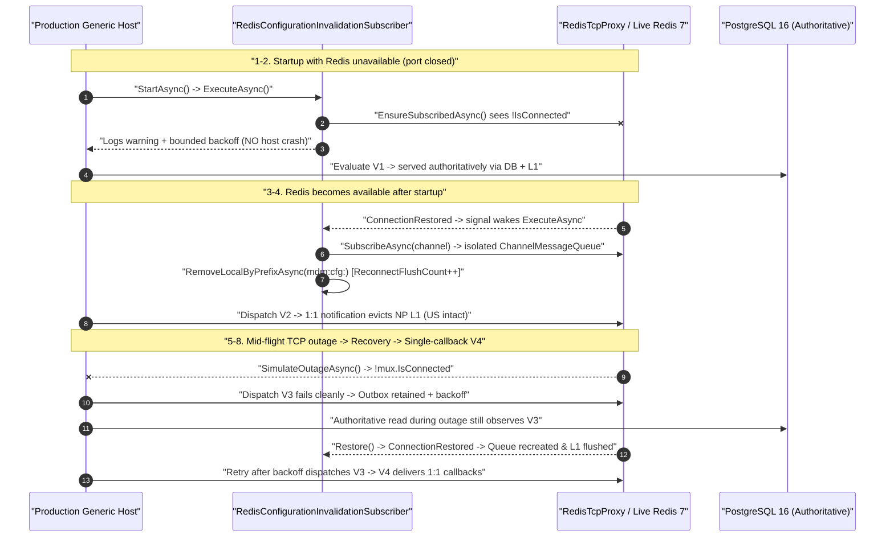

# MDM-1.5 Acceptance Remediation Report (`R01`–`R05` & `R05-F01` Final Hardening)

- **Repository:** `Umesh1200/3PL_Warehouse_Logistics`
- **Branch:** `feature/phase-7-enterprise-frontend`
- **Initial Review Baseline:** `83fba921c91bbef3cc0e439cf6a73c1e297a801c`
- **R05-F01 Authoritative Baseline:** `5c3ef24a3fe9a44b30504dce40fa9018722dac5c`
- **R01–R05 Remediation Commits (`83fba92` → `5c3ef24`):**
  - `a16ebaf` — `fix(mdm-1.5): remediate R01-R05 FX/tx/loop/prefix-tracking/Redis pubsub & outbox backoff`
  - `7245300` — `fix(mdm15): flush policy supersede before approval in live Redis check`
  - `b37bf4d` — `fix(mdm15): flush R02 policy supersede before approval deterministically`
  - `5c3ef24` — `docs(mdm-1.5): update remediation report with verified CI run 45807364080`
- **R05-F01 Code & Verification Commits (`5c3ef24` → `2931be0`):**
  - `39cb07c` — `fix(mdm-1.5): harden Redis subscriber startup/reconnection, L1 bounds, and live host integration checks (R05-F01)`
  - `819a12c` — `fix(mdm15): drain prior setup outbox rows before isolated US/NP Redis checks`
  - `7b9eb4b` — `fix(mdm15): use isolated ChannelMessageQueue and assert 1:1 post-reconnect delivery`
  - `2931be0` — `fix(mdm15): warm explicit US L1 entry before post-reconnect V4 isolation assertion`
- **Preserved `main` & `origin/main`:** `a198f02090194ce4d59dec2941c89d519757f4b4`
- **Verified CI Run for `2931be0` (Code & Test HEAD):** [GitHub Actions Run `45834357619`](https://github.com/Umesh1200/3PL_Warehouse_Logistics/actions/runs/45834357619) (`139959159388` & `139959160231`)

---

## 1. Root Cause Analysis (`R01`–`R05` & `R05-F01`)

| Finding | Root Cause | Impact |
| :--- | :--- | :--- |
| **MDM15-R01** *(Accepted)* Effective-date-safe FX caching | `FxConversionService` cached filtered rate results with mismatched effective-date bundle keys. | Non-monotonic FX conversion queries could mismatch uncached lookups. |
| **MDM15-R02** *(Accepted)* Transaction-local configuration reads | `ConfigurationConsistencyService` accessed shared L1/L2 caches inside active transactions (`HasActiveTransaction == true`). | Uncommitted writes or rollbacks could poison shared cache or hide transaction-local mutations. |
| **MDM15-R03** *(Accepted)* Bounded reload loop & fail-closed contention | Single post-load epoch comparison could fail or return unverified snapshots under concurrent updates. | Concurrent writers could destabilize cached epoch consistency. |
| **MDM15-R04** *(Accepted)* Generation-safe L1 prefix tracking & bounded footprint | Plain key tracking risked ABA callback races; L1 required hard bounds and `RemoveLocalByPrefixAsync`. | Concurrent set/evict cycles could drop key tracking; local memory could retain oversized/stale entries. |
| **MDM15-R05-F01A** Subscriber startup & reconnection resilience | `RedisConfigurationInvalidationSubscriber.ExecuteAsync` called `SubscribeAsync` once directly on startup without exception handling or backoff retry, AND delegate-based `SubscribeAsync(channel, handler)` could retain duplicate delegates in `StackExchange.Redis` across transient connection failures/retries. | If Redis was down at host startup, an unhandled exception could terminate the Generic Host (`StopHost`); across rapid reconnect/subscribe failures, duplicate delegates could fire `2x` callbacks per message. |
| **MDM15-R05-F01B** Live Redis test assertion & host recovery proof | `Mdm15PostgresCheck.cs` lines 706–714 ignored `memB.Count != 0` after the final `Task.Delay` check (false-positive pass if targeted L1 keys remained) and did not verify a full production Generic Host starting offline, recovering via the **same** `mux`/`subscriber`/`transport` instances across an actual TCP outage, and enforcing `1:1` delivery without duplicate callbacks. | Targeted L1 eviction regression, host crash on offline Redis startup, or duplicate post-reconnect callbacks could go undetected in live CI. |
| **Final Hardening** Oversized L1 payloads, shared `IMemoryCache`, strict schema check & caller rollback | `RedisCacheService.SetAsync` checked `MaxCachedEntrySizeBytes` (`262_144`) only before L2 Redis writes while still writing oversized values into L1 `MemoryCache`; `ApplicationDbContext` allowed empty `__EFMigrationsHistory` without checking `configuration_invalidation_events`; live PostgreSQL lacked an explicit caller-owned post-save rollback isolation check. | Oversized objects rejected from L2 could enter/remain stale in L1; partial/corrupt schemas needed stricter fail-closed detection. |

---

## 2. File-Level Implementation Changes (`R01`–`R05` & `R05-F01`)

### Core & Infrastructure Changes
- `src/Core/Warehouse3PL.Application/Common/Interfaces/IApplicationDbContext.cs` & `ICacheService.cs`
  - Added `bool HasActiveTransaction { get; }` and `RemoveLocalByPrefixAsync(string prefixKey, CancellationToken cancellationToken = default)`.
- `src/Core/Warehouse3PL.Domain/Entities/Reference/ConfigurationInvalidationEvent.cs`
  - Added `NextRetryAtUtc` + exponential retry backoff (`ScheduleNextRetry` / `ComputeRetryBackoff`).
- `src/Infrastructure/Warehouse3PL.Infrastructure/Services/Reference/FxDatabaseRateResolver.cs` & `FxConversionService.cs`
  - Unfiltered pair-history loader `QueryAllPublishedForPair` + full-pair bundle cache (`fx-pair-history:{from}:{to}:{authority}`) filtered cleanly over `[EffectiveFromUtc, EffectiveToUtc)` in memory.
- `src/Infrastructure/Warehouse3PL.Infrastructure/Caching/ConfigurationConsistencyService.cs`
  - Transaction-local bypass (`HasActiveTransaction`) + bounded verification loop (`MaxEpochVerificationAttempts = 5`, fail-closed `CONFIG_EPOCH_CONTENTION_EXCEEDED` / `CONFIG_EPOCH_VERIFICATION_UNAVAILABLE`).
- `src/Infrastructure/Warehouse3PL.Infrastructure/Caching/CacheOptions.cs` & `RedisCacheService.cs`
  - Generation-monotonic `_trackedLocalKeys` + striped key gates, L1 TTL clamp (`HardCapLocalFallbackSeconds = 30`), `MemoryCache` `Size = 1` (`LocalCacheSizeLimit = 10_000`), `OutboxDispatchedRetentionDays = 7`, and unified `MaxCachedEntrySizeBytes` (`262_144`) enforcement in `SetAsync<T>`: payloads serialized above `MaxCachedEntrySizeBytes` are skipped from **both** Redis L2 and L1 `MemoryCache` (and any previously cached local key is removed so stale data cannot linger).
- `src/Infrastructure/Warehouse3PL.Infrastructure/Caching/RedisConfigurationInvalidationSubscriber.cs` *(F01-A hardened)*
  - Protected startup retry loop with cancellation-aware bounded exponential backoff (`1s, 2s, 4s, ... capped at MaxBackoffSeconds = 30`), never escaping `ExecuteAsync` to crash the host.
  - Replaced delegate subscription with an explicitly managed, serialized `ChannelMessageQueue` (`_channelQueue`) inside `_subscriptionLock`, tearing down any prior queue before subscribing cleanly so duplicate callbacks cannot accumulate across retries or reconnects.
  - Subscribes cleanly to `ConnectionFailed` and `ConnectionRestored`, immediately waking `_signal` on reconnect to restore the subscription, flush `"mdm:cfg:"` local L1 entries (`ReconnectFlushCount`), and clear failure flags cleanly.
  - Clean `ExecuteAsync` `finally` handler + `Dispose()` override detaching `ConnectionRestored`/`ConnectionFailed`, unsubscribing `_channelQueue`, and disposing synchronization primitives safely.
- `src/Infrastructure/Warehouse3PL.Infrastructure/Caching/RedisConfigurationInvalidationTransport.cs` & `BackgroundJobs/ConfigurationInvalidationDispatcher.cs`
  - Fail-fast publish on `!_multiplexer.IsConnected` + outbox backoff scheduling (`NextRetryAtUtc`) and aged dispatched pruning (`PurgeDispatchedRetentionAsync`).
- `src/Infrastructure/Warehouse3PL.Infrastructure/Persistence/ApplicationDbContext.cs` & `ConfigurationScopeMapper.cs`
  - Hardened `CheckHasMdm15SchemaSync` / `CheckHasMdm15SchemaAsync` so bypassing epoch tracking is restricted strictly to controlled pre-MDM-1.5 databases (`__EFMigrationsHistory` exists **and is non-empty**, zero migrations `>= 20261126083415`, and neither `configuration_scope_epochs` nor `configuration_invalidation_events` exists). Partial schemas (one table missing) or empty/missing migration history fail closed (`InvalidOperationException`).
  - `ConfigurationScopeMapper` invalidates both `OriginalValues` and `CurrentValues` on mutable scopes (`CountryCode`, `FacilityId`, `ClientId`) and tracks `Client` entity lifecycle.
- `src/Infrastructure/Warehouse3PL.Infrastructure/DependencyInjection.cs` & `20261126100927_MDM1_5_R01_OutboxBackoffAndRetention.cs`
  - Configured `MemoryCacheOptions.SizeLimit`, resilient `IConnectionMultiplexer` (`AbortOnConnectFail = false`), hosted `RedisConfigurationInvalidationSubscriber`, and outbox backoff migration.

### Verification Suite Enhancements (`F01-B` & Final Hardening)
- `tests/Warehouse3PL.UnitTests/Reference/Mdm15ConfigurationConsistencyTests.cs`
  - Added `F01A_ProductionGenericHost_StartsCleanlyWhenRedisUnavailable_AndShutDownIsSafe`
  - Added `F01_FinalHardening_OversizedL1PayloadRejected_SharedMemoryCacheCompatible_And_CallerRollbackIsolated`
- `tests/verification/Phase73PostgresCheck/Mdm15PostgresCheck.cs` & `.github/workflows/phase73-postgres-verification.yml`
  - Fixed `RunLiveRedisMultiInstanceChecksAsync` lines 700–714 false-positive assertion: independently verifies `subB.ReceivedNotificationCount > 0`, actual eviction of targeted `Country:NP` L1 keys in `memB`, and preservation of unrelated `Country:US` L1 keys.
  - Added partial-schema fail-closed check (dropping only `configuration_invalidation_events`) and caller-owned post-`SaveChangesAsync` rollback check on live PostgreSQL.
  - Added `RunLiveHostRedisResilienceChecksAsync` using a real in-process TCP proxy (`RedisTcpProxy`) in front of live `redis:7-alpine` proving all 8 required Generic Host live integration scenarios on the **exact same** host/multiplexer/subscriber/cache/transport instances.

---

## 3. Before vs. After Behavioral Evidence (`R05-F01`)

| Scenario | Before `R05-F01` (`5c3ef24`) | After `R05-F01` (`2931be0`) |
| :--- | :--- | :--- |
| **Generic Host startup when Redis is down** | `SubscribeAsync` threw synchronously inside `ExecuteAsync` if multiplexer was disconnected, risking host termination. | Host starts cleanly (`mux.IsConnected == false`, `sub.IsSubscribed == false`), serves PostgreSQL-authoritative reads without errors, and retries with bounded `1s..30s` backoff (`F01A_ProductionGenericHost_...` & `RunLiveHostRedisResilienceChecksAsync`). |
| **Post-startup Redis recovery & reconnect flush** | Fire-and-forget `OnConnectionRestored` lacked serialized re-subscription and could leave/duplicate handlers on startup failure. | Single serialized `ExecuteAsync` loop using isolated `ChannelMessageQueue` wakes on `ConnectionRestored`, restores single subscription, flushes `"mdm:cfg:"` (`ReconnectFlushCount++`), and delivers `1:1` callbacks (`dispatched == delta`, zero `2x` callbacks). |
| **Live Redis targeted eviction check** | `Mdm15PostgresCheck` lines 706–714 only checked `ReceivedNotificationCount == 0` after fallback delay (false-positive risk). | Test now independently fails if targeted `NP` L1 keys remain in `memB` OR if unrelated `US` L1 keys are evicted. |
| **L1 oversized value handling** | Payloads > `MaxCachedEntrySizeBytes` (`262_144`) skipped Redis L2 but were still stored in L1 `MemoryCache`. | Payloads > `MaxCachedEntrySizeBytes` skip both L2 and L1 and remove any stale local value for that key. |
| **Pre-MDM schema bypass check** | Checked only `configuration_scope_epochs` existence and non-null `__EFMigrationsHistory`. | Requires both `configuration_scope_epochs` and `configuration_invalidation_events` AND non-empty `__EFMigrationsHistory`; partial schemas fail closed. |

---

## 4. Architecture & Live Resilience Flows

### (a) Generic Host Offline Startup, Late Redis Recovery & TCP Interruption (`F01-A` / `F01-B`)

---

## 5. Exact Test & Verification Evidence

### 5.1 .NET Unit & Security Regression Tests (`Warehouse3PL.UnitTests`)
- **Command:** `dotnet test tests/Warehouse3PL.UnitTests/Warehouse3PL.UnitTests.csproj --configuration Release`
- **Local Release Run & CI Job:** [Run `45834357619` / Job `139959159388`](https://github.com/Umesh1200/3PL_Warehouse_Logistics/actions/runs/45834357619) (at `2931be0`)
- **Observed Result:** `Passed! - Failed: 0, Passed: 1440, Skipped: 0, Total: 1440` (CI Duration: `1 m 7 s`)
- **Exact MDM-1.5 Test Names in `Mdm15ConfigurationConsistencyTests.cs`:**
  - `TwoInstances_WithoutRedis_DetectPolicyFxCalendarAndLegalEntityMutations_Immediately`
  - `CachePrefixEviction_TenantPartitionIsolation_DispatcherRetry_And_FailClosedDbError_Work`
  - `R01_EffectiveDateSafeFxCaching_PreservesWindowParityAcrossReversedRequests`
  - `R02_R03_TransactionBypass_And_VerifiedReloadLoop_FailClosedUnderContention`
  - `R04_R05_GenerationSafePrefixTracking_SubscriberIdempotency_ScopeChanges_And_ProductionDi_Work`
  - `F01A_ProductionGenericHost_StartsCleanlyWhenRedisUnavailable_AndShutDownIsSafe`
  - `F01_FinalHardening_OversizedL1PayloadRejected_SharedMemoryCacheCompatible_And_CallerRollbackIsolated`

### 5.2 Live PostgreSQL 16 + Live Redis 7 Verification (`Phase73PostgresCheck`)
- **Workflow:** `.github/workflows/phase73-postgres-verification.yml` (`postgres:16-alpine` + `redis:7-alpine`, `PHASE73_REDIS_CONNECTION: 127.0.0.1:6379,abortConnect=false`)
- **CI Job:** [Run `45834357619` / Job `139959160231` (`rollback-retry`)](https://github.com/Umesh1200/3PL_Warehouse_Logistics/actions/runs/45834357619) (at `2931be0`)
- **Local Build:** `dotnet build tests/verification/Phase73PostgresCheck/Phase73PostgresCheck.csproj --configuration Release` → `0 Warning(s), 0 Error(s)`
- **Observed CI Output Lines:**
  - `PASS PostgreSQL MDM-1.1 Migration, btree_gist Exclusion, Idempotent Seed, Concurrent Approval & Supersession Races, Bitemporal Continuity, Rollback & JWT Security verified cleanly.`
  - `PASS PostgreSQL MDM-1.2 Migration, LegalEntity Separation, RBAC R01, Cross-Validation R02, Concurrent Lock R03 & Physical Origin verified cleanly.`
  - `PASS PostgreSQL MDM-1.3 Migration, CurrencyMaster, Dynamic FX Exclusion/Race, UnitMultiplier, Rollback & UOM verified cleanly.`
  - `PASS PostgreSQL MDM-1.4 Migration, Contiguous BS 2075-2090, FacilityCalendar Exclusion/Race, Holidays & NP/US SLA Verified.`
  - `PASS Live PostgreSQL + Real Redis 7 Two-Instance Pub/Sub, Duplicate Handling & Outage Recovery Verified.`
  - `PASS Live Generic Host Offline Startup -> Late Redis -> Disconnect/Reconnect Flush -> Single-Callback Recovery Verified.`
  - `PASS PostgreSQL MDM-1.5 Scope Epochs, Outbox Backoff/Retry, Concurrency, R01-R05 & Real Redis Verification.`
  - `ALL PHASE 7.3, 7.4.0A, 7.4.0B & 7.4.0C POSTGRESQL VERIFICATIONS PASSED CLEANLY!`
- **8-Point Live Generic Host + Real Redis TCP Proxy Interruption/Recovery Coverage (`RunLiveHostRedisResilienceChecksAsync`):**
  1. Production Generic Host started with proxy port closed (`!mux.IsConnected`, `!sub.IsSubscribed`).
  2. PostgreSQL-authoritative `V1` evaluation & L1 caching succeeded during startup Redis unavailability.
  3. Proxy opened on same port after startup -> same `mux`/`sub` connected (`ReconnectFlushCount >= 1`), automatically clearing offline-era L1 keys.
  4. Same subscriber delivered V2 invalidations `1:1` (`dispatched == delta`), evicting targeted `Country:NP` L1 while keeping unrelated `Country:US` L1 intact.
  5. Proxy killed active TCP sockets & entered outage mode (`!mux.IsConnected`) -> same host `IConfigurationInvalidationTransport` retained pending outbox rows, enforced exponential backoff deferral, and same host still served `V3` authoritatively from PostgreSQL.
  6. Proxy restored on same port -> same `sub` restored subscription cleanly and flushed outage-era local `"mdm:cfg:"` L1 entries; `V3 -> V4` invalidation verified single-callback `1:1` delivery post-reconnect and selective `NP` eviction with `US` L1 intact.
  7. Pending outbox backoff window honored (`DeferredByBackoff > 0`) before advancing test clock `+15s` and completing dispatch on the same transport.
  8. Harmless duplicate `Country:NP` pub/sub payload handled idempotently before clean `host.StopAsync()` teardown (`!sub.IsSubscribed`).

### 5.3 Frontend Suites (`src/UI/Nexus3PLFrontend`)
All frontend suites were run cleanly locally (zero frontend files modified in `R01`–`R05-F01`):
- **Vitest:** `npx vitest run --maxWorkers=2` → `Test Files 12 passed (12), Tests 108 passed (108)` (`35.10s`)
- **TypeScript & Production Build:** `npx tsc --noEmit` & `npm run build` → exit `0`, `✓ built in 7.89s`
- **Playwright Chromium E2E:** `npm run test:e2e` → `32 passed (2.2m)`

---

## 6. Hardening Audit Findings & Outstanding Limitations

1. **L1 `MemoryCache` size/capacity policy:** `RedisCacheService.SetAsync<T>` enforces `MaxCachedEntrySizeBytes` (`262_144` bytes) via UTF-8 JSON serialization before storing in **either** Redis L2 or local L1 `MemoryCache` (removing any stale L1 value for that key if overwritten with an oversized payload). Because `IMemoryCache` meters logical entry counts (`Size = 1` within `LocalCacheSizeLimit = 10_000`, `CompactionPercentage = 0.25`, `HardCapLocalFallbackSeconds = 30`) rather than live CLR heap byte size, runtime types that are not JSON-serializable cannot be byte-sized and fall back to entry-count/TTL bounding only.
2. **Shared `IMemoryCache` `SizeLimit` compatibility:** Solution-wide inspection (`src/` and `tests/`) confirms `RedisCacheService` is the sole `IMemoryCache` caller in application/infrastructure code and always sets `MemoryCacheEntryOptions.Size = 1`. Any future consumer injected with the shared `IMemoryCache` from `DependencyInjection.cs` must continue supplying `Size` on `MemoryCacheEntryOptions` because `MemoryCache` rejects entries without `Size` whenever `SizeLimit` is configured.
3. **Controlled pre-MDM schema bypass:** `ApplicationDbContext.CheckHasMdm15SchemaSync/Async` permits bypassing MDM-1.5 outbox writes only when `"__EFMigrationsHistory"` exists with at least one applied row, zero migrations `>= 20261126083415` are recorded, and both `configuration_scope_epochs` and `configuration_invalidation_events` are absent.
4. **Live container environment:** Because Docker is not installed on the Windows workstation, live `postgres:16-alpine` + `redis:7-alpine` execution runs in the GitHub Actions Linux runner (`phase73-postgres-verification.yml`).
5. **Default configuration & preserved workspace:** `appsettings.json` keeps `Redis:EnableRedis: false` by default unless configured; `main` / `origin/main` remains untouched at `a198f02090194ce4d59dec2941c89d519757f4b4` alongside user-owned untracked files.
