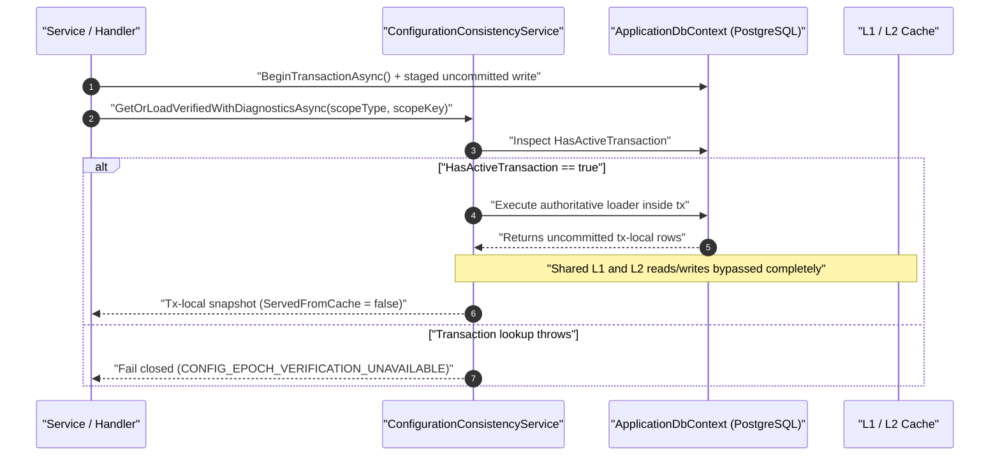
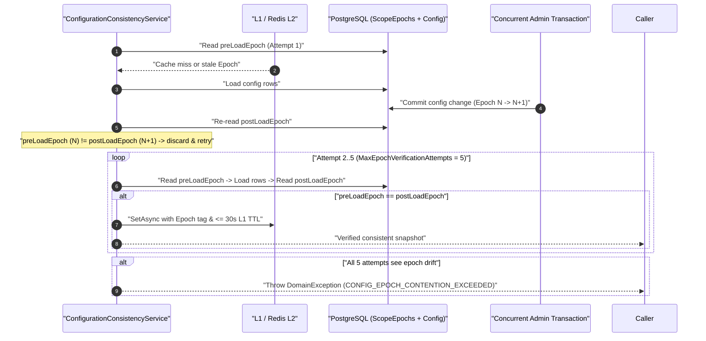
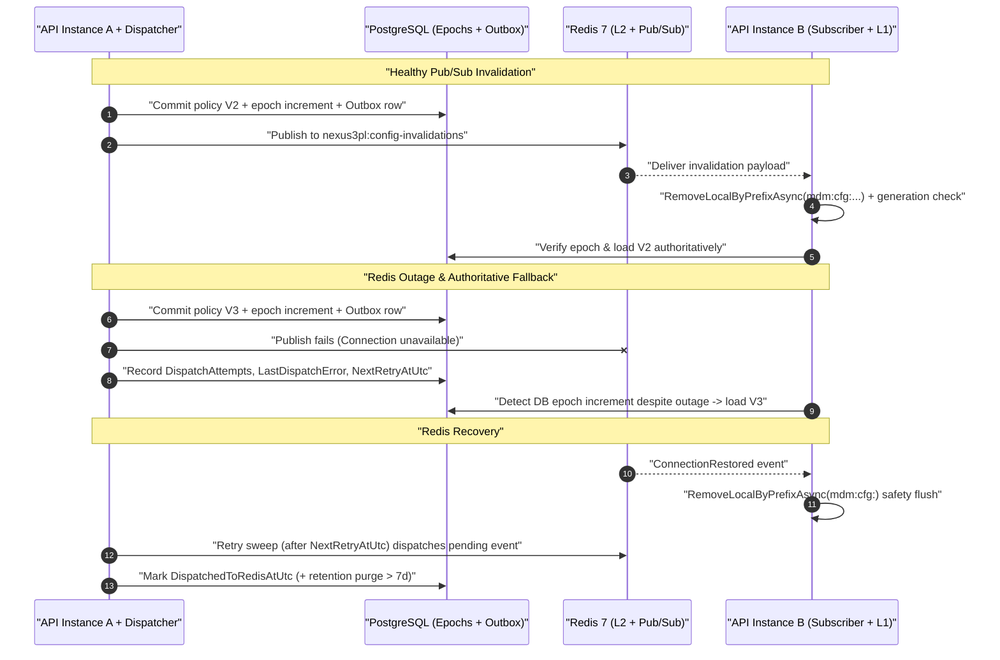

# MDM-1.5 Acceptance Remediation Report (`R01`–`R05` & Hardening)

- **Repository:** `Umesh1200/3PL_Warehouse_Logistics`
- **Branch:** `feature/phase-7-enterprise-frontend`
- **Authoritative Review Baseline:** `83fba921c91bbef3cc0e439cf6a73c1e297a801c`
- **Code & Test Remediation Commits:**
  - `a16ebafd91abae850b34213cdc5e31fc7180d59e` (`fix(mdm-1.5): remediate R01-R05 FX/tx/loop/prefix-tracking/Redis pubsub & outbox backoff`)
  - `7245300e09627e0ffeedd017dd255b0a0a61b3fc` (`fix(mdm15): flush policy supersede before approval in live Redis check`)
  - `b37bf4dbb9201c9da5879449dd669e9694e47a0d` (`fix(mdm15): flush R02 policy supersede before approval deterministically`)
- **Preserved `main` & `origin/main`:** `a198f02090194ce4d59dec2941c89d519757f4b4`
- **Passing CI Verification Run (before final doc commit):** [GitHub Actions Run `45807364080`](https://github.com/Umesh1200/3PL_Warehouse_Logistics/actions/runs/45807364080) on commit `b37bf4dbb9201c9da5879449dd669e9694e47a0d`

---

## 1. Root Cause Analysis (`R01`–`R05` & Review Findings)

| Finding | Root Cause at `83fba92` | Impact |
| :--- | :--- | :--- |
| **MDM15-R01** Effective-date-safe FX caching | `FxConversionService` cached filtered rate results by effective-date/pair key or mismatched query window, risking incorrect or stale historical FX selection when requests arrive in non-monotonic `effectiveAtUtc` order. | Reversed historical/future FX conversion queries on the same currency pair could return empty or mismatched rate candidates compared to an uncached authoritative lookup. |
| **MDM15-R02** Transaction-local configuration reads | `ConfigurationConsistencyService.GetOrLoadVerifiedAsync` read/wrote shared L1/L2 caches even inside an active database transaction (`HasActiveTransaction == true`). | Inside an uncommitted transaction with own uncommitted writes (which later might roll back), shared L1/L2 could be poisoned with uncommitted state or hide intra-transaction mutations behind pre-tx cached snapshots under the same epoch. |
| **MDM15-R03** Bounded verified reload loop & contention fail-closed | Only a single post-load epoch comparison/reload was attempted without bounded retries or fail-closed exception when concurrent writers continuously bumped the epoch. | Under concurrent mutations, a second overlapping race could either serve an unverified mixed snapshot or publish inconsistent epoch data into L1/L2 cache. |
| **MDM15-R04** Generation-safe L1 prefix tracking & bounded cache footprint | Plain key tracking in `RedisCacheService` was vulnerable to ABA/race removal during `PostEvictionCallback` and lacked hard L1 entry/total bounds (`SizeLimit`, `MaxCachedEntrySizeBytes`, L1 fallback TTL hard cap) and a dedicated local-only invalidation API (`RemoveLocalByPrefixAsync`). | Concurrent set/evict callbacks could drop tracking of newly inserted keys; unbounded `MemoryCache` payloads risked excessive local heap growth or extended stale L1 lifetimes if pub/sub failed. |
| **MDM15-R05** End-to-end Redis pub/sub invalidation, DI & outage resilience | No live `BackgroundService` subscriber (`RedisConfigurationInvalidationSubscriber`) or `IConnectionMultiplexer` DI registration was wired for `nexus3pl:config-invalidations`; Redis outage retry lacked backoff/retention; CI did not run a live `redis:7-alpine` container against multi-instance cache consistency. | Running multiple API instances with Redis enabled lacked automatic cross-instance L1 eviction upon outbox publish and reconnect L1 flush after Redis downtime. |
| **Additional Hardening** Mutable scope tracking, fail-closed schema check & outbox retry | `ConfigurationScopeMapper` needed both `OriginalValues` and `CurrentValues` invalidation when mutable foreign-key/country scopes (`CountryCode`, `FacilityId`, `ClientId`) change; `ApplicationDbContext` needed fail-closed MDM-1.5 schema detection once migration `>= 20261126083415` is applied or history is missing; `ConfigurationInvalidationDispatcher` lacked exponential backoff + aged-row retention pruning. | Reparenting a `Facility`/`Client` could leave old-scope epochs unchanged; partial/corrupted schemas could silently skip epoch enforcement; failed Redis dispatches hot-looped without backoff or table retention hygiene. |

---

## 2. File-Level Implementation Changes

### Application & Domain
- `src/Core/Warehouse3PL.Application/Common/Interfaces/IApplicationDbContext.cs`
  - Added `bool HasActiveTransaction { get; }` so `ConfigurationConsistencyService` detects active DB transactions without leaking EF Core internals.
- `src/Core/Warehouse3PL.Application/Common/Interfaces/ICacheService.cs`
  - Added `RemoveLocalByPrefixAsync(string prefixKey, CancellationToken cancellationToken = default)` to evict L1 entries safely without deleting shared L2 Redis keys.
- `src/Core/Warehouse3PL.Domain/Entities/Reference/ConfigurationInvalidationEvent.cs`
  - Added `NextRetryAtUtc` backoff scheduling property and exponential retry state helpers (`ScheduleNextRetry` / `ComputeRetryBackoff`).

### Infrastructure & Persistence
- `src/Infrastructure/Warehouse3PL.Infrastructure/Services/Reference/FxDatabaseRateResolver.cs`
  - Added `internal static IQueryable<FxRateRecord> QueryAllPublishedForPair(...)` returning unfiltered published history for `(baseCurrencyCode, quoteCurrencyCode, preferredAuthority)`.
- `src/Infrastructure/Warehouse3PL.Infrastructure/Services/Reference/FxConversionService.cs`
  - Updated caching key to `fx-pair-history:{fromNorm}:{toNorm}:{preferredAuthority?.ToString() ?? "ANY"}`, caching complete published pair history and filtering `[EffectiveFromUtc, EffectiveToUtc)` + calling `SelectBestCandidate` in memory per requested `effectiveAtUtc`.
- `src/Infrastructure/Warehouse3PL.Infrastructure/Caching/ConfigurationConsistencyService.cs`
  - Enforces transaction-local bypass when `_db.HasActiveTransaction` is `true` (bypassing both L1/L2 reads and cache writes, failing closed with `CONFIG_EPOCH_VERIFICATION_UNAVAILABLE` if transaction state/DB check fails).
  - Replaced single retry with a bounded verification loop (`MaxEpochVerificationAttempts = 5`) asserting `preLoadEpoch == postLoadEpoch` before publishing to cache; throws `DomainException(..., "CONFIG_EPOCH_CONTENTION_EXCEEDED")` fail-closed when exhausted.
- `src/Infrastructure/Warehouse3PL.Infrastructure/Caching/CacheOptions.cs`
  - Added bounded cache/outbox settings: `LocalFallbackMaxTtlSeconds = 30`, `LocalCacheSizeLimit = 10_000`, `MaxCachedEntrySizeBytes = 262_144`, `OutboxDispatchedRetentionDays = 7`.
- `src/Infrastructure/Warehouse3PL.Infrastructure/Caching/RedisCacheService.cs`
  - Added generation-monotonic L1 tracking (`_trackedLocalKeys`, `TrackedLocalKeyCount`, striped locking, `PostEvictionCallback` generation-guarded cleanup), L1 TTL clamping (`<= 30s`), `Size = 1` entries, `MaxCachedEntrySizeBytes` guard, and `RemoveLocalByPrefixAsync`.
- `src/Infrastructure/Warehouse3PL.Infrastructure/Caching/RedisConfigurationInvalidationSubscriber.cs` *(new)*
  - `BackgroundService` subscribing to Redis channel `nexus3pl:config-invalidations`, evicting scoped L1 prefixes via `RemoveLocalByPrefixAsync`, flushing `"mdm:cfg:"` on `ConnectionRestored`, and handling duplicate notifications idempotently (`ReceivedNotificationCount`).
- `src/Infrastructure/Warehouse3PL.Infrastructure/Caching/RedisConfigurationInvalidationTransport.cs`
  - Fails dispatch cleanly (without false outbox completion) when `_multiplexer == null || !_multiplexer.IsConnected`.
- `src/Infrastructure/Warehouse3PL.Infrastructure/BackgroundJobs/ConfigurationInvalidationDispatcher.cs`
  - Added exponential backoff filtering (`NextRetryAtUtc <= now`) and aged dispatched retention pruning (`PurgeDispatchedRetentionAsync` using `OutboxDispatchedRetentionDays`) plus sweep diagnostics (`ConfigurationOutboxDiagnostics`).
- `src/Infrastructure/Warehouse3PL.Infrastructure/Persistence/ConfigurationScopeMapper.cs`
  - Inspects `entry.OriginalValues` and `CurrentValues` on `Modified` mutable scopes (`CountryCode`, `FacilityId`, `ClientId`) so both source and target configuration scopes increment epochs and emit invalidations; tracks `Client` entity lifecycle cleanly.
- `src/Infrastructure/Warehouse3PL.Infrastructure/Persistence/ApplicationDbContext.cs`
  - Exposes `HasActiveTransaction` and hardens `CheckHasMdm15SchemaSync` / `CheckHasMdm15SchemaAsync` to fail closed if `__EFMigrationsHistory` is missing or shows migration `>= 20261126083415` while `configuration_scope_epochs` is absent.
- `src/Infrastructure/Warehouse3PL.Infrastructure/Persistence/Configurations/Reference/ConfigurationInvalidationEventConfiguration.cs` & EF Core Migration `20261126100927_MDM1_5_R01_OutboxBackoffAndRetention.cs`
  - Configures `next_retry_at_utc` column and index on `configuration_invalidation_events` and updates `ApplicationDbContextModelSnapshot.cs`.
- `src/Infrastructure/Warehouse3PL.Infrastructure/DependencyInjection.cs`
  - Configures `MemoryCacheOptions.SizeLimit`, registers `IConnectionMultiplexer` (`AbortOnConnectFail = false`) and `RedisConfigurationInvalidationSubscriber` hosted service when `EnableRedis && !string.IsNullOrWhiteSpace(ConnectionString)`, plus `IConfigurationConsistencyService`, `ICacheService`, `IConfigurationInvalidationTransport`, `ConfigurationInvalidationProcessor`, and `ConfigurationInvalidationDispatcher`.

### Tests & CI Pipeline
- `tests/Warehouse3PL.UnitTests/Reference/Mdm15ConfigurationConsistencyTests.cs`
  - Added dedicated `R01`, `R02`/`R03`, and `R04`/`R05` test suites covering reverse-order FX window parity, active-tx bypass + rollback isolation, bounded reload contention failure, generation-safe L1 prefix eviction, duplicate subscriber payloads, mutable scope moves, and real production DI registration.
- `tests/verification/Phase73PostgresCheck/Mdm15PostgresCheck.cs` & `.github/workflows/phase73-postgres-verification.yml`
  - Added `redis:7-alpine` service container (`6379:6379`, `PHASE73_REDIS_CONNECTION`) to CI and expanded PostgreSQL verification (`RunRemediationPgChecksAsync` & `RunLiveRedisMultiInstanceChecksAsync`) testing real 2-instance Redis pub/sub L1 eviction, duplicate payload idempotency, outage retention/DB-authoritative fallback, backoff recovery, transaction rollback isolation, and outbox retention cleanup (flushing `Supersede` before `Approve` inside an explicit PostgreSQL transaction to satisfy non-deferred `excl_country_compliance_policies_active_window`).

---

## 3. Before vs. After Behavioral Evidence

| Scenario | Before Remediation (`83fba92`) | After Remediation (`b37bf4d`) |
| :--- | :--- | :--- |
| **Reversed-window FX lookup** (`Jun -> Feb` on non-overlapping `[Jan, Jun)` / `[Jun, Dec)` pair) | Effective-date cache key / subset risk could mismatch uncached query. | `FxConversionService` caches full published pair history (`fx-pair-history:EUR:NPR:ManualApproved`) and evaluates `[EffectiveFromUtc, EffectiveToUtc)` identically (`14600.00m` and `13900.00m`, matching uncached path). |
| **Transaction-local config read & rollback** | Reads inside an open transaction could read/populate shared L1/L2 cache with pre-commit or uncommitted rows. | `HasActiveTransaction == true` bypasses L1/L2 read & write completely; callers inside a transaction read DB-local uncommitted changes, and rolled-back changes never poison other instances (`CONFIG_EPOCH_CONTENTION_EXCEEDED` prevents torn snapshots under sustained concurrency). |
| **Concurrent epoch mutation during reload** | Single retry could emit stale snapshot or lose verification invariant. | Bounded loop (`MaxEpochVerificationAttempts = 5`) checks `preLoadEpoch == postLoadEpoch`; fails closed with `DomainException` (`CONFIG_EPOCH_CONTENTION_EXCEEDED`) if concurrent writes outlast all 5 attempts. |
| **L1 prefix eviction & reconnect flush** | No `RemoveLocalByPrefixAsync` / generation tracking / hosted pubsub subscriber; L1 TTL not clamped to `<= 30s`. | `RemoveLocalByPrefixAsync` + generation-safe `PostEvictionCallback` + `SizeLimit` + `<= 30s` L1 cap; `RedisConfigurationInvalidationSubscriber` evicts L1 automatically on live `nexus3pl:config-invalidations` messages and flushes `mdm:cfg:` on `ConnectionRestored`. |
| **Redis outage & recovery** | Transport could lack explicit backoff/retention lifecycle in outbox dispatch. | Unreachable Redis retains outbox rows (`DispatchedToRedisAtUtc == null`) with exponential `NextRetryAtUtc`, PostgreSQL epoch checks still serve fresh `V3` reads authoritatively, and subsequent healthy recovery sweeps dispatch & later prune rows past `OutboxDispatchedRetentionDays`. |

---

## 4. Architecture & Sequence Flows

### (a) Transaction-Local Reads (`MDM15-R02`)

### (b) Repeated Epoch Changes & Bounded Verification (`MDM15-R03`)

### (c) Multi-Instance Redis Outage & Recovery (`MDM15-R04` / `R05`)

---

## 5. Verification Evidence

### 5.1 .NET Unit & Security Tests (`Warehouse3PL.UnitTests`)
- **Command:** `dotnet test tests/Warehouse3PL.UnitTests/Warehouse3PL.UnitTests.csproj --configuration Release`
- **CI Job:** [Run `45807364080` / Job `139866012690`](https://github.com/Umesh1200/3PL_Warehouse_Logistics/actions/runs/45807364080)
- **Observed Result:** `Passed! - Failed: 0, Passed: 1438, Skipped: 0, Total: 1438` (Duration: `49 s`)
- **MDM-1.5 Tests Executed & Passed in `Mdm15ConfigurationConsistencyTests.cs`:**
  - `TwoInstances_WithoutRedis_DetectPolicyFxCalendarAndLegalEntityMutations_Immediately`
  - `CachePrefixEviction_TenantPartitionIsolation_DispatcherRetry_And_FailClosedDbError_Work`
  - `R01_EffectiveDateSafeFxCaching_PreservesWindowParityAcrossReversedRequests`
  - `R02_R03_TransactionBypass_And_VerifiedReloadLoop_FailClosedUnderContention`
  - `R04_R05_GenerationSafePrefixTracking_SubscriberIdempotency_ScopeChanges_And_ProductionDi_Work`

### 5.2 Live PostgreSQL 16 + Live Redis 7 Verification (`Phase73PostgresCheck`)
- **Workflow:** `.github/workflows/phase73-postgres-verification.yml` (`postgres:16-alpine` + `redis:7-alpine`, `PHASE73_REDIS_CONNECTION: 127.0.0.1:6379,abortConnect=false`)
- **CI Job:** [Run `45807364080` / Job `139866013201` (`rollback-retry`)](https://github.com/Umesh1200/3PL_Warehouse_Logistics/actions/runs/45807364080)
- **Observed CI Output:**
  - `PASS PostgreSQL MDM-1.1 Migration, btree_gist Exclusion, Idempotent Seed, Concurrent Approval & Supersession Races, Bitemporal Continuity, Rollback & JWT Security verified cleanly.`
  - `PASS PostgreSQL MDM-1.2 Migration, LegalEntity Separation, RBAC R01, Cross-Validation R02, Concurrent Lock R03 & Physical Origin verified cleanly.`
  - `PASS PostgreSQL MDM-1.3 Migration, CurrencyMaster, Dynamic FX Exclusion/Race, UnitMultiplier, Rollback & UOM verified cleanly.`
  - `PASS PostgreSQL MDM-1.4 Migration, Contiguous BS 2075-2090, FacilityCalendar Exclusion/Race, Holidays & NP/US SLA Verified.`
  - `PASS Live PostgreSQL + Real Redis 7 Two-Instance Pub/Sub, Duplicate Handling & Outage Recovery Verified.`
  - `PASS PostgreSQL MDM-1.5 Scope Epochs, Outbox Backoff/Retry, Concurrency, R01-R05 & Real Redis Verification.`
  - `ALL PHASE 7.3, 7.4.0A, 7.4.0B & 7.4.0C POSTGRESQL VERIFICATIONS PASSED CLEANLY!`
- **Local Release Build Command:** `dotnet build tests/verification/Phase73PostgresCheck/Phase73PostgresCheck.csproj --configuration Release` -> `Build succeeded. 0 Warning(s), 0 Error(s)`.

### 5.3 Frontend TypeScript, Unit, Production Build & Playwright E2E
All frontend suites were run locally in `src/UI/Nexus3PLFrontend`:
1. **Vitest:** `npx vitest run --maxWorkers=2`
   - Result: `Test Files 12 passed (12), Tests 108 passed (108)` (`52.61s`)
2. **TypeScript Check & Production Vite Build:** `npx tsc --noEmit` & `npm run build`
   - Result: Exit `0`, `✓ built in 8.90s`
3. **Playwright Chromium E2E:** `npm run test:e2e`
   - Result: `32 passed (2.3m)`

---

## 6. Operational Notes & Verification Scope Limitations

1. **Docker-backed live PostgreSQL 16 & Redis 7 execution environment:** Because Docker is not installed on the local Windows workstation, the full `Phase73PostgresCheck` suite (including live `postgres:16-alpine` and live `redis:7-alpine` 2-instance integration checks) ran in the GitHub Actions Linux runner (`phase73-postgres-verification.yml`).
2. **Default runtime Redis flag:** `src/Presentation/Warehouse3PL.WebApi/appsettings.json` keeps `Redis:EnableRedis` disabled (`false`) for zero-dependency single-node startup unless Redis connection settings are enabled in deployment configuration, in which case `DependencyInjection.cs` automatically activates `IConnectionMultiplexer` and `RedisConfigurationInvalidationSubscriber`.
3. **User workspace preservation:** `test_script.sql` was checked prior to remediation and was not present in the working directory; untracked reference artifacts (`docs/Phase6_7_8_Discovery.md`, `mapnav/`) were preserved untouched, and `main`/`origin/main` remained unchanged at `a198f02090194ce4d59dec2941c89d519757f4b4`.
