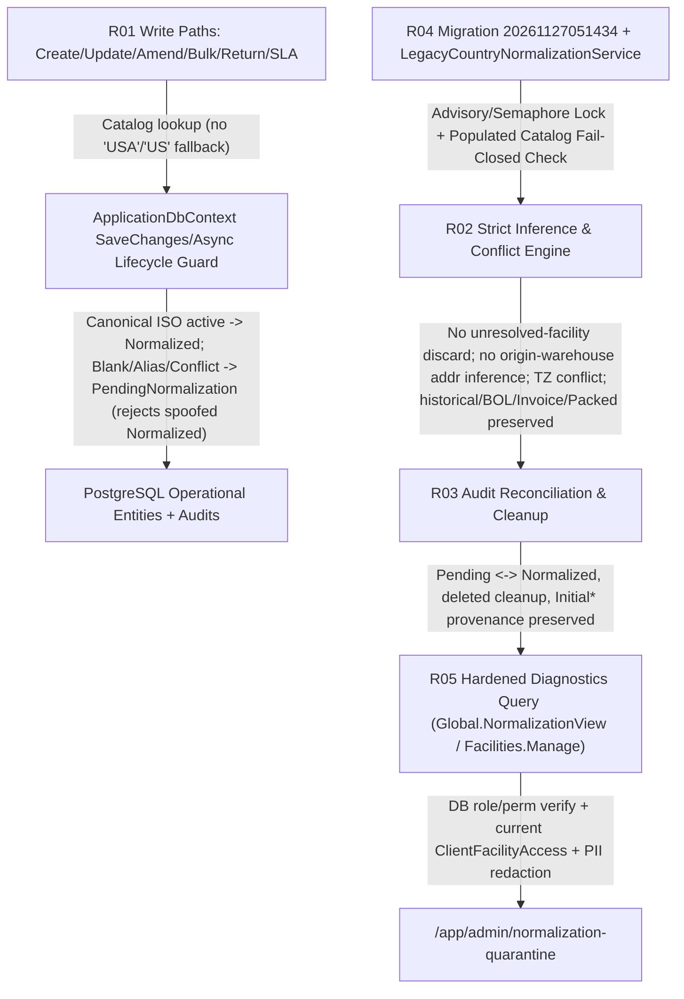

# MDM-1.6 — Independent Acceptance Remediation Report (R01–R05)

## 1. Executive Summary & Git / CI Anchors

Following independent acceptance review of baseline commit `0b9f2cfa553887ab4a4b4350f8fddb8dd5b43458`, all five remediation directives (**R01–R05**) plus historical snapshot immutability, SQL/C# parity, concurrency/lock boundaries, and frontend Playwright E2E coverage have been implemented and verified.

| Verification Anchor | Value |
| :--- | :--- |
| **Repository** | `Umesh1200/3PL_Warehouse_Logistics` |
| **Feature Branch** | `feature/phase-7-enterprise-frontend` |
| **Remediation Baseline SHA** | `0b9f2cfa553887ab4a4b4350f8fddb8dd5b43458` |
| **Code, Migrations, Tests & Screenshots Verified SHA** | `68f45dfb7ae2ecbdec41a0c1bee8c3242b33db1f` |
| **Preserved `main` / `origin/main` SHA** | `a198f02090194ce4d59dec2941c89d519757f4b4` |
| **Additive R04 EF Core Migration ID** | `20261127051434_MDM1_6_R04_NormalizationRemediationLifecycle` (original `20261126143014_MDM1_6_LegacyCountryNormalization` left unedited) |
| **GitHub Actions CI (Attempt 2 — Code + Tests + Live PG 16 & Redis 7)** | [Run `45955610471`](https://github.com/Umesh1200/3PL_Warehouse_Logistics/actions/runs/45955610471) (`success`) |
| **Acceptance Scope Boundary** | Stops cleanly at MDM-1.6 re-review gate; no MDM-2 or subsequent stage started |

---

## 2. Root-Cause Findings & Remediation Architecture

### 2.1 R01 — Normalization Lifecycle Consistency & Default Removal
- **Root Cause:** All 7 audited domain entities defaulted `CountryNormalizationStatus = Normalized`; `Facility`, `ShippingAddress`, `ReturnShipment`, `CarrierContractualSlaPolicy`, `CarrierSlaComplianceRecord`, `FacilityConfiguration`, `ImportOutboundOrdersBulkCommand`, `ReturnShipmentService`, `DbInitializer`, and `TransportationProjectionService` injected silent `"USA"`/`"US"` fallbacks; `ShippingAddress.Amend(...)` failed to reset normalization status; DTOs omitted `CountryNormalizationStatus` or lacked `JsonStringEnumConverter`.
- **Remediation:**
  - Updated all 7 domain entities (`Facility.cs`, `Customer.cs`, `Supplier.cs`, `ShippingAddress.cs`, `ReturnShipment.cs`, `CarrierContractualSlaPolicy.cs`, `CarrierSlaComplianceRecord.cs`) and `FacilityConfiguration.cs` so unvalidated records start at `CountryNormalizationStatus.PendingNormalization` without `"USA"`/`"US"` fallbacks.
  - Added `CountryNormalizationWriteHelper.ResolveForWriteAsync` across `CreateSupplierCommand`, `CreateOutboundOrderCommand`, `ImportOutboundOrdersBulkCommand`, and removed `"US"` fallbacks in `ReturnShipmentService` and `TransportationProjectionService`.
  - Reset `CountryNormalizationStatus = PendingNormalization` inside `ShippingAddress.Amend(...)`.
  - Exposed `[JsonConverter(typeof(JsonStringEnumConverter))] CountryNormalizationStatus` on `FacilityDto`, `SupplierDto`, `ShippingAddressDto`, and `ReturnShipmentResult`.
  - Enforced lifecycle consistency in `ApplicationDbContext` (`ReconcileCountryNormalizationLifecycleSync` / `ReconcileCountryNormalizationLifecycleAsync`): rejects explicit `Normalized` claims on blank, unrecognized, or uncanonical values with `ValidationException`, automatically resets `Normalized -> PendingNormalization` if a country field is mutated to an uncanonical value, and preserves historical `PreservedHistoricalValue = true` records only while their country fields remain unchanged against `OriginalCountryValue`.

### 2.2 R02 — Strict Parent-Context Inference, Timezone Conflicts & Historical Fulfillment Preservation
- **Root Cause:** `LegacyCountryNormalizationService` and `20261126143014` filtered out `PendingNormalization` facilities before computing `client_single_country` (misclassifying mixed resolved/unresolved networks as single-country domestic), accepted unverified raw country codes on quarantined parents, fell back to origin `Facility` on blank `ShippingAddress` rows, skipped explicit `Facility` timezone conflict checks, and checked only `ShipmentId != null` rather than `Package.Status != Open` and `BillsOfLading`.
- **Remediation:**
  - `client_single_country` now computes over **all** active access facilities of active non-deleted clients; any unresolved/non-`Normalized` facility in a client network disables domestic client inference.
  - Parent country hints (`CustomerDefault`, `TransferDestinationFacility`, `OriginalOrderShippingAddress`, `ReturnDestinationFacility`) require active non-deleted entities with `CountryNormalizationStatus == Normalized` and valid active catalog country resolution.
  - Blank `ShippingAddress` rows on `B2BSalesOrder` no longer fall back to the origin warehouse facility (`OrderFacility`), while `StockTransferOrder` rows use only verified `TransferDestinationFacility` (even cross-border, validated strictly against subdivision + postal regex).
  - Explicit `Facility.CountryCode` is cross-checked against active `TimeZoneProfile.CountryCode` (`allowTimeZoneInference` / timezone conflict quarantine).
  - Historical immutability for `ShippingAddress` now checks `OutboundOrder` lifecycle status **or** `Packages` (`ShipmentId != null || Status != PackageStatus.Open || linked BillOfLading`). Verified closed `Shipment`, `BillOfLading`, and `Invoice` rows remain untouched.

### 2.3 R03 — Audit Lifecycle Reconciliation, Deleted Cleanup & Immutable Initial Provenance
- **Root Cause:** `ReconcileAudit` skipped updates when entity columns weren't mutated in the current pass, leaving stale `PendingNormalization` audits when external updates corrected records or quarantined previously normalized parents, failing to remove audits for soft-deleted entities, and failing to separate initial vs latest batch timestamps.
- **Remediation:**
  - Added `InitialCorrelationBatchId` and `InitialRecordedAtUtc` to `CountryNormalizationAudit` and `CountryNormalizationAuditConfiguration` (`initial_correlation_batch_id`, `initial_recorded_at_utc`).
  - Reconciles `PendingNormalization <-> Normalized`, `FacilityId`, `ClientId`, `Reason`, `InferenceSource`, `WasInferredFromParent`, and `PreservedHistoricalValue` in both C# (`LegacyCountryNormalizationService`) and SQL (`20261127051434`).
  - Preserves existing `Normalized` provenance (`InferenceSource`, `WasInferredFromParent`, `Reason`, `CorrelationBatchId`, `RecordedAtUtc`) untouched across semantic no-op reruns (`Zero` mutations, unchanged batch ID), while always keeping `OriginalCountryValue`, `InitialCorrelationBatchId`, and `InitialRecordedAtUtc` immutable.
  - Removes stale `CountryNormalizationAudits` rows for soft-deleted entities (`Facility`, `Customer`, `Supplier`, `ShippingAddress`).

### 2.4 R04 — Additive Fail-Closed Migration (`20261127051434`) & Staged Cutover Contract
- **Root Cause:** Already-applied `20261126143014_MDM1_6_LegacyCountryNormalization` returned early (`IF NOT v_has_profiles THEN RETURN;`) on populated databases missing reference catalogs.
- **Remediation:**
  - Preserved `20261126143014_MDM1_6_LegacyCountryNormalization` unedited for compatibility and added additive migration `20261127051434_MDM1_6_R04_NormalizationRemediationLifecycle`.
  - Pre-cutover `DO $$` block distinguishes fresh empty databases (`v_total_rows = 0`, succeeds without catalogs) from populated databases (`v_total_rows > 0`) lacking active `CountryProfile` or `AdministrativeDivision` catalogs (**fails closed cleanly via full PostgreSQL transaction rollback**).
  - Re-evaluates originally-blank `was_inferred_from_parent = true` rows created by `20261126143014` under strict R02 rules and restores historically immutable `ShippingAddress` rows prematurely mutated on packed (`Status <> 'Open'`) packages back to their `OriginalCountryValue` snapshot.
  - Documented staged upgrade probes in `tests/verification/Phase73PostgresCheck/Program.cs` (`MDM-1.5` -> `ReferenceCatalogSeeder.SeedAsync` -> `MDM-1.6` -> `MDM-1.6 R04`) alongside standalone fail-closed tests in `Mdm16PostgresCheck.VerifyR04EmptyAndMissingCatalogGuardsAsync`.

### 2.5 R05 — RBAC Hardening, Access Revalidation, Bounds Checking & PII Redaction
- **Root Cause:** `GetNormalizationQuarantineQueryHandler` trusted stale JWT claims without DB verification, accepted overly broad permissions, allowed stale `audit.FacilityId` on client-owned rows to bypass revoked `ClientFacilityAccess`, didn't validate conflicting `facilityId` vs `X-Facility-Id`, allowed integer multiplication overflow in `(PageNumber - 1) * PageSize`, and echoed raw email/phone/street PII tokens in `OriginalCountryValue` & `Reason`.

| Caller Identity & Condition | `GET /api/v1/reference/normalization-quarantine` Result | Enforcement Layer |
| :--- | :--- | :--- |
| Unauthenticated / tampered SuperAdmin role | `401 Unauthorized` | `JwtBearer` + `JwtStaffFacilityValidator` |
| Client / Driver / Suspended or Deleted DB User | `403 Forbidden` | `GetNormalizationQuarantineQueryHandler` DB user verification |
| Staff with stale JWT claim but permission stripped in DB | `403 Forbidden` | `GetNormalizationQuarantineQueryHandler` DB `UserRoles`/`RolePermissions` check |
| Conflicting `?facilityId=A` and `X-Facility-Id: B` | `400 Bad Request` | `ValidationException` |
| Pagination integer overflow (`pageNumber=int.MaxValue`) | `400 Bad Request` | `long skipLong` overflow guard |
| Facility Manager (`Facilities.Manage`) querying foreign facility or foreign `?clientId` | `403 Forbidden` | DB assigned-facility + active `ClientFacilityAccess` guard |
| Facility Manager querying when `audit.FacilityId` is stale after `ClientFacilityAccess` revocation | `200 OK` with stale client rows **excluded** | Live `ClientFacilityAccess` + active `Client` revalidation |
| Platform Staff (`global:normalization:view`) | `200 OK` | `[REDACTED_POTENTIAL_PII]` for email/phone/address patterns |

- `CountryDiagnosticSanitizer` (`[REDACTED_POTENTIAL_PII]`) applied identically in C# normalization, query output projection, and PostgreSQL migration `pg_temp.mdm16_r04_sanitize_raw`.
- Concurrency protection: `LegacyCountryNormalizationService.BackfillAllAsync` acquires PostgreSQL transaction/advisory lock (`pg_advisory_xact_lock(hashtextextended('MDM16:COUNTRY_NORM_BACKFILL', 0::bigint))`) or non-relational `SemaphoreSlim`.

---

## 3. UI & Playwright Visual Audit Evidence

- Hardened [`NormalizationQuarantinePage.tsx`](../src/UI/Nexus3PLFrontend/src/pages/admin/NormalizationQuarantinePage.tsx) (`global:normalization:view` / `facilities:manage` alignment matching `Sidebar.tsx`, responsive grid/filter wrap down to `320px`, avoided duplicate mount fetches on facility hydration).
- Expanded Vitest suite [`normalization-quarantine.test.tsx`](../src/UI/Nexus3PLFrontend/src/test/normalization-quarantine.test.tsx) (`3` tests) and added Playwright E2E suite [`normalization-quarantine.spec.ts`](../src/UI/Nexus3PLFrontend/e2e/normalization-quarantine.spec.ts) (`2` E2E specs).
- Committed viewport screenshots under `docs/audits/mdm-1-6/`:
  - Desktop (`1440x900`): `docs/audits/mdm-1-6/mdm16-quarantine-desktop-1440.png`
  - Tablet (`768x1024`): `docs/audits/mdm-1-6/mdm16-quarantine-tablet-768.png`
  - Mobile (`375x812`): `docs/audits/mdm-1-6/mdm16-quarantine-mobile-375.png`
  - Small Mobile (`320x568`): `docs/audits/mdm-1-6/mdm16-quarantine-mobile-320.png`

---

## 4. Verification Matrix & Observed Results

| Verification Check | Command / CI Reference | Observed Result |
| :--- | :--- | :--- |
| `.NET Unit & Security Regression Suite` | `dotnet test tests/Warehouse3PL.UnitTests/Warehouse3PL.UnitTests.csproj --configuration Release` + CI Job [`140363369488`](https://github.com/Umesh1200/3PL_Warehouse_Logistics/actions/runs/45955610471) | `1,446 / 1,446 Passed` (`0 Failed, 0 Skipped`, includes `Mdm16LegacyCountryNormalizationTests` & 4 `Mdm16RemediationR01ToR05Tests`) |
| `Phase73PostgresCheck` Build | `dotnet build tests/verification/Phase73PostgresCheck/Phase73PostgresCheck.csproj --configuration Release` | `0 Warning(s), 0 Error(s)` |
| Live PostgreSQL 16 + Real Redis 7 (`MDM-0`..`MDM-1.6 R04`) | GitHub Actions Run [`45955610471`](https://github.com/Umesh1200/3PL_Warehouse_Logistics/actions/runs/45955610471) / Job `140363367601` (`attempt 2`) | `success` (`[MDM-1.6] ALL Live PostgreSQL Country Normalization, Quarantine, Historical Immutability, Epoch & RBAC checks passed cleanly.`) |
| Frontend Vitest | `npx vitest run --maxWorkers=1` (in `src/UI/Nexus3PLFrontend`) | `13` test files, `111 / 111 Passed` |
| Frontend TypeScript Check | `npx tsc --noEmit` (in `src/UI/Nexus3PLFrontend`) | Exit code `0` |
| Frontend Vite Production Build | `npm run build` (in `src/UI/Nexus3PLFrontend`) | Exit code `0` (`dist/assets/index-CQ8vNMzl.js`) |
| Playwright Chromium E2E | `npm run test:e2e` (in `src/UI/Nexus3PLFrontend`) | `34 / 34 Passed` (including `e2e/normalization-quarantine.spec.ts` + 4 responsive screenshots with zero horizontal overflow) |
