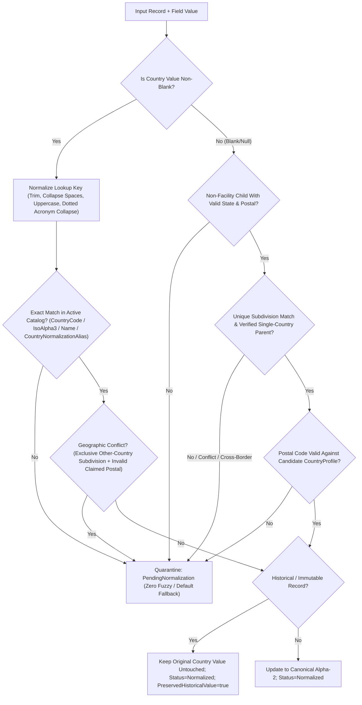
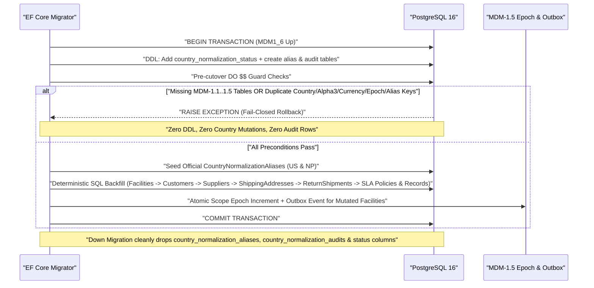

# MDM-1.6 — Legacy Country Normalization, Quarantine & Safe Backfill Report

## 1. Executive Summary

MDM-1.6 introduces deterministic, catalog-driven ISO 3166-1 alpha-2 legacy country normalization, quarantine provenance tracking, and historical record preservation across Nexus3PL without blind warehouse-facility inheritance, fuzzy matching, or default country fallbacks.

- **Branch:** `feature/phase-7-enterprise-frontend`
- **Accepted Baseline:** `450fbadcd9804328ac5023f1f2c6cc0995ab66d6` (MDM-1.5)
- **Preserved `main` / `origin/main`:** `a198f02090194ce4d59dec2941c89d519757f4b4`
- **Verified Implementation & Test SHA:** `576eea9e174eaaf8e5c41834b285aa14f9c54684`
- **Authoritative EF Core Migration ID:** `20261126143014_MDM1_6_LegacyCountryNormalization`
- **Specification:** [`docs/MDM_1_6_Legacy_Country_Normalization_Specification.md`](MDM_1_6_Legacy_Country_Normalization_Specification.md)
- **GitHub Actions CI (Code + Tests + Live PostgreSQL 16 & Redis 7):** [Run `45851034318`](https://github.com/Umesh1200/3PL_Warehouse_Logistics/actions/runs/45851034318) (`success`)

---

## 2. Normalization Architecture & Cutover Flow

### 2.1 Deterministic Country Normalization & Quarantine Pipeline

### 2.2 PostgreSQL Cutover, Pre-Check, Backfill & Rollback Sequence

---

## 3. Implementation Summary

### 3.1 Domain, Enumeration & Permissions
- `CountryNormalizationStatus` (`src/Core/Warehouse3PL.Domain/Enums/CountryNormalizationStatus.cs`): `Normalized = 1`, `PendingNormalization = 2` (mapped as `varchar(30)` with DB default `PendingNormalization` for post-cutover safety).
- `CountryNormalizationAlias` (`src/Core/Warehouse3PL.Domain/Entities/Reference/CountryNormalizationAlias.cs`): Catalog-linked alias entries with FK to `CountryProfile.CountryCode` and `NormalizeLookupKey` (trims, collapses multi-whitespace, uppercases, collapses dotted acronyms such as `U.S.A.` -> `USA` and `U.S.` -> `US`).
- `CountryNormalizationAudit` (`src/Core/Warehouse3PL.Domain/Entities/Reference/CountryNormalizationAudit.cs`): Unique keyed (`(entity_type, entity_id, field_name)`) provenance & quarantine record storing `OriginalCountryValue`, `NormalizedCountryCode`, `NormalizationStatus`, `PreservedHistoricalValue`, `WasInferredFromParent`, `InferenceSource`, `Reason`, `FacilityId`, `ClientId`, and `CorrelationBatchId`.
- `Permissions.Global.NormalizationView` (`"global:normalization:view"`) added to `Permissions.Global` and `Permissions.GetAllPermissions()`.

### 3.2 Audited Entities & Historical Immutability Policy

| Entity | Country Field(s) Audited | Mutability Rule | Inference / Parent Rule |
| :--- | :--- | :--- | :--- |
| `Facility` | `CountryCode` | Mutable master data | Direct catalog / explicit geo + `TimeZoneProfile`; never defaulted |
| `Customer` | `DefaultCountryCode` | Mutable master data | Verified `ClientDomesticAccess` + active `AdministrativeDivision` + valid `PostalCode` |
| `Supplier` | `Country` | Mutable master data | Verified `ClientDomesticAccess` + active `AdministrativeDivision` + valid `PostalCode` |
| `ShippingAddress` | `CountryCode` | Mutable pre-fulfillment; immutable once `OutboundOrder` reaches `Allocated`/`PartiallyAllocated`/`InProgress`/`Completed`/`Cancelled` or linked to a `Shipment` via `Package` | Verified `CustomerDefault` or `OrderFacility`; cross-border client/facility blanks quarantined |
| `ReturnShipment` | `OriginCountry`, `DestinationCountry` | Mutable only while `Authorized` with null `LabelGeneratedAtUtc` and null `CarrierHandoverAtUtc` | Origin never inherits `DestinationFacility`; Destination may infer from `ReturnDestinationFacility` + geo |
| `CarrierContractualSlaPolicy` | `DestinationCountry` | Mutable while `IsActive = true`; immutable if `!IsActive` | Destination geo only (never inherits origin facility) |
| `CarrierSlaComplianceRecord` | `DestinationCountry` | Always immutable historical shipment evidence | `PreservedHistoricalValue = true`; records audit entry when non-canonical or quarantined |

### 3.3 Persistence, Seeding & MDM-1.5 Cache Synchronization
- EF Core configurations updated for all 7 entities plus new configurations for `country_normalization_aliases` and `country_normalization_audits`.
- `ReferenceCatalogSeeder.SeedCountryNormalizationAliasesAsync` idempotently seeds verified `US` and `NP` aliases when `20261126143014_MDM1_6_LegacyCountryNormalization` is applied (or on InMemory contexts).
- `ConfigurationScopeMapper` invalidates `Country` and `Global` scopes on `CountryProfile` and `CountryNormalizationAlias` mutations.
- `20261126143014_MDM1_6_LegacyCountryNormalization` executes pre-cutover `DO $$` fail-closed validations, idempotent SQL backfill, provenance `ON CONFLICT DO UPDATE` preserving initial `original_country_value`, and atomic `configuration_scope_epochs` + `configuration_invalidation_events` inserts when any `Facility.CountryCode` mutates.
- `LegacyCountryNormalizationService` (`ResolveCountryAsync` + `BackfillAllAsync`) mirrors the SQL rules in C#, using `.IgnoreQueryFilters()` on `ClientFacilityAccesses` and non-soft-deleted queries so batch execution succeeds reliably outside HTTP request contexts.

---

## 4. Before / After & Provenance Examples

| Entity | Before (`OriginalCountryValue`) | Contextual Geo / State | After (DB Column) | `NormalizationStatus` | Provenance Flags |
| :--- | :--- | :--- | :--- | :--- | :--- |
| `Facility` (`FAC-US`) | `U.S.A.` / `USA` | `Illinois`, `60601` | `US` | `Normalized` | Direct catalog (`CatalogIsoAlpha3` / `CatalogAlias`) |
| `Facility` (`FAC-NP`) | `Nepal` / `NPL` | `Bagmati`, `44600` | `NP` | `Normalized` | Direct catalog (`CatalogName` / `CatalogIsoAlpha3`) |
| `Facility` (`FAC-CA`) | `CAN` | `Ontario`, `M5V 2T6` | `CA` | `Normalized` | Extensible active `CountryProfile` (`CatalogIsoAlpha3`) |
| `Facility` (`FAC-ORPHAN`) | `""` | `""`, `""` | `""` | `PendingNormalization` | Quarantined (no default US/NP fallback) |
| `Facility` (`FAC-CONFLICT`) | `US` | `Bagmati`, `44600` | `US` | `PendingNormalization` | Quarantined (subdivision/postal conflicts with `US`) |
| `Customer` (`CUST-NP-INF`) | `""` | `Bagmati`, `44600` (single NP client) | `NP` | `Normalized` | `WasInferredFromParent = true` |
| `ShippingAddress` (`Draft`) | `USA` / `United States` | `Illinois`, `60601` | `US` | `Normalized` | Mutable draft updated |
| `ShippingAddress` (`Completed`) | `NPL` | `Bagmati`, `44600` | `NPL` (preserved) | `Normalized` | `PreservedHistoricalValue = true` |
| `ShippingAddress` (`Cross-Border`) | `""` | Customer=`NP`, Facility=`US` | `""` | `PendingNormalization` | Quarantined (`CrossBorderOrderContext`) |
| `CarrierSlaComplianceRecord` | `NPL` | `Bagmati`, `44600` | `NPL` (preserved) | `Normalized` | `PreservedHistoricalValue = true` |

---

## 5. Quarantine Diagnostics API, RBAC & Frontend Diagnostics Surface

### 5.1 API & RBAC Authorization Matrix (`GET /api/v1/reference/normalization-quarantine`)

| Caller Profile | Endpoint Access | Scope & Leak Prevention |
| :--- | :--- | :--- |
| Unauthenticated | `401 Unauthorized` | Rejected before handler |
| Spoofed `SuperAdmin` JWT (not in DB) | `401 Unauthorized` | Rejected by `JwtStaffFacilityValidator` |
| `Client` User (even with `global:normalization:view` claim) | `403 Forbidden` | Blocked by `UserType == Staff` check in `GetNormalizationQuarantineQueryHandler` |
| `Driver` User | `403 Forbidden` | Blocked by `UserType == Staff` check |
| Unprivileged `Staff` (e.g., `WarehouseOperator`) | `403 Forbidden` | Blocked by `[HasAnyPermission]` + handler permission check |
| Facility-scoped `Staff` (`Facilities.Manage`) querying foreign `facilityId` or `X-Facility-Id` | `403 Forbidden` | Explicit `ForbiddenException` |
| Facility-scoped `Staff` querying own facility | `200 OK` | `PendingCount`, `NormalizedCount`, and paginated rows strictly filtered to authorized facility before counting/paging |
| Platform-authorized `Staff` (`global:normalization:view`, `analytics:multi-facility:view`, `SuperAdmin`) | `200 OK` | Paginated platform view across entities with filters (`status`, `includeAllStatuses`, `entityType`, `facilityId`, `clientId`, `search`) |

- **Zero PII Exposure:** `CountryNormalizationQuarantineItemDto` returns structural identifiers, facility code, status, raw/normalized country codes, provenance flags, reason, batch ID, and UTC timestamp only (no customer names, emails, street addresses, phone numbers, or tax identifiers).

### 5.2 Frontend Diagnostics Page (`/app/admin/normalization-quarantine`)
- Service: `src/UI/Nexus3PLFrontend/src/services/normalizationService.ts`
- Component: `src/UI/Nexus3PLFrontend/src/pages/admin/NormalizationQuarantinePage.tsx` (wired in `App.tsx` and `Sidebar.tsx` under Staff navigation)
- Displays KPI strip (`Pending Quarantine`, `Normalized Audited`, `Diagnostic Scope`), status/entity/search filters, badges (`Normalized`, `Pending Normalization`, `Historical Preserved`, `Parent Inferred`), pagination, loading/error/retry/empty states, and non-Staff `403 FORBIDDEN` guard.

---

## 6. Verification Commands & Observed Results

| Verification Suite | Command / CI Reference | Observed Result |
| :--- | :--- | :--- |
| Backend Build (`Release`) | `dotnet build src/Presentation/Warehouse3PL.WebApi/Warehouse3PL.WebApi.csproj --configuration Release` | `0 Warning(s), 0 Error(s)` |
| `.NET Unit & Security Tests` | `dotnet test tests/Warehouse3PL.UnitTests/Warehouse3PL.UnitTests.csproj --configuration Release` (local + CI Job `140017128920`) | `1,442 / 1,442 Passed` (`0 Failed, 0 Skipped`; includes new `Mdm16LegacyCountryNormalizationTests`) |
| `Phase73PostgresCheck` Build | `dotnet build tests/verification/Phase73PostgresCheck/Phase73PostgresCheck.csproj --configuration Release` | `0 Warning(s), 0 Error(s)` |
| Live PostgreSQL 16 + Live Redis 7 CI (`Mdm0`..`Mdm16` + Phase 7.3/7.4) | GitHub Actions Run [`45851034318`](https://github.com/Umesh1200/3PL_Warehouse_Logistics/actions/runs/45851034318) / Job `140017129318` | `success` (`[MDM-1.6] ALL Live PostgreSQL Country Normalization, Quarantine, Historical Immutability, Epoch & RBAC checks passed cleanly.` and `ALL PHASE 7.3, 7.4.0A, 7.4.0B & 7.4.0C POSTGRESQL VERIFICATIONS PASSED CLEANLY!`) |
| Frontend Vitest | `npx vitest run --maxWorkers=1` (in `src/UI/Nexus3PLFrontend`) | `13 passed` files, `110 / 110 Passed` (includes 2 new tests in `normalization-quarantine.test.tsx`) |
| Frontend TypeScript | `npx tsc --noEmit` (in `src/UI/Nexus3PLFrontend`) | Exit code `0` |
| Frontend Production Build | `npm run build` (in `src/UI/Nexus3PLFrontend`) | Exit code `0` |
| Playwright Chromium E2E | `npm run test:e2e` (in `src/UI/Nexus3PLFrontend`) | `32 / 32 Passed` |

---

## 7. Known Limitations & Acceptance Gate Boundary

1. **Manual Quarantine Resolution UI:** Per MDM-1.6 scope, `/api/v1/reference/normalization-quarantine` and `/app/admin/normalization-quarantine` are strictly read-only diagnostic surfaces so stewards inspect and resolve legacy ambiguous/conflicting records via authoritative facility/client master maintenance workflows rather than blind override mutations.
2. **Database Length Constraints in Legacy `facilities`:** `facilities.country_code` is currently constrained to `varchar(3)` (`MaxLength(3)`) per existing schema, which safely accommodates ISO alpha-3 (`USA`, `NPL`, `CAN`) and alpha-2 (`US`, `NP`, `CA`), while `customers`, `suppliers`, `shipping_addresses`, `return_shipments`, and SLA tables accommodate longer legacy names/acronyms as mapped.
3. **Acceptance Boundary & Remediation Addendum:** Initial implementation stopped at the MDM-1.6 review gate; subsequent independent acceptance blockers **R01–R05** are completely remediated, verified, and documented in [`docs/MDM_1_6_Acceptance_Remediation_Report.md`](MDM_1_6_Acceptance_Remediation_Report.md) with additive EF Core migration `20261127051434_MDM1_6_R04_NormalizationRemediationLifecycle`.
