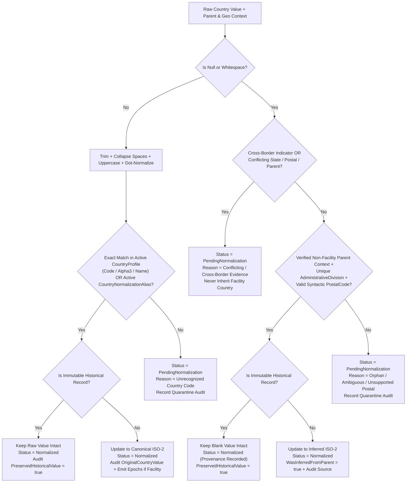

# Nexus3PL — `MDM-1.6` Legacy Country Normalization, Quarantine & Safe Backfill Specification

- **Workstream:** `MDM-1.6` — Legacy Country Normalization, Quarantine & Safe Backfill
- **Repository:** `Umesh1200/3PL_Warehouse_Logistics`
- **Branch:** `feature/phase-7-enterprise-frontend`
- **Authoritative Baseline:** `450fbadcd9804328ac5023f1f2c6cc0995ab66d6` (`MDM-1.5` Accepted)
- **Companion References:**
  - [Global_Master_Data_Localization_And_Logistics_PreImplementation_Specification.md](Global_Master_Data_Localization_And_Logistics_PreImplementation_Specification.md)
  - [Global_Master_Data_And_Configuration_Gap_Audit.md](Global_Master_Data_And_Configuration_Gap_Audit.md)
  - [MDM_1_Implementation_Plan_And_Design.md](MDM_1_Implementation_Plan_And_Design.md)
  - [MDM_1_5_Acceptance_Remediation_Report.md](MDM_1_5_Acceptance_Remediation_Report.md)

---

## 1. Purpose & Design Invariants

`MDM-1.6` replaces legacy free-text, mixed alias (`"USA"`, `"U.S.A."`, `"United States"`, `"NPL"`, `"Nepal"`), and blank/unvalidated country values across existing master and logistics tables with a **deterministic, catalog-driven, historical-preserving, and fail-closed normalization architecture**.

### Core Invariants
1. **No Guessing / No Fuzzy Matching / No Silent Defaults:** Country codes never default silently to `"US"` or `"NP"`. Every normalization resolves strictly against active `CountryProfile` rows and verified `CountryNormalizationAlias` entries in PostgreSQL.
2. **Multi-Country Catalog Extensibility:** Normalization resolves dynamically across all active `CountryProfile` rows (`CountryCode`, `IsoAlpha3Code`, `Name`, and active `CountryNormalizationAlias` entries), supporting countries beyond `US` and `NP` (e.g., `CA`, `GB`, `IN`, `DE`, etc.) once seeded into `country_profiles`.
3. **Immutable Historical Snapshot Preservation:** Issued financial/logistics documents (`Invoice`, `CreditNote`, `BillOfLading`, `ShippingLabel`), shipped/completed `OutboundOrder` `ShippingAddress` snapshots, in-transit/completed/labelled `ReturnShipment` records, and historical `CarrierSlaComplianceRecord` rows are **never blindly rewritten**. Original values remain intact while normalization status and canonical mappings are recorded in `country_normalization_audits`.
4. **MDM-1.5 Epoch & Outbox Atomicity:** Any SQL or backfill normalization mutating `Facility` (or future MDM-1.5 scoped configuration entities) atomically increments `configuration_scope_epochs` (`Facility`, original/destination `Country`, and `Global`) and inserts `configuration_invalidation_events` outbox rows inside the **same PostgreSQL transaction**.
5. **Typed Status Enum:** Introduces `CountryNormalizationStatus`:
   - `Normalized = 1`
   - `PendingNormalization = 2`

---

## 2. Entity-Level Normalization & Preservation Inventory

| Entity (`Table`) | Field(s) | Classification | Mutability Boundary | Normalization & Inference Strategy | Quarantine / Audit Scope Context |
| :--- | :--- | :--- | :--- | :--- | :--- |
| **`Facility`** (`facilities`) | `country_code` (`varchar(3)`) | **Mutable Warehouse Master** *(closed `BillOfLading` / `ShippingLabel` / `Invoice` store independent frozen snapshots)* | Always mutable master | Canonical/alias match normalizes `country_code` to ISO-2 + sets `Normalized` + emits `CountryNormalizationAudit` + emits `MDM-1.5` epochs/outbox (`Facility`, old/new `Country`, `Global`). Blank `country_code` infers ONLY when `state_or_province` matches a unique active `CountryProfile`'s `AdministrativeDivision` AND `postal_code` validates syntactically against that country (without timezone conflict). Unrecognized/blank-orphan -> `PendingNormalization`. | `FacilityId = facility.Id`, `ClientId = null` |
| **`Customer`** (`customers`) | `default_country_code` (`varchar(10)?`) | **Mutable Client Master** *(default order template)* | Always mutable master | Canonical/alias match normalizes to ISO-2 + `Normalized` + audit provenance. Blank/null NEVER inherits from a client's warehouse facility alone; infers ONLY when unambiguous domestic `default_state_or_province` (`AdministrativeDivision`) + valid `default_postal_code` match a single active `CountryProfile` **and** client domestic order/facility context agrees without cross-border conflict. Orphan/blank/conflicting/unknown -> `PendingNormalization`. | `ClientId = customer.ClientId`; `FacilityId` set if client is bound to a single active `ClientFacilityAccess` facility (`null` otherwise, never exposing PII). |
| **`Supplier`** (`suppliers`) | `country` (`varchar(100)?`) | **Mutable Client Master** | Always mutable master | Canonical/case/whitespace/official multi-word name match (e.g., `"United States of America"` -> `"US"`, `"Nepal"` -> `"NP"`) normalizes to ISO-2 + `Normalized` + audit provenance. Blank/null infers ONLY when unambiguous `state` (`AdministrativeDivision`) + valid `postal_code` + client non-conflicting domestic facility context agree. Orphan/unknown/conflicting -> `PendingNormalization`. | `ClientId = supplier.ClientId`; `FacilityId` derived strictly when client has single active `ClientFacilityAccess` (`null` otherwise). |
| **`ShippingAddress`** (`shipping_addresses`) | `country_code` (`varchar(10)`) | **Order Snapshot** | **Mutable ONLY** when parent `OutboundOrder.Status` is `Draft`, `Released`, or `OnHold` AND order has zero `Shipments` / `BillOfLading`s. **Immutable Historical Snapshot** when `Allocated`, `PartiallyAllocated`, `InProgress`, `Completed`, `Cancelled`, or linked to any shipment/BOL. | **Immutable orders:** NEVER modify `country_code`; canonical/alias (`"USA"` -> `"US"`) gets `Normalized` + provenance with `PreservedHistoricalValue = true`; unknown/blank/conflicting gets `PendingNormalization` + quarantine audit (`PreservedHistoricalValue = true`). **Mutable orders:** canonical/alias normalizes to ISO-2 with provenance (`PreservedHistoricalValue = false`); blank infers ONLY via non-conflicting `Customer.DefaultCountryCode` / `Order.Facility` + `AdministrativeDivision` + `PostalCode` match; cross-border/conflicting/orphan -> `PendingNormalization`. | `FacilityId = order.FacilityId`, `ClientId = order.ClientId` |
| **`ReturnShipment`** (`return_shipments`) | `origin_country` (`varchar(50)`), `destination_country` (`varchar(50)`) | **Reverse-Logistics Document** | **Mutable ONLY** when `Status == Authorized && LabelGeneratedAtUtc == null && CarrierHandoverAtUtc == null`. **Immutable** once label generated, handed over (`InTransitToWarehouse`..`Completed`), or `Cancelled`. | Evaluates **both** `OriginCountry` and `DestinationCountry` independently in `country_normalization_audits`; entity `CountryNormalizationStatus = Normalized` iff both fields resolve cleanly, otherwise `PendingNormalization`. Immutable rows preserve raw strings untouched (`PreservedHistoricalValue = true`). Mutable blank `OriginCountry` never inherits from `DestinationFacility` (requires original `Order.ShippingAddress` / unambiguous division+postal match); cross-border (`OriginFacilityId != DestinationFacilityId` or state/postal mismatch) stays `PendingNormalization`. | `OriginCountry` -> `FacilityId = OriginFacilityId`, `DestinationCountry` -> `FacilityId = DestinationFacilityId`; both include `ClientId`. |
| **`CarrierContractualSlaPolicy`** (`carrier_contractual_sla_policies`) | `destination_country` (`varchar(10)`) | **Effective-Dated Config Master** | **Mutable** when `IsActive == true`; **Historical** when `IsActive == false`. | Active policies normalize canonical/alias `destination_country` -> ISO-2 with audit provenance (`PreservedHistoricalValue = false`). Inactive historical policies preserve raw value (`PreservedHistoricalValue = true`). Blank `destination_country` NEVER inherits `OriginFacility.CountryCode` (lanes may be international); requires unambiguous state + full valid postal match without conflict, else `PendingNormalization`. | `FacilityId = OriginFacilityId`, `ClientId = ClientId` |
| **`CarrierSlaComplianceRecord`** (`carrier_sla_compliance_records`) | `destination_country` (`varchar(10)`) | **Historical Shipment SLA Evidence** | **Always Immutable Historical Snapshot** | Raw `destination_country` is NEVER overwritten (`PreservedHistoricalValue = true`). Canonical/alias matches record `Normalized` + provenance (`NormalizedCountryCode`); unknown (`"ZZZ"`), blank, or conflicting entries receive `PendingNormalization` + quarantine audit. | `FacilityId = record.FacilityId`, `ClientId = record.ClientId` |

---

## 3. Deterministic Normalization & Safe Inference Flow

---

## 4. Schema Extensions & Audit Model

1. **`CountryNormalizationStatus` Enum:** `Normalized = 1`, `PendingNormalization = 2` stored as `varchar(30)` on all 7 tables.
2. **`country_normalization_aliases`:**
   - `alias_id` (`Guid`, PK), `alias_key` (`varchar(120)`, unique uppercase dot/space-normalized token), `country_code` (`varchar(2)`, FK -> `country_profiles.country_code` `OnDelete(Restrict)`), `source_standard` (`varchar(60)`), `is_active` (`bool`), `created_at` (`DateTime`).
   - Seeded idempotently for verified ISO/statutory names of cataloged `CountryProfile`s (`USA`, `U.S.A.`, `U.S.`, `UNITED STATES`, `UNITED STATES OF AMERICA`, `NPL`, `NEPAL`, `FEDERAL DEMOCRATIC REPUBLIC OF NEPAL`, plus `Canada`/`CAN`, `United Kingdom`/`GBR`/`UK`/`U.K.`, `India`/`IND`/`Republic of India`, `Germany`/`DEU`, etc. whenever matching `country_profiles` rows exist).
3. **`country_normalization_audits`:**
   - `audit_id` (`Guid`, PK), `entity_type` (`varchar(64)`), `entity_id` (`Guid`), `field_name` (`varchar(64)`), `original_country_value` (`varchar(120)?`), `normalized_country_code` (`varchar(3)?`), `normalization_status` (`varchar(30)`), `preserved_historical_value` (`bool`), `was_inferred_from_parent` (`bool`), `inference_source` (`varchar(120)?`), `reason` (`varchar(500)`), `facility_id` (`Guid?`), `client_id` (`Guid?`), `correlation_batch_id` (`varchar(64)`), `recorded_at_utc` (`DateTime`).
   - **Unique Index:** `ux_country_normalization_audits_entity_field` on `(entity_type, entity_id, field_name)` — guarantees idempotency without losing original raw pre-migration values across repeated runs.
   - **Query Indexes:** `(normalization_status, facility_id, entity_type)`, `(client_id, normalization_status)`.

---

## 5. Pre-Cutover Fail-Closed Guards, Migration & Rollback Strategy

### Pre-Cutover SQL Guards (`MDM1_6_LegacyCountryNormalization`)
Before applying normalization DML inside the PostgreSQL migration transaction, the migration executes fail-closed `DO $$ ... END $$` assertions:
1. Confirms required prerequisite tables exist (`country_profiles`, `administrative_divisions`, `configuration_scope_epochs`, `configuration_invalidation_events`).
2. Rejects cutover (`RAISE EXCEPTION`) if duplicate active normalized keys exist in `country_profiles` (duplicate `UPPER(BTRIM(country_code))` or duplicate `UPPER(BTRIM(iso_alpha3_code))` or duplicate active `country_normalization_aliases.alias_key`).
3. Rejects cutover (`RAISE EXCEPTION`) if duplicate `(scope_type, scope_key)` pairs exist in `configuration_scope_epochs` or duplicate active `UPPER(BTRIM(currency_code))` exist in `currencies`.

### Transactional Backfill & Idempotency
- Executed inside EF Core's single transactional migration (or repeatable `ILegacyCountryBackfillService.ExecuteBackfillAsync` transaction):
  - All primary keys and foreign keys remain preserved (`0` row deletions).
  - Closed orders/shipments/invoices/BOLs/compliance records preserve historical columns untouched.
  - Upserts to `country_normalization_audits` preserve initial `original_country_value` (`ON CONFLICT (entity_type, entity_id, field_name) DO UPDATE` preserves `EXCLUDED` only when `original_country_value` changes cleanly or keeps the original raw historical value on re-run).
  - Any `Facility` `country_code` mutation atomically updates `configuration_scope_epochs` and inserts `configuration_invalidation_events` outbox rows inside the same PostgreSQL transaction.
- **Rollback (`Down`):** Drops added `country_normalization_status` columns and `country_normalization_audits` / `country_normalization_aliases` cleanly without deleting operational records (preserving fail-closed safety).

---

## 6. Quarantine API & RBAC Authorization Matrix

**Endpoint:** `GET /api/v1/reference/normalization-quarantine`

Query parameters: `status` (defaults to `PendingNormalization`, optional all/`Normalized`/`PendingNormalization`), `entityType`, `facilityId`, `clientId`, `search`, `pageNumber` (default `1`), `pageSize` (default `25`, max `100`).

| Caller Identity | Required Permissions | Facility / Tenant Filtering & Enforcement | Response |
| :--- | :--- | :--- | :--- |
| Anonymous / unauthenticated | — | Rejected by `[Authorize]` | `401 Unauthorized` |
| `Client` or `Driver` (even with spoofed claims) | Verified `UserType == Staff` required | Fails runtime Staff check cleanly | `403 Forbidden` |
| `Staff` lacking (`global:normalization:view`, `global:compliance:view`, `global:compliance:manage`, `global:reference:view`, `facilities:manage`) | Attribute + runtime permission check | Fails authorization | `403 Forbidden` |
| Unassigned `Staff` (`AssignedFacilityId == null`) lacking (`IsSuperAdmin`, `analytics:multi-facility:view`, `global:normalization:view`, `global:compliance:view`, `global:compliance:manage`) | Fail-closed unassigned scope guard | Prevents unintended platform-wide disclosure | `403 Forbidden` |
| **Platform-authorized Staff** (`IsSuperAdmin` or holding global normalization/compliance perm / `analytics:multi-facility:view` with permitted view perm) | Verified `UserType == Staff` + perm | Platform-wide view; optional `?facilityId=` & `?clientId=` filters apply to both items and `totalCount` | `200 OK` |
| **Facility-scoped Staff** (`AssignedFacilityId = facA` + permitted view perm, without platform scope) | Verified `UserType == Staff` + DB `AssignedFacilityId` | Requesting foreign `?facilityId=facB` or `X-Facility-Id: facB` -> **`403 Forbidden`**. Unfiltered queries restrict `items` and `totalCount` strictly to `audit.FacilityId == facA` OR client-scoped `Customer`/`Supplier` (`FacilityId == null`) whose client holds active `ClientFacilityAccess` to `facA`. Zero PII fields exposed. | `200 OK` |

---

## 7. Acceptance Gates

1. Deterministic unit, HTTP auth & live PostgreSQL verification covering all 17 required `MDM-1.6` test scenarios (`USA`/`NPL`, case/whitespace, other catalog countries, already-normalized preservation, deterministic parent+geo inference, blank-orphan/unknown `ZZZ`/conflicting/cross-border quarantine, idempotency, rollback, closed shipment/invoice immutability, FK/row-count conservation, MDM-1.5 epoch & outbox integrity, cross-facility/tenant isolation, Client/Driver/unpriv Staff `403`, fail-closed migration preconditions, and full MDM-1.5 Redis resilience regression).
2. Full regression green across `.NET` Unit & Security suite, live PostgreSQL 16 (`Phase 7.3–7.4`, `MDM-0`, `MDM-1.1`–`MDM-1.6`), real Redis 7, `Vitest`, `tsc --noEmit`, Vite build, and Playwright Chromium E2E.

---

## 9. R01–R05 Independent Acceptance Remediation Addendum

Implemented in commits through `68f45dfb7ae2ecbdec41a0c1bee8c3242b33db1f` and documented in [`docs/MDM_1_6_Acceptance_Remediation_Report.md`](MDM_1_6_Acceptance_Remediation_Report.md):

- **R01 Lifecycle Consistency:** Removed legacy `"USA"` / `"US"` / `CountryNormalizationStatus.Normalized` defaults across all 7 audited entities and DTOs, added catalog-driven write resolution (`CountryNormalizationWriteHelper`), reset `CountryNormalizationStatus` on `ShippingAddress.Amend(...)`, and enforced persistence-boundary lifecycle consistency in `ApplicationDbContext`.
- **R02 Strict Inference & Historical Preservation:** Prohibited discarding unresolved facilities during client domestic checks, disallowed origin-warehouse country inference on blank `ShippingAddress` rows, added explicit-country `Facility` timezone conflict quarantine, enforced verified-`Normalized` active non-deleted parents, and expanded fulfillment immutability across `Package` (`Status != Open`), `Shipment`, `BillOfLading`, and `Invoice` snapshots.
- **R03 Audit Reconciliation:** Added bi-directional `PendingNormalization <-> Normalized` audit reconciliation, soft-deleted/association cleanup, `InitialRecordedAtUtc`/`InitialCorrelationBatchId` immutable provenance, and semantic idempotency on unchanged reruns.
- **R04 Additive Fail-Closed Migration:** Added `20261127051434_MDM1_6_R04_NormalizationRemediationLifecycle` (leaving `20261126143014` unedited), distinguishing fresh empty installs from populated DBs lacking active `CountryProfile`/`AdministrativeDivision` catalogs and re-evaluating prior blank-inferred / wrongly-mutated packed snapshot rows.
- **R05 Security & PII Redaction:** Restricted endpoint access to active DB-verified Staff (`global:normalization:view` / `facilities:manage`), added active `ClientFacilityAccess` revalidation per record, rejected header/query conflicts (`400`) and pagination overflow (`400`), and redacted raw PII tokens via `CountryDiagnosticSanitizer`.
