# Nexus3PL — `MDM-1` Detailed Implementation Plan & Architecture Design

**Workstream:** `MDM-1` — Global References, Localization & Configuration Consistency  
**Gate Status:** **Planning & Design Only** *(No migrations, entities, or code written pending independent approval of this plan and `MDM-1.1`)*  
**Branch:** `feature/phase-7-enterprise-frontend`  
**Accepted `MDM-0` Baseline SHA:** `6ce6165ebdf606b12538371a5f6c82a3ca6d9c8c`  
**Companion Specifications:**  
- [Global_Master_Data_Localization_And_Logistics_PreImplementation_Specification.md](Global_Master_Data_Localization_And_Logistics_PreImplementation_Specification.md)  
- [Global_Master_Data_And_Configuration_Gap_Audit.md](Global_Master_Data_And_Configuration_Gap_Audit.md)  
- [MDM_0_Stabilization_Closure_Report.md](MDM_0_Stabilization_Closure_Report.md)  
**Date:** November 25, 2026  

---

## 1. Executive Decomposition & Dependency Order

`MDM-1` establishes the foundational global reference catalogs, legal-entity vs. physical-facility identity separation, currency/FX/UOM foundations, Nepal & multi-country calendar/formatting localization, multi-instance DB-authoritative cache consistency, and non-destructive legacy country-code normalization required by `MDM-2` through `MDM-6`.

To prevent risky monolithic migrations and preserve clean independent acceptance gates, `MDM-1` is decomposed into **six sequential sub-units (`MDM-1.1` through `MDM-1.6`)**:

```mermaid
flowchart LR
    M11["MDM-1.1: Global Reference Catalogs & CountryCompliancePolicy"] --> M12["MDM-1.2: LegalEntity Separation & Facility Geo Binding"]
    M11 --> M13["MDM-1.3: CurrencyMaster, Dynamic FxRateRecord & UN/ECE UOM"]
    M11 --> M14["MDM-1.4: BikramSambatCalendarMonth, Facility/Holiday Calendars & UI formatters.ts"]
    M12 --> M14
    M11 --> M15["MDM-1.5: ConfigRevision, ScopeEpochs & Multi-Instance Invalidation"]
    M12 --> M15
    M13 --> M15
    M14 --> M15
    M12 --> M16["MDM-1.6: Legacy Country Normalization, Quarantine & Safe Backfill"]
    M15 --> M16
```

### Design Invariants Preserved Across All `MDM-1` Sub-Units
1. **Strict Scope Separation:** Immutable global standards (`CountryProfile`, `AdministrativeDivision`, `CurrencyMaster`, `UomDefinition`/`UomConversion`, `BikramSambatCalendarMonth`) permit zero client overrides and zero `PUT`/`DELETE` endpoints (`405`/`409`).
2. **Reuse Existing Anchors:** Extend `Facility`, `Iso4217Currencies`, `FxRateProvider` (`IFxRateProvider`), `ICacheService` / `RedisCacheService`, `AuditableEntityInterceptor`, and `CarrierContractualSlaPolicy` rather than creating duplicate parallel services.
3. **Zero Silent Defaults on Critical Paths:** Operations lacking an active `CountryProfile`, `TaxJurisdiction` linkage, `FxRateRecord`, or valid `CountryCompliancePolicy` evaluation fail closed (`422 Unprocessable Entity`), never silently falling back to `"USD"`, `"USA"`, or static mock values.
4. **Preserve Closed Phase 7.4 & `MDM-0` Baselines:** All `1,409` .NET tests, `103` Vitest tests, `32` Playwright tests, and live PostgreSQL Phase 7.3–7.4 + `MDM-0.1`–`MDM-0.4` verifiers remain green after every sub-unit.

---

## 2. Sub-Unit Decomposition, Schemas, APIs & Acceptance Gates

### `MDM-1.1` — Immutable Global Reference Catalogs & `CountryCompliancePolicy` Engine *(Proposed First Unit)*
*(Detailed implementation blueprint provided in Section 3 below for immediate approval.)*
- **Deliverables:** `CountryProfile`, `AdministrativeDivision`, `TimeZoneProfile` (or verified IANA timezone registry), `CountryCompliancePolicy`, formal `ResolvedConfigurationResult<T>` / `ConfigResolutionState` / `ConfigScope` contract, platform reference seed (`US` + `NP`), read-only reference endpoints + versioned compliance policy management endpoints, and conditional VCTS/CBMS applicability evaluator.
- **Database & Migration Gate:** Additive schema creating `country_profiles`, `administrative_divisions`, `time_zone_profiles`, `country_compliance_policies`; idempotent platform seed (`US` + 51 subdivisions, `NP` + 7 ISO 3166-2:NP provinces & sample district/Palika seed hierarchy, IANA zones incl. `Asia/Kathmandu` & US zones, conditional `NP-DRI-VCTS`, `NP-IRD-CBMS`, `NP-IRD-VAT` policy definitions).
- **Tenant-Isolation & Authorization Gate:** Anonymous requests return `401`; `Client` / `Driver` / unprivileged `Staff` denied (`403`) on `CountryCompliancePolicy` mutations; only verified platform `SuperAdmin` or dedicated `Permissions.Global.ManageCompliance` (`Staff`) may publish/supersede `CountryCompliancePolicy` versions; reference catalogs reject `POST`/`PUT`/`DELETE` from non-platform callers (`403`/`405`).
- **Regression Gate:** Unit + HTTP + live PostgreSQL tests verifying conditional `NP-DRI-VCTS` (exempt micro-retail vs. covered wholesale), `NP-IRD-CBMS` conditional applicability, retroactive policy window overlap rejection (`409 Conflict`), and `US` vs `NP` postal pattern validation (`^\d{5}(-\d{4})?$` vs `NP` 5/7-digit locality + legacy GPO codes).

---

### `MDM-1.2` — Issuing `LegalEntity` Separation & Facility Geographic Binding
- **Domain & Schema:**
  - `LegalEntity` (`legal_entities`): `Id`, `LegalCode` (unique uppercase), `LegalName`, `RegistrationNumber`, `CountryCode` (FK -> `country_profiles.country_code`), `TaxIdentifierType` (`PAN` | `VAT` | `EIN`), `TaxRegistrationNumber` (validated per country format, e.g. 9-digit PAN for `NP`), `RegisteredAddressLine1..2`, `RegisteredCity`, `RegisteredStateOrProvince`, `RegisteredPostalCode`, `IsCbmsMandated` (`bool`), `IroSoftwarePermitRef`, `DefaultCurrencyCode` (`Iso4217Currencies` + `CurrencyMaster` validated), `ConfigRevision` (`bigint`), `IsActive`, `IsDeleted` + audit columns.
  - Extend `Facility` (`facilities`): add nullable `DefaultLegalEntityId` (`Guid?`, FK -> `legal_entities.legal_entity_id`, `OnDelete(Restrict)`), `DefaultCurrencyCode` (`varchar(3)`, nullable initially during `MDM-1`, populated in seed/update). Keep physical ship-from `Facility` address intact.
  - Extend `FacilityDto` cleanly to expose `DefaultLegalEntityId` (preserving `MDM-0.1` authorization split for privileged config).
- **Application & WebApi:**
  - `LegalEntitiesController` (`/api/v1/legal-entities`): `GET` list/by-id, `POST` create, `PUT /{id}` update (blocked on immutable `LegalCode` / if referenced by issued fiscal documents in `MDM-3`, `IsCbmsMandated` change guarded), `PATCH /{id}/status` (`Activate`/`Deactivate` blocked `409` if referenced by active `Facility`).
  - Facility `Create`/`Update` handlers validate `CountryCode` against `CountryProfile` (`IsActive`) and `Timezone` against `TimeZoneProfile` (no free-text unvalidated strings on new writes).
  - Add `Permissions.Global.ManageLegalEntities` / `Permissions.Global.ViewLegalEntities` cleanly to `Permissions.cs`.
- **Acceptance Gates:**
  - **Database:** Migration adds `legal_entities` and nullable `facilities.default_legal_entity_id` without breaking existing seeded `Facility` rows; `OnDelete(Restrict)` blocks deleting/deactivating an in-use `LegalEntity`.
  - **Tenant Isolation & Auth:** Only authorized `Staff` (with `LegalEntities` permissions / `SuperAdmin`) can read full `LegalEntity` tax configuration or mutate records; `Client` / `Driver` rejected `403` on mutations and cross-facility/foreign entity leaks prevented.
  - **Regression:** Live PostgreSQL check verifies `ShippingLabelService` and `BillOfLading` continue reading physical `Facility` origin address (not `LegalEntity` registered HQ when they differ!), establishing clean seller vs. origin separation.

---

### `MDM-1.3` — `CurrencyMaster`, Dynamic `FxRateRecord` & UN/ECE `UomDefinition`/`UomConversion`
- **Domain & Schema:**
  - `CurrencyMaster` (`currencies`): `CurrencyCode` (PK, `varchar(3)`, validated by `Iso4217Currencies`), `NumericCode`, `Name`, `Symbol`, `MinorUnits` (`int`, `2` for USD/NPR, `0` for JPY, `3` for KWD), `SymbolBeforeAmount` (`bool`), `IsActive`. Immutable catalog (platform-seeded).
  - `FxRateRecord` (`fx_rates`): `Id`, `BaseCurrencyCode` (FK -> `currencies`), `QuoteCurrencyCode` (FK -> `currencies`), `EffectiveFromUtc`, `EffectiveToUtc`, `UnitMultiplier` (`int`, default `1`, e.g., `100` for `INR` -> `NPR`), `BuyRate` (`decimal(18,6)`), `SellRate` (`decimal(18,6)`), `MidRate` (`decimal(18,6)`), `RateDirection`, `SourceAuthority` (`NRB`, `FRB`, `ECB`, `BOE`, `ManualApproved`), `BulletinVersion`, `IntegrityHash`, `ApprovalStatus`, `ConfigRevision`, `IsActive`. Unique exclusion/overlap guard per `(BaseCurrencyCode, QuoteCurrencyCode, SourceAuthority, EffectiveFromUtc..EffectiveToUtc)`.
  - `UomDefinition` (`uom_definitions`): `UomCode` (PK, `KG`, `G`, `LB`, `OZ`, `CM`, `M`, `IN`, `CM3`, `FT3`, `EA`, `CS`, `PLT`), `Name`, `Dimension` (`Mass`, `Length`, `Volume`, `Count`), `SystemOfMeasure` (`SI`, `Imperial`, `Packaging`), `IsCanonicalBase`, `RoundingPrecision`. Immutable UN/ECE Rec 20 seeded table.
  - `UomConversion` (`uom_conversions`): `FromUomCode`, `ToUomCode`, `ConversionFactor` (`decimal(18,10)`, e.g. `1 KG = 2.2046226218 LB`, `1 IN = 2.54 CM`), `InverseFactor`, `IsExact`. Immutable platform-governed table.
- **Application & Infrastructure:**
  - Update `FxRateProvider` (`IFxRateProvider`) to resolve PostgreSQL `FxRateRecord` first (honoring `UnitMultiplier`, `EffectiveFromUtc..EffectiveToUtc`, `BuyRate`/`SellRate`/`MidRate`, and `NPR` pairs cleanly), falling back to verified embedded FRB/ECB/BOE artifacts only for their exact historical bulletin dates, and **failing closed (`422` / `DomainException`)** when no valid rate exists for `(FromCurrency, ToCurrency, AsOfDate)`.
  - Implement `IUomConversionService` with strict `MidpointRounding.AwayFromZero` and explicit canonical metric preservation (`WeightKg`, `LengthCm`, `WidthCm`, `HeightCm`, `VolumeCm3`).
  - Expose `CurrenciesController`, `FxRatesController` (supersede-only `POST`, `void`/`deactivate` only — retroactive `PUT`/`DELETE` return `409 Conflict`), and `UomController` (read-only catalogs + conversion preview endpoint).
- **Acceptance Gates:**
  - **Database:** PostgreSQL migration enforces FK to `currencies` and prevents overlapping active `FxRateRecord` effective windows; verified NRB `100 INR -> NPR` (`UnitMultiplier = 100`) and `1 USD -> NPR` conversions commit cleanly.
  - **Tenant Isolation & Auth:** Zero tenant mutation of `CurrencyMaster`, `UomDefinition`, `UomConversion`; `FxRateRecord` mutations restricted to authorized finance/platform Staff (`403` for `Client`/`Driver`/unprivileged Staff).
  - **Regression:** Existing Phase 6.4 FX bulletin cryptographic verification tests (`FxRateProvider` SHA-256 manifest checks) remain 100% green alongside new `NPR` / `UnitMultiplier` / missing-rate fail-closed (`422`) tests.

---

### `MDM-1.4` — Calendars, Nepal Bikram Sambat Lookup (`BikramSambatCalendarMonth`) & Frontend `formatters.ts`
- **Domain & Schema:**
  - `BikramSambatCalendarMonth` (`bikram_sambat_calendar_months`): `BsYear` (`int`, e.g., `2082`, `2083`, `2084`), `BsMonth` (`int`, `1..12`), `MonthNameEn`, `MonthNameNe`, `DaysInMonth` (`29..32`), `GregorianStartDate` (`DateOnly`), `GregorianEndDate` (`DateOnly`), `FiscalYearLabel` (e.g., `"2083/84"` starting at `BsMonth == 4` Shrawan 1), `SourceCitation`. Immutable seeded lookup table covering `2075 BS`–`2090 BS` sourced from official Nepal Gazette / Panchanga data (including 32-day Ashadh years).
  - `HolidayCalendar` (`holiday_calendars`): `Id`, `CountryCode` (FK -> `country_profiles`), `SubdivisionCode` (nullable), `FacilityId` (nullable FK -> `facilities`), `HolidayDate` (`DateOnly`), `Name`, `HolidayScope` (`National`, `Regional`, `Facility`), `IsWorkingDayOverride`, `ConfigRevision`, `IsActive`.
  - `FacilityCalendar` (`facility_calendars`): `Id`, `FacilityId` (FK -> `facilities`), `EffectiveFromUtc`, `EffectiveToUtc`, `WeeklyRestDaysCsv` (e.g., `"Saturday"` for `NP`, `"Saturday,Sunday"` for `US`), `WorkdayStartLocalTime`, `WorkdayEndLocalTime`, `DefaultCutoffLocalTime`, `ConfigRevision`, `IsActive`.
- **Application, Infrastructure & Frontend:**
  - Implement `IBikramSambatCalendarService` (AD <-> BS exact lookup, Shrawan 1 fiscal year resolution `"2083/84"`, 25th-of-next-BS-month VAT due-date resolver).
  - Upgrade `CarrierContractualSlaPolicy` / `WorkingCalendarService` to resolve transit business days using `FacilityCalendar` weekly rest days + `HolidayCalendar` dates in `Facility.Timezone` (`Asia/Kathmandu` `UTC+05:45` vs `America/Chicago`).
  - Frontend `src/utils/formatters.ts`: centralized `formatDate`, `formatDateTime`, `formatCurrency`, `formatWeight`, `formatDimensions` backed by `Intl.DateTimeFormat` / `Intl.NumberFormat`, facility IANA timezone, active currency minor units, and optional BS date dual-display; remove hardcoded `' UTC'`, `'USD'` fallbacks, and unscoped `.toLocale*` calls across React dashboards & outbound/control-tower components.
- **Acceptance Gates:**
  - **Database:** Seeded BS calendar rows verified contiguous (`GregorianEndDate + 1 day == next month GregorianStartDate`, zero gaps/overlaps across `2075 BS`–`2090 BS`); `FacilityCalendar` overlap check prevents conflicting active windows.
  - **Tenant Isolation & Auth:** Only facility-authorized Staff (`Facilities.Manage`) or platform Staff can edit `FacilityCalendar` / facility-scoped `HolidayCalendar`; `Client` / `Driver` / foreign-facility Staff receive `403`.
  - **Regression:** Unit + PostgreSQL boundary tests verify `Ashadh End` -> `Shrawan 1` (`2082/83` -> `2083/84`), `Asia/Kathmandu` (`UTC+05:45`) midnight rollovers, `NP` Saturday-only rest vs `US` Sat/Sun rest in SLA delivery calculation, and `Vitest` suite checks formatted outputs across `en-US` / `en-NP` (`NPR`, `kg`/`lb`, `Asia/Kathmandu`).

---

### `MDM-1.5` — DB-Authoritative Multi-Instance Configuration Consistency
- **Schema & Interceptor:**
  - Add `ConfigRevision` (`long`, concurrency-safe increment) to mutable `MDM-1` config tables (`CountryCompliancePolicy`, `LegalEntity`, `FxRateRecord`, `FacilityCalendar`, `HolidayCalendar`).
  - Create `ConfigurationScopeEpoch` (`configuration_scope_epochs`): `ScopeType` (`Global`, `Country`, `LegalEntity`, `Facility`, `Client`), `ScopeKey`, `CurrentEpoch` (`bigint`), `UpdatedAtUtc`. Unique index on `(ScopeType, ScopeKey)`.
  - Create `ConfigurationInvalidationEvent` (`configuration_invalidation_events`): `Id` (`bigint` identity), `ScopeType`, `ScopeKey`, `NewEpoch`, `EntityType`, `EntityId`, `CreatedAtUtc`, `DispatchedToRedisAtUtc` (`DateTime?`).
- **Consistency Engine & Cache Service:**
  - Update `AuditableEntityInterceptor` / `ApplicationDbContext.SaveChangesAsync` so every configuration commit atomically increments matching `ConfigurationScopeEpochs` rows and writes a `ConfigurationInvalidationEvent` row inside the **same PostgreSQL transaction**.
  - Upgrade `RedisCacheService`: implement real prefix/tag tracking so `RemoveByPrefixAsync` evicts local `IMemoryCache` keys cleanly; cap local L1 fallback TTL at `<= 30s`; add `ConfigurationInvalidationDispatcher` background worker (`5s` sweep of undispatched `ConfigurationInvalidationEvent` rows).
  - Implement `IConfigurationConsistencyService`: critical paths (`CountryCompliancePolicy`, `LegalEntity`, `FxRateRecord` billing reads, and future tax/safety resolvers) verify cached bundle epoch against PostgreSQL `ConfigurationScopeEpochs` (or read directly inside the active DB transaction), failing closed if verification disagrees or DB fails.
- **Acceptance Gates:**
  - **Database & Concurrency:** Simultaneous config writes on two contexts serialize cleanly on `ConfigurationScopeEpochs` without lost epoch increments.
  - **2-Context Multi-Instance PostgreSQL Gate (Mandatory per Spec §2.4):** Simulate two independent `ApplicationDbContext` + `IMemoryCache` service containers (Context A and Context B); mutate `CountryCompliancePolicy` / `FxRateRecord` in Context A while deliberately suppressing/skipping Redis pub/sub; verify Context B immediately detects epoch mismatch from PostgreSQL and reloads the new revision rather than serving stale config.
  - **Tenant Isolation:** Cache keys partition strictly by `(ScopeType, ScopeKey, Epoch)` so tenant/facility entries never bleed across scopes.

---

### `MDM-1.6` — Legacy Country Normalization, Quarantine & Safe Backfill
- **Schema & Migration Safety:**
  - Add `CountryNormalizationStatus` enum/column (`Normalized = 1`, `PendingNormalization = 2`) where legacy unvalidated country fields exist (`Facility`, `Customer`, `Supplier`, `ShippingAddress`, `ReturnShipment`, `CarrierContractualSlaPolicy`, `CarrierSlaComplianceRecord`).
  - Execute deterministic, idempotent PostgreSQL normalization migration/job:
    - Exact case-insensitive canonical mapping (`"USA"`, `"U.S.A."`, `"UNITED STATES"`, `"UNITED STATES OF AMERICA"` -> `"US"`; `"NEPAL"`, `"NPL"` -> `"NP"`).
    - Blank/null values inferred **only** when parent context (`Facility.CountryCode` + matching unambiguous domestic postal/subdivision rule) is deterministic.
    - All genuinely ambiguous or unrecognized country strings flagged as `CountryNormalizationStatus = PendingNormalization` in an admin diagnostics query (`GET /api/v1/reference/normalization-quarantine`) — **never silently stamped `"USA"` or `"US"`**.
  - Pre-cutover fail-closed check (modeled on `Phase745PodIdempotencyAndAuditColumns`) ensures no duplicate active `CurrencyMaster`, `CountryProfile`, or conflicting active epochs prevent clean cutover, while preserving 100% of closed Phase 7.4 rows.
- **Acceptance Gates:**
  - **Database:** Live PostgreSQL upgrade test seeds legacy `"USA"`, `"NPL"`, blank-with-US-parent, and genuinely ambiguous `"ZZZ"` / blank-orphan rows, runs migration/backfill, confirms deterministic `"US"`/`"NP"` mapping and quarantine (`PendingNormalization`) preservation without data loss or mutation of closed shipments/invoices.
  - **Tenant Isolation & Auth:** Quarantine diagnostics endpoint requires verified Staff global/facility admin permissions (`403` for `Client`/`Driver`/unauthorized Staff; facility-scoped Staff see only records tied to their assigned facility).
  - **Regression:** Full `.NET` suite + live PostgreSQL Phase 7.3–7.4 + `MDM-0` + `MDM-1.1`–`MDM-1.6` end-to-end checks green.

---

## 3. Proposed First Implementation Unit for Approval: `MDM-1.1`

`MDM-1.1` is deliberately isolated as a **zero-breaking, additive foundation** that introduces no edits to `Facility`, `Client`, `Invoice`, or `RedisCacheService` yet, allowing clean review of the global reference schema and conditional Nepal compliance model before any foreign keys or backfills attach.

### 3.1 Proposed Domain Entities (`src/Core/Warehouse3PL.Domain/Entities/Reference/`)
1. **`CountryProfile`** (`country_profiles`)
   - `CountryCode` (`string(2)`, PK, ISO 3166-1 alpha-2, e.g. `"US"`, `"NP"`)
   - `IsoAlpha3Code` (`string(3)`, e.g. `"USA"`, `"NPL"`)
   - `NumericCode` (`string(3)`, e.g. `"840"`, `"524"`)
   - `Name` (`string(120)`)
   - `DefaultCurrencyCode` (`string(3)`, validated via `Iso4217Currencies`, e.g. `"USD"`, `"NPR"`)
   - `PrimaryTimeZoneId` (`string(64)`, IANA, e.g. `"America/Chicago"`, `"Asia/Kathmandu"`)
   - `AddressSchemaType` (`enum`: `UsStateZip`, `NepalProvinceDistrictPalika`, `GenericPostal`)
   - `PostalCodeRegex` (`string(120)`) and `LegacyPostalCodeRegex` (`string(120)?`) — `NP` validates 5/7-digit locality codes (`^\d{5}(\d{2})?$`) alongside legacy 5-digit district GPO codes
   - `PrimaryCalendarSystem` (`enum`: `Gregorian`, `BikramSambatDual`)
   - `FiscalYearStartMonth` (`int`: `1` for `US`, `4` Shrawan for `NP`)
   - `IsActive` (`bool`), audit timestamps (`SeedVersion` / `CreatedAt`)
2. **`AdministrativeDivision`** (`administrative_divisions`)
   - `Id` (`Guid`, PK), `CountryCode` (`string(2)`, FK -> `country_profiles`), `ParentDivisionId` (`Guid?`, self-FK for hierarchy: Province -> District -> Palika)
   - `DivisionLevel` (`enum`: `State = 1`, `Province = 2`, `District = 3`, `LocalLevelPalika = 4`)
   - `IsoCode` (`string(20)?`, e.g., `"US-IL"`, `"NP-P3"` per ISO 3166-2)
   - `Code` (`string(30)`), `Name` (`string(120)`), `LocalName` (`string(120)?`), `PostalPrefix` (`string(20)?`), `IsActive` (`bool`)
   - Unique index on `(CountryCode, DivisionLevel, Code)`
3. **`TimeZoneProfile`** (`time_zone_profiles`)
   - `TimeZoneId` (`string(64)`, PK, valid IANA `tzdb` ID, e.g., `"Asia/Kathmandu"`, `"America/Chicago"`, `"America/New_York"`, `"America/Los_Angeles"`, `"UTC"`)
   - `DisplayName` (`string(120)`), `StandardUtcOffsetMinutes` (`int`, e.g. `345` for `Asia/Kathmandu`), `ObservesDst` (`bool`), `CountryCode` (`string(2)?` primary hint), `IsActive` (`bool`)
4. **`CountryCompliancePolicy`** (`country_compliance_policies`)
   - `Id` (`Guid`, PK), `CountryCode` (`string(2)`, FK -> `country_profiles`)
   - `PolicyCode` (`string(50)`, e.g. `"NP-DRI-VCTS"`, `"NP-IRD-CBMS"`, `"NP-IRD-VAT"`)
   - `Version` (`int`, >= 1), `Title` (`string(160)`)
   - `StatutorySourceRef` (`string(200)`), `OfficialNoticeCitation` (`string(300)?`)
   - `ApplicabilityPredicateJson` (`jsonb` / `string`, evaluated by typed predicate engine: `BusinessClassification`, `OrderCategory`, `CargoClass`, `TaxpayerMandateFlag`)
   - `EnforcementMode` (`enum`: `MandatoryFailClosed = 1`, `ConditionalRequired = 2`, `AdvisoryWarning = 3`)
   - `EffectiveFromUtc` (`DateTime`), `EffectiveToUtc` (`DateTime?`)
   - `ApprovalStatus` (`enum`: `Draft = 1`, `VerifiedApproved = 2`, `Superseded = 3`), `ApprovedByUserId` (`Guid?`), `ApprovedAtUtc` (`DateTime?`)
   - `ConfigRevision` (`long`, concurrency token), `IsActive` (`bool`)
   - Unique index on `(CountryCode, PolicyCode, Version)`

### 3.2 Shared Contract & Conditional Applicability Evaluator (`src/Core/Warehouse3PL.Application/Common/Models/`)
- Define `ResolvedConfigurationResult<T>`, `ConfigResolutionState`, and `ConfigScope` exactly matching Specification §2.1.
- Define `ICountryComplianceEvaluator` evaluating `CountryCompliancePolicy` applicability rules deterministically without treating Nepal VCTS/CBMS as unconditional:
  - Example: `NP-DRI-VCTS` returns `ExplicitValue(Required -> ManualReferenceRecorded mode)` for `Wholesale` / `Importer` / `Manufacturer` B2B commercial cargo, and `NotApplicable` / `Disabled` for exempt `RetailMicro` (*खुद्रा*) or `DirectConsumer` personal parcels.
  - Never treats any compliance rule evaluation or user-supplied reference as `AuthorityVerified`.

### 3.3 Proposed API Surface & Permissions (`MDM-1.1`)
- New permissions in `Permissions.Global`:
  - `Permissions.Global.ReferenceView` (`"global:reference:view"`)
  - `Permissions.Global.ComplianceView` (`"global:compliance:view"`)
  - `Permissions.Global.ComplianceManage` (`"global:compliance:manage"`)
- Endpoints:
  - `GET /api/v1/reference/countries` & `GET /api/v1/reference/countries/{countryCode}` (authenticated read)
  - `GET /api/v1/reference/countries/{countryCode}/divisions` (optional `?level=&parentId=` filter)
  - `GET /api/v1/reference/timezones` (optional `?countryCode=` filter)
  - `GET /api/v1/compliance-policies` (authenticated `Staff` with `ComplianceView` or `SuperAdmin`, filtered by `countryCode`, `asOfUtc`, `activeOnly`)
  - `POST /api/v1/compliance-policies` (creates new `Draft` version; requires `Staff` + `Permissions.Global.ComplianceManage` or verified `SuperAdmin`; rejects overlapping `VerifiedApproved` windows with `409 Conflict`)
  - `POST /api/v1/compliance-policies/{id}/approve` (transitions `Draft` -> `VerifiedApproved` and supersedes prior active overlapping version atomically; records `ApprovedByUserId` + `ApprovedAtUtc`)
  - Explicit `405` / no `PUT` / no `DELETE` routes on immutable `reference/*` endpoints and active `compliance-policies`.

### 3.4 `MDM-1.1` Verification & Exit Criteria
1. **Migration Test (Live PostgreSQL):** Cleanly applies `MDM1_1_GlobalReferencesAndCompliance` on top of `Phase745PodIdempotencyAndAuditColumns`, idempotently seeds `US` + `NP` profiles, 7 Nepal provinces + US states, `Asia/Kathmandu` + US IANA zones, and conditional `NP-DRI-VCTS` / `NP-IRD-CBMS` / `NP-IRD-VAT` policies.
2. **Unit & HTTP Security Tests:**
   - Unauthenticated calls return `401`; `Client` and `Driver` (even with spoofed permissions) and permissionless `Staff` receive `403` on `compliance-policies` writes/reads; `reference/*` rejects `PUT`/`DELETE`.
   - `NP` postal validation accepts both 7-digit locality codes and legacy 5-digit GPO codes (`44600`, `33700`) while rejecting invalid strings; `US` enforces 5/9-digit ZIP.
   - `CountryCompliancePolicy` overlap guard returns `409 Conflict` for duplicate/overlapping active versions; conditional VCTS predicate separates wholesale B2B (`Required`) from micro-retail (`NotApplicable`).
3. **Baseline Preservation:** All existing `1,409` .NET tests, `103` Vitest tests, `32` Playwright tests, and live PostgreSQL checks pass alongside new `MDM-1.1` tests.

---

**Ready Gate:** Awaiting independent approval of this staged `MDM-1` plan and authorization to begin **`MDM-1.1`**.
