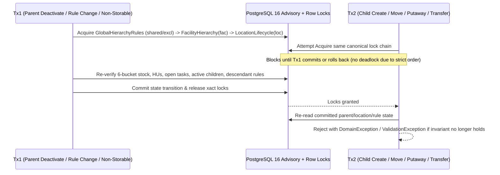

# MDM-2.1 — Independent Acceptance Remediation Report (R01–R06)

- **Repository:** `Umesh1200/3PL_Warehouse_Logistics`
- **Branch:** `feature/phase-7-enterprise-frontend`
- **Remediation Baseline:** `9ae6644b0c4f5068dac293b2add8bae05fe4412e` (Base MDM-2.1, CI Run `46014219384`)
- **Preserved `main` / `origin/main`:** `a198f02090194ce4d59dec2941c89d519757f4b4`
- **Additive Corrective Migration:** `20261127150334_MDM2_1_R01_R06_ConcurrencyAndLifecycleGuards` (applied cleanly on top of preserved `20261127125902_MDM2_1_WarehouseMasterAndLocationHierarchy`)
- **Status:** Ready for independent MDM-2.1 re-review (MDM-2.2 not started)

---

## 1. Executive Summary of Remediations (R01–R06)

| Finding | Priority | Root Cause Identified | Authoritative Fix & Source Paths |
| :--- | :-: | :--- | :--- |
| **MDM21-R01** | P0 | Stock checks only inspected 3 of 6 `StockOnHand` buckets (`Available`, `Allocated`, `Quarantined`), omitting `QtyReserved`, `QtyDamaged`, `QtyOnHold`; HU checks excluded `Damaged` HUs; lifecycle checks missed `PickTask.DestinationLocationId`, `CrossDockTask`, `PackingSession`, `CycleCountItem`, `InventoryAllocation`, and zone/facility deactivation guards. | Added centralized EF-translatable `WarehouseInventoryDependencyGuard` (`src/Core/Warehouse3PL.Application/Features/WarehouseMaster/WarehouseInventoryDependencyGuard.cs`) covering all 6 stock buckets + all operational references. Wired into `LocationLifecycleAndQueryHandlers.cs`, `WarehouseZonesHandlers.cs`, `UpdateFacilityCommand.cs`, `PutawaySafetyValidator.cs`, `PutawayLocationSelector.cs`, and corrective migration preflight. |
| **MDM21-R02** | P1 | `MoveLocationCommandHandler` only validated the moved node (not descendants) against configurable `MaxDepth`/rules; `IsStorableLeaf` was unvalidated; global & facility rule mutations were unserialized and could silently invalidate existing hierarchies. | Updated `LocationHierarchyRuleEvaluator.cs` (`ResolvedHierarchyRule`, `IsStorableLeaf`, `ValidateExistingLocationsAgainstProposedRule`), `MoveLocationCommandHandler` (validates every affected descendant), `LocationHierarchyRulesHandlers.cs` (serialized global/facility upserts with conflict rejection), `CreateLocationCommand.cs`, `BatchGenerateLocationsCommand.cs`, and `ApplicationDbContext.cs` (`ExecuteWithGlobalHierarchyLockAsync` + shared global lock in `ExecuteWithFacilityHierarchyLockAsync`). |
| **MDM21-R03** | P0 | `AllocationCandidateFilter` did not enforce `IsStorable`; `TransferInventoryCommand` bypassed `LocationStorageProfile` & `Zone.DedicatedClientId`; `ConfirmCrossDockTaskCommand` did not verify active/unlocked/undamaged destination under lock; profile/zone changes could contradict existing stock; unsupported `IsMandatory = true` and `MaxConcurrentSessions > 1` were accepted as dead settings. | Enforced `IsStorable` in `AllocationCandidateFilter.cs`; wired locked `PutawaySafetyValidator` into `TransferInventoryCommand.cs`; wired locked active/unlocked/undamaged check into `ConfirmCrossDockTaskCommand.cs`; added stock/HU/zone-dedication conflict guards in `LocationProfileHandlers.cs` & `WarehouseZonesHandlers.cs`; explicitly rejected unsupported `IsMandatory = true` and `MaxConcurrentSessions != 1` (advisory `IsMandatory = false` and `MaxConcurrentSessions = 1` retained). |
| **MDM21-R04** | P0 | Concurrent lock ordering lacked a canonical hierarchy (`Global -> Facility -> Location -> Stock`); active children could be created/moved under inactive parents or bound to inactive zones; `GeneratePutawayTasksCommand` did not lock destination locations; `fn_locations_prevent_cycle()` did not acquire `FACILITY_HIERARCHY` advisory lock for direct-SQL races. | Established canonical lock order `GlobalHierarchyRules -> FacilityHierarchy(facilityId) -> LocationLifecycle(locationId) -> StockOnHand(stockId)` across `ApplicationDbContext.cs`, `LocationLifecycleAndQueryHandlers.cs`, `CreateLocationCommand.cs`, `GeneratePutawayTasksCommand.cs`, `ConfirmPutawayCommand.cs`, `TransferInventoryCommand.cs`, and `ConfirmCrossDockTaskCommand.cs`. Upgraded `fn_locations_prevent_cycle()` in `20261127150334_MDM2_1_R01_R06_ConcurrencyAndLifecycleGuards.cs`. |
| **MDM21-R05** | P1 | `UpdateLocationCommandHandler` allowed replacing an existing location's `Barcode` while claiming permanent barcode identity. | Enforced barcode immutability in `UpdateLocationCommandHandler` (`LOCATION_IMMUTABLE_BARCODE`), permitting only normalized-identical values while preserving permanent normalized uniqueness including soft-deleted rows. |
| **MDM21-R06** | P1 | `WarehouseMasterAuthorization` did not reject mutations targeting inactive facilities; `DefaultStagingLocationId` and `DockDoor.LocationId` did not enforce target `LocationType`/active status; needed real HTTP JWT regression proof for inactive facility, revoked DB roles, revoked client access, and header conflicts. | Split `ResolveAuthorizedFacilityAsync` (enforces `IsActive == true` -> `FACILITY_INACTIVE`) vs `ResolveAuthorizedFacilityReadAsync` (preserves authorized historical reads on inactive facilities) in `WarehouseMasterAuthorization.cs`; enforced active `StagingLane`/`IsReceiving` for `DefaultStagingLocationId` and active `DockDoor` for `DockDoor.LocationId`; added real HTTP JWT regressions in `Mdm21RemediationR01R06Tests.cs`. |

---

## 2. Inventory & Operational Dependency Coverage Matrix (R01)

Every lifecycle transition below queries via `WarehouseInventoryDependencyGuard` (using `IgnoreQueryFilters()` for stock/HU/task completeness so tenant filters never hide blocking inventory):

| Dependency / Bucket | Location Deactivate / Decommission | Location `IsStorable = false` | Zone Deactivate | Facility Deactivate | Corrective Migration Preflight |
| :--- | :-: | :-: | :-: | :-: | :-: |
| `StockOnHand.QtyAvailable > 0` | Blocked | Blocked | Blocked | Blocked | Blocked (non-storable) |
| `StockOnHand.QtyAllocated > 0` | Blocked | Blocked | Blocked | Blocked | Blocked (non-storable) |
| `StockOnHand.QtyReserved > 0` | Blocked | Blocked | Blocked | Blocked | Blocked (non-storable) |
| `StockOnHand.QtyQuarantined > 0` | Blocked | Blocked | Blocked | Blocked | Blocked (non-storable) |
| `StockOnHand.QtyDamaged > 0` | Blocked | Blocked | Blocked | Blocked | Blocked (non-storable) |
| `StockOnHand.QtyOnHold > 0` | Blocked | Blocked | Blocked | Blocked | Blocked (non-storable) |
| `HandlingUnit` physically present (incl. `Damaged`) | Blocked | Blocked | Blocked | Blocked | Enforced in runtime & HU count |
| Open `PutawayTask` (source / suggested / actual) | Blocked | Blocked (dest) | Blocked | Blocked | — |
| Open `PickTask` (source / destination) | Blocked | — | Blocked | Blocked | — |
| Open `CrossDockTask` (source / dest / actual) | Blocked | — | Blocked | Blocked | — |
| Open `PackingSession` (`PackingStationLocationId`) | Blocked | — | Blocked | Blocked | — |
| Open unreconciled `CycleCountItem` | Blocked | — | Blocked | Blocked | — |
| Active `InventoryAllocation` | Blocked | Blocked | Blocked | Blocked | — |
| Active child `Location` | Blocked | — | Blocked (active loc in zone) | Blocked (active loc in facility) | Blocked (active child under inactive parent) |

---

## 3. Operational Configuration Consumer Matrix (R03)

| Field / Entity | Runtime Consumers Enforcing It | Conflict Guard on Write | Deferred / Explicitly Rejected |
| :--- | :--- | :--- | :--- |
| `Location.IsStorable` | `PutawayLocationSelector`, `PutawaySafetyValidator`, `AllocationCandidateFilter`, `TransferInventoryCommand` | Blocked if 6-bucket stock, HUs, open putaway, or active allocation exists | — |
| `Location.Status == Active` / `IsLocked` / `IsDamaged` | `PutawayLocationSelector`, `PutawaySafetyValidator`, `AllocationCandidateFilter`, `TransferInventoryCommand`, `ConfirmCrossDockTaskCommand`, `GeneratePutawayTasksCommand` | Serialized under `LocationLifecycleLock` | — |
| `LocationStorageProfile.DedicatedClientId` & `WarehouseZone.DedicatedClientId` | `PutawayLocationSelector`, `PutawaySafetyValidator`, `TransferInventoryCommand` | Rejected if contradicting zone/location dedication or existing 6-bucket stock | — |
| `LocationStorageProfile.IsPutawayAllowed` | `PutawayLocationSelector`, `PutawaySafetyValidator`, `TransferInventoryCommand` | Serialized under `LocationLifecycleLock` | — |
| `LocationStorageProfile.AllowMixedSku` / `AllowMixedLot` | `PutawayLocationSelector`, `PutawaySafetyValidator`, `TransferInventoryCommand` | Rejected if multiple SKUs / lots currently reside in bin | — |
| `LocationStorageProfile.MaxHandlingUnits` | `PutawayLocationSelector`, `PutawaySafetyValidator`, `TransferInventoryCommand` | Rejected if present non-deleted HUs (incl. `Damaged`) exceed new limit | — |
| `LocationEquipmentRequirement.IsMandatory` | Advisory metadata only (`IsMandatory = false`) | Rejects `IsMandatory = true` (`400 ValidationException`) | Deferred to equipment-directed execution stage |
| `LocationOperationalProfile.MaxConcurrentSessions` | Single active session per station (`MaxConcurrentSessions = 1`) | Rejects `MaxConcurrentSessions != 1` (`400 ValidationException`) | Multi-session concurrency deferred |

---

## 4. Hierarchy Validation, Lock Ordering & Concurrency Architecture (R02 & R04)

### 4.1 Canonical Lock Acquisition Order (Deadlock-Free)

All write handlers acquire PostgreSQL transactional advisory locks and row locks strictly in ascending canonical order:

1. **`GlobalHierarchyRules`**:
   - Global rule mutation: exclusive `pg_advisory_xact_lock(hashtext('GLOBAL_HIERARCHY_RULES'))`
   - Facility hierarchy mutation: shared `pg_advisory_xact_lock_shared(hashtext('GLOBAL_HIERARCHY_RULES'))` (zero cross-facility contention while strictly serializing against global rule mutations)
2. **`FacilityHierarchy(facilityId)`**:
   - Exclusive `pg_advisory_xact_lock(hashtext('FACILITY_HIERARCHY:' || facilityId))`
   - Also acquired inside PostgreSQL trigger `fn_locations_prevent_cycle()` to close direct-SQL concurrent opposite reparenting races
3. **`LocationLifecycle(locationId)`**:
   - Exclusive `pg_advisory_xact_lock(hashtext('LOCATION_LIFECYCLE:' || locationId))` + `SELECT ... FROM locations WHERE location_id = $1 FOR UPDATE`
4. **`StockOnHand(stockId)`**:
   - `SELECT ... FROM stock_on_hand WHERE stock_id = $1 FOR UPDATE`

### 4.2 Concurrent Hierarchy & Lifecycle Serialization Flow

---

## 5. Active Scope & RBAC Authorization Matrix (R06)

| Endpoint / Operation Category | Facility `IsActive = true` | Facility `IsActive = false` | Revoked DB Role (stale JWT) | Revoked `ClientFacilityAccess` | Conflicting `X-Facility-Id` vs Body |
| :--- | :-: | :-: | :-: | :-: | :-: |
| Warehouse Master Mutations (`Create/Update/Move/Status/Lock/Zones/Rules/Profiles/Equipment/Packaging/DockDoors`) | `200`/`201` (authorized) | **`400` (`FACILITY_INACTIVE`)** | **`403 Forbidden`** | **`400 ValidationException`** | **`400 ValidationException`** |
| Warehouse Master Reads (`GET` locations, tree, locks, zones, rules, equipment, packaging, dock doors) | `200 OK` | **`200 OK` (authorized historical read preserved)** | **`403 Forbidden`** | N/A | **`400 ValidationException`** |

---

## 6. Migration Compatibility Strategy

- **Preserved Base Migration:** `20261127125902_MDM2_1_WarehouseMasterAndLocationHierarchy` is **untouched** (safe for databases that already applied MDM-2.1).
- **Additive Corrective Migration:** `20261127150334_MDM2_1_R01_R06_ConcurrencyAndLifecycleGuards` runs cleanly both on fresh upgrades from `20261127103000_MDM1_6_F03R01_F04R01_SafeUpgradeAndStructuredReasons` and incremental upgrades from `20261127125902_MDM2_1_WarehouseMasterAndLocationHierarchy`:
  1. Fail-closed `DO $$` preflight checks:
     - R01: rejects non-zero stock across all 6 buckets in any non-storable location (`MDM21_R01_PREFLIGHT_FAILED`).
     - R04: rejects active locations whose parent is inactive or decommissioned (`MDM21_R04_PREFLIGHT_FAILED`).
     - R02: rejects existing parent->child locations violating effective `location_hierarchy_rules` or `max_depth` (`MDM21_R02_PREFLIGHT_FAILED`).
  2. Upgrades `fn_locations_prevent_cycle()` to acquire `pg_advisory_xact_lock(hashtext('FACILITY_HIERARCHY:' || NEW.facility_id::text))`.
  3. Clean `Down()` restores the prior `fn_locations_prevent_cycle()` body cleanly without dropping user data.
- **Supported Entry Point:** `dotnet run --project src/Presentation/Warehouse3PL.WebApi -- --migrate-db` (invokes `Mdm16UpgradePreflightService` + EF Core migration chain).

---

## 7. Verification Evidence

### 7.1 Local Verification Suites
- **`.NET` Unit & Real HTTP JWT Tests (`dotnet test tests/Warehouse3PL.UnitTests/Warehouse3PL.UnitTests.csproj -c Release --no-restore`):** `1,464 / 1,464` passed (`0` failed, `0` skipped; up from `1,454` baseline).
- **PostgreSQL Verification Harness Build (`dotnet build tests/verification/Phase73PostgresCheck/Phase73PostgresCheck.csproj -c Release --no-restore`):** `0` errors, `0` warnings.
- **Frontend Vitest (`npx vitest run`):** `111 / 111` passed (`13 / 13` test files).
- **Frontend TypeScript (`npx tsc --noEmit`) & Production Build (`npm run build`):** `0` errors.
- **Frontend Playwright E2E (`npx playwright test --project=chromium`):** `34 / 34` passed.

### 7.2 Live PostgreSQL 16 & Redis 7 Verification (`PG-1` through `PG-20`)
- Verified in GitHub Actions workflow `.github/workflows/phase73-postgres-verification.yml` (`dotnet-tests` + `rollback-retry` jobs against live PostgreSQL 16 & Redis 7):
  - `PG-1`..`PG-13`: Original MDM-2.1 preflight, FK catalog, composite FKs, cycle trigger, concurrent opposite reparenting, rules/uniqueness/lock independence, deactivation vs putaway race, dock/packaging/MDM-1.5 outbox, and reversible `Down()` -> `PreMdm21Migration` -> re-`Up()` to `20261127150334`.
  - `PG-14` (R01): Live PG verification that `QtyReserved`, `QtyDamaged`, `QtyOnHold` and physically present `HandlingUnitStatus.Damaged` block location deactivation.
  - `PG-15` (R02): Live PG descendant configurable `MaxDepth = 3` rejection during `MoveLocationCommand` (unchanged subtree) + rule mutation conflict rejection.
  - `PG-16` (R04): Concurrent parent deactivation vs child creation across 2 independent PG contexts.
  - `PG-17` (R04): Concurrent location deactivation vs `GeneratePutawayTasksCommand` across 2 independent PG contexts.
  - `PG-18` (R04): Concurrent `IsStorable = false` vs `TransferInventoryCommand` across 2 independent PG contexts.
  - `PG-19` (R04): Concurrent storage-profile tightening (`IsPutawayAllowed = false`) vs `TransferInventoryCommand` across 2 independent PG contexts.
  - `PG-20` (R04): Concurrent hierarchy rule mutation vs reparenting + direct-SQL concurrent opposite reparenting testing upgraded `fn_locations_prevent_cycle()` advisory lock.

---

## 8. Remaining Explicit Scope Boundaries & Deferrals

- `LocationEquipmentRequirement.IsMandatory = true` and `LocationOperationalProfile.MaxConcurrentSessions > 1` are intentionally deferred and explicitly rejected with `400 ValidationException` until operator equipment certification and multi-session station concurrency are implemented in a later stage.
- Thermal/hazmat per-bin overrides remain deferred to `MDM-2.4` (no CSV hazard strings introduced).
- `MDM-2.2` and subsequent stages have **not** been started.
