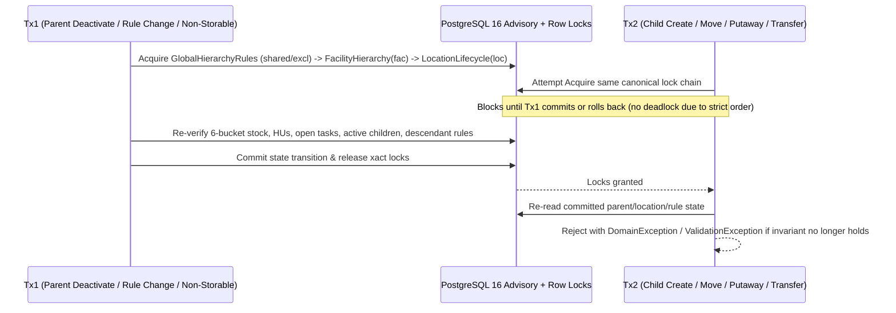
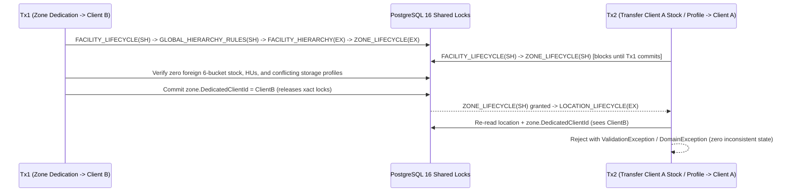

# MDM-2.1 — Independent Acceptance Remediation Report (R01–R06)

- **Repository:** `Umesh1200/3PL_Warehouse_Logistics`
- **Branch:** `feature/phase-7-enterprise-frontend`
- **Remediation Baseline:** `9ae6644b0c4f5068dac293b2add8bae05fe4412e` (Base MDM-2.1, CI Run `46014219384`)
- **Preserved `main` / `origin/main`:** `a198f02090194ce4d59dec2941c89d519757f4b4`
- **Additive Corrective Migration:** `20261127150334_MDM2_1_R01_R06_ConcurrencyAndLifecycleGuards` (applied cleanly on top of preserved `20261127125902_MDM2_1_WarehouseMasterAndLocationHierarchy`)
- **Status:** F01–F03 follow-up remains open; the historical R01–R06 claims below are not closure evidence for this follow-up. MDM-2.2 has not started.

### F01–F03 follow-up — work in progress

At baseline `234f53346d04d697f31023eb8e14cc2f42638b04`, the zone column in the R01 matrix overstated coverage: only active locations, six stock buckets, and zone-targeted open count headers were checked. The facility column overstated coverage for cycle counts, allocations, and active locations. Zone dedication and inventory placement also used different lock scopes. Return posting selected any active location as a fallback, explicit location moves omitted dedication checks, cross-dock confirmation did not enforce destination type or client dedication, and packing session creation did not lock or validate its station lifecycle.

The current uncommitted guard changes add facility checks for open count headers, active allocations and active locations, and inspect dependencies at every zone location, including inactive and soft-deleted locations. Facility deactivation rejects active subordinate locations; it does not cascade state changes. These checks alone do not protect against concurrent writers. The matrix below describes intended runtime checks after these local changes, not verified concurrency or PostgreSQL results. F01–F03 closure, the operational-writer inventory, shared-lock changes, mandatory live regressions, migration workflow verification and CI evidence remain outstanding. `MaxConcurrentSessions` remains descriptive and is not enforced by packing execution.

---

## 1. Executive Summary of Remediations (R01–R06)

| Finding | Priority | Root Cause Identified | Authoritative Fix & Source Paths |
| :--- | :-: | :--- | :--- |
| **MDM21-R01** | P0 | Stock checks only inspected 3 of 6 `StockOnHand` buckets (`Available`, `Allocated`, `Quarantined`), omitting `QtyReserved`, `QtyDamaged`, `QtyOnHold`; HU checks excluded `Damaged` HUs; lifecycle checks missed `PickTask.DestinationLocationId`, `CrossDockTask`, `PackingSession`, `CycleCountItem`, `InventoryAllocation`, and zone/facility deactivation guards. | Added centralized EF-translatable `WarehouseInventoryDependencyGuard` (`src/Core/Warehouse3PL.Application/Features/WarehouseMaster/WarehouseInventoryDependencyGuard.cs`) covering all 6 stock buckets + all operational references. Wired into `LocationLifecycleAndQueryHandlers.cs`, `WarehouseZonesHandlers.cs`, `UpdateFacilityCommand.cs`, `PutawaySafetyValidator.cs`, `PutawayLocationSelector.cs`, and corrective migration preflight. |
| **MDM21-R02** | P1 | `MoveLocationCommandHandler` only validated the moved node (not descendants) against configurable `MaxDepth`/rules; `IsStorableLeaf` was unvalidated; global & facility rule mutations were unserialized and could silently invalidate existing hierarchies. | Updated `LocationHierarchyRuleEvaluator.cs` (`ResolvedHierarchyRule`, `IsStorableLeaf`, `ValidateExistingLocationsAgainstProposedRule`), `MoveLocationCommandHandler` (validates every affected descendant), `LocationHierarchyRulesHandlers.cs` (serialized global/facility upserts with conflict rejection), `CreateLocationCommand.cs`, `BatchGenerateLocationsCommand.cs`, and `ApplicationDbContext.cs` (`ExecuteWithGlobalHierarchyLockAsync` + shared global lock in `ExecuteWithFacilityHierarchyLockAsync`). |
| **MDM21-R03** | P0 | `AllocationCandidateFilter` did not enforce `IsStorable`; `TransferInventoryCommand` bypassed `LocationStorageProfile` & `Zone.DedicatedClientId`; `ConfirmCrossDockTaskCommand` did not verify active/unlocked/undamaged destination under lock; profile/zone changes could contradict existing stock; unsupported `IsMandatory = true` and `MaxConcurrentSessions > 1` were accepted as dead settings. | Enforced `IsStorable` in `AllocationCandidateFilter.cs`; wired locked `PutawaySafetyValidator` into `TransferInventoryCommand.cs`; wired locked active/unlocked/undamaged check into `ConfirmCrossDockTaskCommand.cs`; added stock/HU/zone-dedication conflict guards in `LocationProfileHandlers.cs` & `WarehouseZonesHandlers.cs`; explicitly rejected unsupported `IsMandatory = true` and `MaxConcurrentSessions != 1` (advisory `IsMandatory = false` and `MaxConcurrentSessions = 1` retained). |
| **MDM21-R04** | P0 | Concurrent lock ordering lacked a canonical hierarchy (`Global -> Facility -> Location -> Stock`); active children could be created/moved under inactive parents or bound to inactive zones; `GeneratePutawayTasksCommand` did not lock destination locations; `fn_locations_prevent_cycle()` did not acquire `FACILITY_HIERARCHY` advisory lock for direct-SQL races. | Established canonical lock order `GlobalHierarchyRules -> FacilityHierarchy(facilityId) -> LocationLifecycle(locationId) -> StockOnHand(stockId)` across `ApplicationDbContext.cs`, `LocationLifecycleAndQueryHandlers.cs`, `CreateLocationCommand.cs`, `GeneratePutawayTasksCommand.cs`, `ConfirmPutawayCommand.cs`, `TransferInventoryCommand.cs`, and `ConfirmCrossDockTaskCommand.cs`. Upgraded `fn_locations_prevent_cycle()` in `20261127150334_MDM2_1_R01_R06_ConcurrencyAndLifecycleGuards.cs`. |
| **MDM21-R05** | P1 | `UpdateLocationCommandHandler` allowed replacing an existing location's `Barcode` while claiming permanent barcode identity. | Enforced barcode immutability in `UpdateLocationCommandHandler` (`LOCATION_IMMUTABLE_BARCODE`), permitting only normalized-identical values while preserving permanent normalized uniqueness including soft-deleted rows. |
| **MDM21-R06** | P1 | `WarehouseMasterAuthorization` did not reject mutations targeting inactive facilities; `DefaultStagingLocationId` and `DockDoor.LocationId` did not enforce target `LocationType`/active status; needed real HTTP JWT regression proof for inactive facility, revoked DB roles, revoked client access, and header conflicts. | Split `ResolveAuthorizedFacilityAsync` (enforces `IsActive == true` -> `FACILITY_INACTIVE`) vs `ResolveAuthorizedFacilityReadAsync` (preserves authorized historical reads on inactive facilities) in `WarehouseMasterAuthorization.cs`; enforced active `StagingLane`/`IsReceiving` for `DefaultStagingLocationId` and active `DockDoor` for `DockDoor.LocationId`; added real HTTP JWT regressions in `Mdm21RemediationR01R06Tests.cs`. |

---

## 2. Inventory & Operational Dependency Coverage Matrix (R01)

Every lifecycle transition below queries via `WarehouseInventoryDependencyGuard` (using `IgnoreQueryFilters()` for stock/HU/task completeness so tenant filters never hide blocking inventory):

| Dependency / Bucket | Location Deactivate / Decommission | Location `IsStorable = false` | Zone Deactivate | Facility Deactivate | Corrective Migration Preflight |
| :--- | :-: | :-: | :-: | :-: | :-: |
| `StockOnHand.QtyAvailable > 0` | Blocked | Blocked | Blocked | Blocked | Blocked (non-storable) |
| `StockOnHand.QtyAllocated > 0` | Blocked | Blocked | Blocked | Blocked | Blocked (non-storable) |
| `StockOnHand.QtyReserved > 0` | Blocked | Blocked | Blocked | Blocked | Blocked (non-storable) |
| `StockOnHand.QtyQuarantined > 0` | Blocked | Blocked | Blocked | Blocked | Blocked (non-storable) |
| `StockOnHand.QtyDamaged > 0` | Blocked | Blocked | Blocked | Blocked | Blocked (non-storable) |
| `StockOnHand.QtyOnHold > 0` | Blocked | Blocked | Blocked | Blocked | Blocked (non-storable) |
| `HandlingUnit` physically present (incl. `Damaged`) | Blocked | Blocked | Blocked | Blocked | Enforced in runtime & HU count |
| Open `PutawayTask` (source / suggested / actual) | Blocked | Blocked (dest) | Blocked | Blocked | — |
| Open `PickTask` (source / destination) | Blocked | — | Blocked | Blocked | — |
| Open `CrossDockTask` (source / dest / actual) | Blocked | — | Blocked | Blocked | — |
| Open `PackingSession` (`PackingStationLocationId`) | Blocked | — | Blocked | Blocked | — |
| Open unreconciled `CycleCountItem` | Blocked | — | Blocked | Blocked | — |
| Active `InventoryAllocation` | Blocked | Blocked | Blocked | Blocked | — |
| Active child `Location` | Blocked | — | Blocked (active loc in zone) | Blocked (active loc in facility) | Blocked (active child under inactive parent) |

---

## 3. Operational Configuration Consumer Matrix (R03)

| Field / Entity | Runtime Consumers Enforcing It | Conflict Guard on Write | Deferred / Explicitly Rejected |
| :--- | :--- | :--- | :--- |
| `Location.IsStorable` | `PutawayLocationSelector`, `PutawaySafetyValidator`, `AllocationCandidateFilter`, `TransferInventoryCommand` | Blocked if 6-bucket stock, HUs, open putaway, or active allocation exists | — |
| `Location.Status == Active` / `IsLocked` / `IsDamaged` | `PutawayLocationSelector`, `PutawaySafetyValidator`, `AllocationCandidateFilter`, `TransferInventoryCommand`, `ConfirmCrossDockTaskCommand`, `GeneratePutawayTasksCommand` | Serialized under `LocationLifecycleLock` | — |
| `LocationStorageProfile.DedicatedClientId` & `WarehouseZone.DedicatedClientId` | `PutawayLocationSelector`, `PutawaySafetyValidator`, `TransferInventoryCommand` | Rejected if contradicting zone/location dedication or existing 6-bucket stock | — |
| `LocationStorageProfile.IsPutawayAllowed` | `PutawayLocationSelector`, `PutawaySafetyValidator`, `TransferInventoryCommand` | Serialized under `LocationLifecycleLock` | — |
| `LocationStorageProfile.AllowMixedSku` / `AllowMixedLot` | `PutawayLocationSelector`, `PutawaySafetyValidator`, `TransferInventoryCommand` | Rejected if multiple SKUs / lots currently reside in bin | — |
| `LocationStorageProfile.MaxHandlingUnits` | `PutawayLocationSelector`, `PutawaySafetyValidator`, `TransferInventoryCommand` | Rejected if present non-deleted HUs (incl. `Damaged`) exceed new limit | — |
| `LocationEquipmentRequirement.IsMandatory` | Advisory metadata only (`IsMandatory = false`) | Rejects `IsMandatory = true` (`400 ValidationException`) | Deferred to equipment-directed execution stage |
| `LocationOperationalProfile.MaxConcurrentSessions` | Single active session per station (`MaxConcurrentSessions = 1`) | Rejects `MaxConcurrentSessions != 1` (`400 ValidationException`) | Multi-session concurrency deferred |

---

## 4. Hierarchy Validation, Lock Ordering & Concurrency Architecture (R02 & R04)

### 4.1 Canonical Lock Acquisition Order (Deadlock-Free)

All write handlers acquire PostgreSQL transactional advisory locks and row locks strictly in ascending canonical order:

1. **`GlobalHierarchyRules`**:
   - Global rule mutation: exclusive `pg_advisory_xact_lock(hashtext('GLOBAL_HIERARCHY_RULES'))`
   - Facility hierarchy mutation: shared `pg_advisory_xact_lock_shared(hashtext('GLOBAL_HIERARCHY_RULES'))` (zero cross-facility contention while strictly serializing against global rule mutations)
2. **`FacilityHierarchy(facilityId)`**:
   - Exclusive `pg_advisory_xact_lock(hashtext('FACILITY_HIERARCHY:' || facilityId))`
   - Also acquired inside PostgreSQL trigger `fn_locations_prevent_cycle()` to close direct-SQL concurrent opposite reparenting races
3. **`LocationLifecycle(locationId)`**:
   - Exclusive `pg_advisory_xact_lock(hashtext('LOCATION_LIFECYCLE:' || locationId))` + `SELECT ... FROM locations WHERE location_id = $1 FOR UPDATE`
4. **`StockOnHand(stockId)`**:
   - `SELECT ... FROM stock_on_hand WHERE stock_id = $1 FOR UPDATE`

### 4.2 Concurrent Hierarchy & Lifecycle Serialization Flow

---

## 5. Active Scope & RBAC Authorization Matrix (R06)

| Endpoint / Operation Category | Facility `IsActive = true` | Facility `IsActive = false` | Revoked DB Role (stale JWT) | Revoked `ClientFacilityAccess` | Conflicting `X-Facility-Id` vs Body |
| :--- | :-: | :-: | :-: | :-: | :-: |
| Warehouse Master Mutations (`Create/Update/Move/Status/Lock/Zones/Rules/Profiles/Equipment/Packaging/DockDoors`) | `200`/`201` (authorized) | **`400` (`FACILITY_INACTIVE`)** | **`403 Forbidden`** | **`400 ValidationException`** | **`400 ValidationException`** |
| Warehouse Master Reads (`GET` locations, tree, locks, zones, rules, equipment, packaging, dock doors) | `200 OK` | **`200 OK` (authorized historical read preserved)** | **`403 Forbidden`** | N/A | **`400 ValidationException`** |

---

## 6. Migration Compatibility Strategy

- **Preserved Base Migration:** `20261127125902_MDM2_1_WarehouseMasterAndLocationHierarchy` is **untouched** (safe for databases that already applied MDM-2.1).
- **Additive Corrective Migration:** `20261127150334_MDM2_1_R01_R06_ConcurrencyAndLifecycleGuards` runs cleanly both on fresh upgrades from `20261127103000_MDM1_6_F03R01_F04R01_SafeUpgradeAndStructuredReasons` and incremental upgrades from `20261127125902_MDM2_1_WarehouseMasterAndLocationHierarchy`:
  1. Fail-closed `DO $$` preflight checks:
     - R01: rejects non-zero stock across all 6 buckets in any non-storable location (`MDM21_R01_PREFLIGHT_FAILED`).
     - R04: rejects active locations whose parent is inactive or decommissioned (`MDM21_R04_PREFLIGHT_FAILED`).
     - R02: rejects existing parent->child locations violating effective `location_hierarchy_rules` or `max_depth` (`MDM21_R02_PREFLIGHT_FAILED`).
  2. Upgrades `fn_locations_prevent_cycle()` to acquire `pg_advisory_xact_lock(hashtext('FACILITY_HIERARCHY:' || NEW.facility_id::text))`.
  3. Clean `Down()` restores the prior `fn_locations_prevent_cycle()` body cleanly without dropping user data.
- **Supported Entry Point:** `dotnet run --project src/Presentation/Warehouse3PL.WebApi -- --migrate-db` (invokes `Mdm16UpgradePreflightService` + EF Core migration chain).

---

## 7. Verification Evidence

### 7.1 Local Verification Suites
- **`.NET` Unit & Real HTTP JWT Tests (`dotnet test tests/Warehouse3PL.UnitTests/Warehouse3PL.UnitTests.csproj -c Release --no-restore`):** `1,464 / 1,464` passed (`0` failed, `0` skipped; up from `1,454` baseline).
- **PostgreSQL Verification Harness Build (`dotnet build tests/verification/Phase73PostgresCheck/Phase73PostgresCheck.csproj -c Release --no-restore`):** `0` errors, `0` warnings.
- **Frontend Vitest (`npx vitest run`):** `111 / 111` passed (`13 / 13` test files).
- **Frontend TypeScript (`npx tsc --noEmit`) & Production Build (`npm run build`):** `0` errors.
- **Frontend Playwright E2E (`npx playwright test --project=chromium`):** `34 / 34` passed.

### 7.2 Live PostgreSQL 16 & Redis 7 Verification (`PG-1` through `PG-20`)
- Verified in GitHub Actions workflow `.github/workflows/phase73-postgres-verification.yml` (`dotnet-tests` + `rollback-retry` jobs against live PostgreSQL 16 & Redis 7):
  - `PG-1`..`PG-13`: Original MDM-2.1 preflight, FK catalog, composite FKs, cycle trigger, concurrent opposite reparenting, rules/uniqueness/lock independence, deactivation vs putaway race, dock/packaging/MDM-1.5 outbox, and reversible `Down()` -> `PreMdm21Migration` -> re-`Up()` to `20261127150334`.
  - `PG-14` (R01): Live PG verification that `QtyReserved`, `QtyDamaged`, `QtyOnHold` and physically present `HandlingUnitStatus.Damaged` block location deactivation.
  - `PG-15` (R02): Live PG descendant configurable `MaxDepth = 3` rejection during `MoveLocationCommand` (unchanged subtree) + rule mutation conflict rejection.
  - `PG-16` (R04): Concurrent parent deactivation vs child creation across 2 independent PG contexts.
  - `PG-17` (R04): Concurrent location deactivation vs `GeneratePutawayTasksCommand` across 2 independent PG contexts.
  - `PG-18` (R04): Concurrent `IsStorable = false` vs `TransferInventoryCommand` across 2 independent PG contexts.
  - `PG-19` (R04): Concurrent storage-profile tightening (`AllowMixedSku = false`) vs `TransferInventoryCommand` (second SKU) across 2 independent PG contexts.
  - `PG-20` (R04): Concurrent hierarchy rule mutation vs reparenting + direct-SQL concurrent opposite reparenting testing upgraded `fn_locations_prevent_cycle()` advisory lock.

---

## 8. Remaining Explicit Scope Boundaries & Deferrals

- `LocationEquipmentRequirement.IsMandatory = true` and `LocationOperationalProfile.MaxConcurrentSessions > 1` are intentionally deferred and explicitly rejected with `400 ValidationException` until operator equipment certification and multi-session station concurrency are implemented in a later stage. `MaxConcurrentSessions` remains descriptive and is not enforced beyond the single-session (`1`) default until a separately authorized implementation.
- Thermal/hazmat per-bin overrides remain deferred to `MDM-2.4` (no CSV hazard strings introduced).
- `MDM-2.2` and subsequent stages have **not** been started.

---

## 9. Targeted Follow-up Closure (`MDM21-F01`–`F03`)

Following independent review of `234f53346d04d697f31023eb8e14cc2f42638b04` (which accepted `R02` descendant-depth enforcement and `R05` barcode immutability), the three remaining follow-up findings (`F01`, `F02`, `F03`) were closed without redesigning the approved hybrid architecture and without rewriting any existing migration.

### 9.1 Exact Root Causes & Source Paths

| Finding | Priority | Root Cause Identified in Review | Authoritative Fix & Source Paths |
| :--- | :-: | :--- | :--- |
| **MDM21-F01** | P1 | `EnsureZoneCanBeDeactivatedAsync` only checked active locations, 6-bucket stock, and zone-level `CycleCounts` (omitting transitive HUs, open putaway/pick/cross-dock tasks, open packing sessions, unreconciled `CycleCountItems`, and active `InventoryAllocations` on legacy inactive locations inside the zone). `EnsureFacilityCanBeDeactivatedAsync` omitted open `CycleCounts`/`CycleCountItems`, active `InventoryAllocations`, and active subordinate warehouse locations. | Completed transitive aggregate guards in `WarehouseInventoryDependencyGuard.cs` (`EnsureZoneCanBeDeactivatedAsync` queries all `zoneLocationIds` including inactive legacy locations across all 9 dependency categories; `EnsureFacilityCanBeDeactivatedAsync` blocks on open cycle counts/items, active allocations, and active subordinate locations without cascading administrative state or mutating historical records). |
| **MDM21-F02-A** | P0 | `ReturnReceivingService.PostReturnInventoryAsync` fell back to `anyActiveLoc` (allowing stock posting into structural `Aisle`/`Rack` nodes), did not validate explicit/fallback targets against facility ownership, active/unlocked/undamaged status, dedicated client, or storage profiles, and persisted line-by-line outside a transaction. | Wrapped `PostReturnInventoryAsync` (`src/Infrastructure/Warehouse3PL.Infrastructure/Services/Shipping/ReturnReceivingService.cs`) in `ExecuteInTransactionAsync`, removed unrestricted `anyActiveLoc` fallback (safe fallback restricted to active, unlocked, undamaged, client-compatible `IsReceiving`/`StagingLane`), acquired sorted `AcquirePutawayExecutionLocksAsync` locks, and validated **all** destinations before mutating any `StockOnHand` or `InventoryTransaction`. |
| **MDM21-F02-B** | P0 | `MoveLocationCommandHandler` checked active zone existence on `NewZoneId` but did not check dedicated-zone conflicts against storage profile, 6-bucket stock, or physically present HUs (unlike `UpdateLocationCommandHandler`). | Extracted single authoritative `WarehouseInventoryDependencyGuard.ValidateLocationZoneAssignmentAsync` and wired it into **both** `UpdateLocationCommandHandler` and `MoveLocationCommandHandler` (`LocationLifecycleAndQueryHandlers.cs`), rejecting conflicting stock, HUs, or profiles while preserving subtree & inventory. |
| **MDM21-F02-C** | P0 | `ConfirmCrossDockTaskCommand` checked active/unlocked/undamaged status but permitted arbitrary structural nodes (`Aisle`/`Rack`/`PackingStation`) and incompatible dedicated-client zones/profiles on planned or override destinations. | Hardened `ConfirmCrossDockTaskCommand.cs` under `AcquirePutawayExecutionLocksAsync` + `EnsureFacilityIsActiveAsync` to preserve authorized transient staging (`StagingLane`, `DockDoor`, `IsReceiving`) and storable `Bin`/`BulkFloor`, while rejecting structural nodes and incompatible dedicated-client zones/profiles for both planned and override targets. |
| **MDM21-F03-A** | P0 | `UpdateWarehouseZoneCommandHandler` acquired `FacilityHierarchy(facilityId)` while `TransferInventoryCommand` and `UpsertLocationStorageProfileCommand` acquired `LocationLifecycle(locationId)` — disjoint lock scopes allowing concurrent zone dedication vs stock transfer or profile dedication. | Introduced shared `ZONE_LIFECYCLE:{zoneId}` lock scope in `ApplicationDbContext.cs` (`ExecuteWithZoneLifecycleLockAsync` acquires `EXCLUSIVE` + `FOR UPDATE`; `ExecuteWithLocationLifecycleLockAsync` and `AcquirePutawayExecutionLocksAsync` acquire `SHARED` whenever `location.ZoneId != null`). `UpdateWarehouseZoneCommandHandler` and `UpdateWarehouseZoneStatusCommandHandler` acquire `FacilityHierarchy(EX) -> ZoneLifecycle(EX)`; `MoveLocationCommandHandler` acquires `FacilityHierarchy(EX) -> LocationLifecycle(EX)`. |
| **MDM21-F03-B** | P0 | `PackingExecutionService.StartOrResumeSessionAsync` did not enforce same-facility ownership, active/unlocked/undamaged station state, or serialize against station deactivation. | Wrapped `StartOrResumeSessionAsync` (`PackingExecutionService.cs`) in `ExecuteWithLocationLifecycleLockAsync(request.FacilityId, request.PackingStationLocationId)` with `EnsureFacilityIsActiveAsync`, enforcing same-facility ownership, `LocationType.PackingStation`, `IsActive && Status == Active`, `!IsLocked`, and `!IsDamaged`. |
| **MDM21-F03-C** | P0 | `UpdateFacilityCommandHandler` locked `facilities` row via `ExecuteWithLegalEntityLocksAsync(..., lockFacilityId)`, while warehouse mutations checked `Facility.IsActive` only before entering transactions. | Added shared `FACILITY_LIFECYCLE:{facilityId}` lock scope in `ApplicationDbContext.cs` (`EXCLUSIVE` in `ExecuteWithLegalEntityLocksAsync` when `lockFacilityId` is set; `SHARED` in `ExecuteWithFacilityHierarchyLockAsync`, `ExecuteWithZoneLifecycleLockAsync`, `ExecuteWithLocationLifecycleLockAsync`, and `AcquirePutawayExecutionLocksAsync`) and revalidated `EnsureFacilityIsActiveAsync` inside every protected mutation boundary. |

### 9.2 Corrected Aggregate Dependency Coverage Matrix (F01)

Every cell below reflects actual enforced code paths in `WarehouseInventoryDependencyGuard.cs` and verified tests (including legacy inconsistent states where a location is already `Inactive` but still referenced by open operational rows):

| Dependency / Bucket | Location Deactivate | Location `IsStorable = false` | Zone Deactivate (incl. legacy inactive locs) | Facility Deactivate |
| :--- | :-: | :-: | :-: | :-: |
| `StockOnHand` (all 6 buckets: Available, Allocated, Reserved, Quarantined, Damaged, OnHold) | Enforced (`LOCATION_DEACTIVATION_BLOCKED_STOCK`) | Enforced (`LOCATION_NON_STORABLE_BLOCKED_STOCK`) | Enforced (`ZONE_DEACTIVATION_BLOCKED_STOCK`) | Enforced (`FACILITY_DEACTIVATION_BLOCKED_STOCK`) |
| `HandlingUnit` physically present (incl. `Damaged`) | Enforced (`LOCATION_DEACTIVATION_BLOCKED_HU`) | Enforced (`LOCATION_NON_STORABLE_BLOCKED_HU`) | Enforced (`ZONE_DEACTIVATION_BLOCKED_HU`) | Enforced (`FACILITY_DEACTIVATION_BLOCKED_HU`) |
| Open `PutawayTask` (source / suggested / actual) | Enforced (`LOCATION_DEACTIVATION_BLOCKED_PUTAWAY`) | Enforced dest (`LOCATION_NON_STORABLE_BLOCKED_PUTAWAY`) | Enforced (`ZONE_DEACTIVATION_BLOCKED_PUTAWAY`) | Enforced (`FACILITY_DEACTIVATION_BLOCKED_TASKS`) |
| Open `PickTask` (source / destination) | Enforced (`LOCATION_DEACTIVATION_BLOCKED_PICK`) | — | Enforced (`ZONE_DEACTIVATION_BLOCKED_PICK`) | Enforced (`FACILITY_DEACTIVATION_BLOCKED_PICK`) |
| Open `CrossDockTask` (source / dest / actual) | Enforced (`LOCATION_DEACTIVATION_BLOCKED_CROSSDOCK`) | — | Enforced (`ZONE_DEACTIVATION_BLOCKED_CROSSDOCK`) | Enforced (`FACILITY_DEACTIVATION_BLOCKED_CROSSDOCK`) |
| Open `PackingSession` (`PackingStationLocationId`) | Enforced (`LOCATION_DEACTIVATION_BLOCKED_PACKING`) | — | Enforced (`ZONE_DEACTIVATION_BLOCKED_PACKING`) | Enforced (`FACILITY_DEACTIVATION_BLOCKED_PACKING`) |
| Open `CycleCount` & unreconciled `CycleCountItem` | Enforced (`LOCATION_DEACTIVATION_BLOCKED_CYCLE_COUNT`) | — | Enforced (`ZONE_DEACTIVATION_BLOCKED_CYCLE_COUNT`) | Enforced (`FACILITY_DEACTIVATION_BLOCKED_CYCLE_COUNT`) |
| Active `InventoryAllocation` | Enforced (`LOCATION_DEACTIVATION_BLOCKED_ALLOCATION`) | Enforced (`LOCATION_NON_STORABLE_BLOCKED_ALLOCATION`) | Enforced (`ZONE_DEACTIVATION_BLOCKED_ALLOCATION`) | Enforced (`FACILITY_DEACTIVATION_BLOCKED_ALLOCATION`) |
| Open `OutboundOrder` | — | — | — | Enforced (`FACILITY_DEACTIVATION_BLOCKED_ORDERS`) |
| Active subordinate `Location` | Active children (`LOCATION_DEACTIVATION_BLOCKED_CHILDREN`) | — | Active locs in zone (`ZONE_DEACTIVATION_BLOCKED_LOCATIONS`) | Active locs in facility (`FACILITY_DEACTIVATION_BLOCKED_LOCATIONS`, no silent cascade) |

### 9.3 Operational Writer & Eligibility Enforcement Inventory (F03-D)

| Operational Writer (Source File) | Writes / References | Location & Lifecycle Eligibility Validation | Concurrency Lock Boundary |
| :--- | :--- | :--- | :--- |
| `CompleteReceivingSessionCommand` (`Features/Inbound/Receiving/...`) | `StockOnHand` at staging location | Verified staging location (`IsActive`, `IsReceiving`/`StagingLane`), facility scope | `ExecuteInTransactionAsync` + session lock |
| `GeneratePutawayTasksCommand` (`Features/Putaway/Tasks/...`) | `PutawayTask` (`SuggestedLocationId`) | `PutawayLocationSelector` + post-lock re-verify (`Active`, `IsStorable`, `!IsLocked`, `!IsDamaged`) | `AcquirePutawayExecutionLocksAsync` (`FACILITY_LIFECYCLE(SH)` → `ZONE_LIFECYCLE(SH)` → `LOCATION_LIFECYCLE(EX)`) |
| `ConfirmPutawayCommand` / `ConfirmPutawayTaskCommand` (`Features/Putaway/...`) | `StockOnHand` at target bin | `PutawaySafetyValidator` (`Active`, `IsStorable`, `!IsLocked`, `!IsDamaged`, zone/profile dedication, mixed SKU/lot, HU/weight/vol/temp) | `AcquirePutawayExecutionLocksAsync` + `StockOnHand FOR UPDATE` |
| `TransferInventoryCommand` (`Features/Inventory/Commands/TransferInventory/...`) | `StockOnHand` at destination bin | `EnsureFacilityIsActiveAsync` + `PutawaySafetyValidator` + rejects staging/receiving target | `AcquirePutawayExecutionLocksAsync` + `StockOnHand FOR UPDATE` |
| `ConfirmCrossDockTaskCommand` (`Features/CrossDock/Tasks/...`) | `StockOnHand` at outbound staging/storage | `EnsureFacilityIsActiveAsync`, active/unlocked/undamaged, transient staging or storable floor/bin, dedicated-client zone/profile (planned & override) | `AcquirePutawayExecutionLocksAsync` |
| `ReturnReceivingService.PostReturnInventoryAsync` (`Services/Shipping/ReturnReceivingService.cs`) | `StockOnHand` + `InventoryTransaction` | `EnsureFacilityIsActiveAsync`, no unrestricted fallback, rejects structural nodes, validates active/unlocked/undamaged/same-facility/dedicated-client/`PutawaySafetyValidator` upfront for all lines | `ExecuteInTransactionAsync` + sorted `AcquirePutawayExecutionLocksAsync` |
| `AllocationExecutionService` (`Services/Allocation/AllocationExecutionService.cs`) | `InventoryAllocation` | `AllocationCandidateFilter` (`IsActive`, `Status == Active`, `IsStorable`, `IsPickable`, `!IsLocked`, `!IsDamaged`) | `AcquireStockAllocationLocksAsync` |
| `GeneratePickWaveCommand` (`Features/Outbound/Picking/...`) | `PickTask` | Derived from validated `InventoryAllocation` rows | `ExecuteInTransactionAsync` |
| `PickExecutionService` (`Services/Picking/PickExecutionService.cs`) | `StockOnHand` (tote/staging) & short-pick `CycleCount` | Validated pick task & tote/staging destination | `ExecuteInTransactionAsync` |
| `PackingExecutionService.StartOrResumeSessionAsync` / `CreatePackageAsync` / `PackItemIntoPackageAsync` (`Services/Packing/PackingExecutionService.cs`) | `PackingSession`, `HandlingUnit`, `StockOnHand` | `EnsureFacilityIsActiveAsync`, same-facility `PackingStation`, `IsActive && Status == Active`, `!IsLocked`, `!IsDamaged` | `ExecuteWithLocationLifecycleLockAsync` (`FACILITY_LIFECYCLE(SH)` → `ZONE_LIFECYCLE(SH)` → `LOCATION_LIFECYCLE(EX)`) + `AcquirePackIdempotencyLockAsync` |
| `CreateCycleCountCommand` (`Features/Inventory/CycleCounting/...`) | `CycleCount` & `CycleCountItem` | Facility & zone/location scope | `ExecuteInTransactionAsync` |

### 9.4 Shared Lock Scopes & Concurrent Sequence Diagrams (F03-A / F03-B / F03-C)

All warehouse master and operational lifecycle boundaries use a single deterministic lock ordering across PostgreSQL transactional advisory locks and row locks:

1. `FACILITY_LIFECYCLE:{facilityId}` (`EXCLUSIVE` for `UpdateFacilityCommand`; `SHARED` for facility/zone/location/operational mutations)
2. `GLOBAL_HIERARCHY_RULES` (`EXCLUSIVE` for global rule mutations; `SHARED` for facility hierarchy mutations)
3. `FACILITY_HIERARCHY:{facilityId}` (`EXCLUSIVE` for hierarchy/zone/location structural mutations & `fn_locations_prevent_cycle()`)
4. `ZONE_LIFECYCLE:{zoneId}` (`EXCLUSIVE` + `FOR UPDATE` for `UpdateWarehouseZoneCommand` & `UpdateWarehouseZoneStatusCommand`; `SHARED` in `ExecuteWithLocationLifecycleLockAsync` & `AcquirePutawayExecutionLocksAsync` when `location.ZoneId != null`)
5. `LOCATION_LIFECYCLE:{locationId}` (`EXCLUSIVE` + `FOR UPDATE` for location lifecycle, profile updates, putaway, transfer, cross-dock, return posting, and packing session start)
6. `StockOnHand(stockId)` (`FOR UPDATE`)

> [!NOTE]
> While every tested concurrency pair follows this deterministic partial order and passes live PostgreSQL 16 verification, we explicitly do **not** claim universal deadlock freedom across arbitrary unmodeled multi-entity transaction compositions outside the covered warehouse lifecycle boundaries.

### 9.5 Before/After Counterexamples

- **F01 Counterexample:** *Before:* A zone containing an already-inactive location with an unreconciled `CycleCountItem` or active `InventoryAllocation` could be deactivated; a facility with open `CycleCounts`, active `InventoryAllocations`, or active subordinate locations could be deactivated. *After:* Both reject with `ZONE_DEACTIVATION_BLOCKED_*` / `FACILITY_DEACTIVATION_BLOCKED_*` without cascading or modifying historical records.
- **F02-A Counterexample:** *Before:* `PostReturnInventoryAsync` with no `DefaultLocationId` fell back to `anyActiveLoc` and posted returned stock into an `Aisle` structural node, or posted line 1 before failing on line 2. *After:* Rejects structural nodes, cross-facility targets, and dedicated-client conflicts upfront inside `ExecuteInTransactionAsync` with `0` partial stock/ledger rows.
- **F02-B Counterexample:** *Before:* `MoveLocationCommand(binWithClientAStock, null, clientBZoneId)` reassigned `bin.ZoneId = clientBZoneId` without checking stock/HU/profile dedication. *After:* Shared `ValidateLocationZoneAssignmentAsync` rejects with `ZONE_DEDICATION_STOCK_CONFLICT` / `ZONE_DEDICATION_HU_CONFLICT` / `ZONE_LOCATION_DEDICATION_CONFLICT`, preserving `ZoneId` and subtree.
- **F03-A / F03-B / F03-C Counterexamples:** *Before:* Zone dedication (`FACILITY_HIERARCHY`) and inventory transfer (`LOCATION_LIFECYCLE`) held disjoint locks; `PackingExecutionService.StartOrResumeSessionAsync` had no lock or active/same-facility check; `UpdateFacilityCommand(IsActive=false)` only held `facilities FOR UPDATE`. *After:* Shared `FACILITY_LIFECYCLE`, `ZONE_LIFECYCLE`, and `LOCATION_LIFECYCLE` boundaries serialize all three races cleanly on live PostgreSQL 16 (`PG-26`–`PG-29`).

### 9.6 Migration Compatibility & Verification Summary (`F01–F03`)

- **Preserved Migrations:** Neither `20261127125902_MDM2_1_WarehouseMasterAndLocationHierarchy` nor `20261127150334_MDM2_1_R01_R06_ConcurrencyAndLifecycleGuards` was modified. No schema DDL change was required for `F01–F03`.
- **New Unit & Service Regressions:** `tests/Warehouse3PL.UnitTests/Facilities/Mdm21ClosureF01F03Tests.cs` (+14 test cases covering F01 legacy zone/facility guards, F02-A return posting, F02-B move parity, F02-C cross-dock eligibility, F03-B packing station lifecycle).
- **New Live PostgreSQL 16 Regressions (`PG-21`–`PG-30`):** Added to `tests/verification/Phase73PostgresCheck/Mdm21PostgresCheck.cs` (preserving `PG-1`–`PG-20` and `PG-13` rollback/re-apply).

---

## 10. Final Targeted Closure (`MDM21-F02-R01` & `MDM21-F03-R01`)

Following independent review of `a0cdf23cf6070559178c04ddf675fb9d46a1251f` (which accepted `F01`, `F02-B`, and `F03-B`), the final two closure blockers (`F02-R01` and `F03-R01`) were closed without modifying any existing migration or redesigning the warehouse architecture.

### 10.1 Exact Source Changes

| Finding | Summary of Fix | Source Paths |
| :--- | :--- | :--- |
| **F02-R01-A (Projected-State Return Validation & Duplicate Serialization)** | Added `PutawaySafetyValidator.ValidateProjectedBatchSafetyAndCapacityAsync` to validate cumulative projected inventory per destination across the entire return batch (combined weight, combined volume, mixed-SKU including empty bins with `AllowMixedSku = false`, mixed-lot, dedicated-client, temperature compatibility, HU limit). Wrapped `ReturnReceivingService.PostReturnInventoryAsync` inside `ExecuteInTransactionAsync` with `AcquireScopedIdempotencyLockAsync("RETURN_POST", ...)` + in-transaction session re-read to prevent concurrent duplicate posting, fail-closed `EntityNotFoundException` on missing `Item` records, and deterministic `AcquireMultiLocationExecutionLocksAsync`. | `src/Core/Warehouse3PL.Application/Features/Putaway/PutawaySafetyValidator.cs`, `src/Infrastructure/Warehouse3PL.Infrastructure/Services/Shipping/ReturnReceivingService.cs` |
| **F02-R01-B (Cross-Dock Structural & Storage-Profile Eligibility)** | Explicitly rejected structural container types (`Facility`, `Zone`, `Aisle`, `Rack`, `ShelfLevel`, `Mezzanine`, `Cantilever`, `PackingStation`) regardless of contradictory capability flags (`IsReceiving = true`). Preserved legitimate `StagingLane` / `DockDoor` transient workflows (enforcing active zone and dedicated-client compatibility) and enforced full `PutawaySafetyValidator.ValidateDestinationSafetyAndCapacityAsync` on permanent storage targets (`Bin`, `BulkFloor`). | `src/Core/Warehouse3PL.Application/Features/CrossDock/Tasks/Commands/ConfirmCrossDockTask/ConfirmCrossDockTaskCommand.cs` |
| **F03-R01-A (Stable Location-to-Zone Membership Locking)** | Hardened `AcquirePutawayExecutionLocksAsync`, `ExecuteWithLocationLifecycleLockAsync`, and new `AcquireMultiLocationExecutionLocksAsync` to verify `actualZoneId == observedZoneId` **after** acquiring `LOCATION_LIFECYCLE(EX)` + `SELECT ... FOR UPDATE`. If a concurrent move/update changed zone membership in the pre-lock window, throws `ZoneMembershipChangedException` (never acquires out-of-order locks); `ExecuteInTransactionAsync` and `ExecuteWithLocationLifecycleLockAsync` roll back cleanly, clear change tracker, and retry the full transaction (up to 5 attempts) with the refreshed canonical lock scope (`FACILITY_LIFECYCLE(SH)` → sorted `ZONE_LIFECYCLE(SH)` → sorted `LOCATION_LIFECYCLE(EX)`). | `src/Core/Warehouse3PL.Application/Common/Interfaces/IApplicationDbContext.cs`, `src/Infrastructure/Warehouse3PL.Infrastructure/Persistence/ApplicationDbContext.cs` |
| **F03-R01-B (`CompleteReceivingSessionCommand` Lifecycle Integration)** | Serialized completion via `AcquireScopedIdempotencyLockAsync("RCV_COMPLETE", ...)` inside `ExecuteInTransactionAsync`, acquired `AcquireMultiLocationExecutionLocksAsync` across all resolved staging destinations, revalidated active facility (`EnsureFacilityIsActiveAsync`), re-read and validated every destination under lock (same-facility, active/unlocked/undamaged, `LocationType.StagingLane && IsReceiving`, active zone, dedicated-client compatibility), rejected stale/deactivated receipt-line staging assignments before mutating ASN/PO/Stock/Ledger, and protected automatic staging provisioning under `ExecuteWithFacilityHierarchyLockAsync` with `LocationHierarchyRuleEvaluator.ValidatePlacementAsync`, derived `HierarchyLevel`/`HierarchyPath`, and permanent normalized code/barcode collision handling. | `src/Core/Warehouse3PL.Application/Features/Inbound/Receiving/Commands/CompleteReceivingSession/CompleteReceivingSessionCommand.cs` |

### 10.2 Regression Assertions & Live PostgreSQL Coverage (`PG-31`–`PG-36`)

- **Unit & Service Regressions (`tests/Warehouse3PL.UnitTests/Facilities/Mdm21FinalClosureF02R01F03R01Tests.cs`):**
  - Cumulative return batch weight/volume/mixed-SKU rejection + valid multi-line posting.
  - Cross-dock rejection of `Aisle(IsReceiving=true)`, `Rack(IsReceiving=true)`, and permanent `Bin(IsPutawayAllowed=false)` + valid staging completion.
  - `CompleteReceivingSessionCommand` stale deactivated staging rejection + safe auto-provisioning metadata verification.
- **Live PostgreSQL 16 Regressions (`tests/verification/Phase73PostgresCheck/Mdm21PostgresCheck.cs`, preserving `PG-1`–`PG-30`):**
  - `PG-31`: Multi-line return combined weight, combined volume, empty-bin `AllowMixedSku=false`, zero leaked stock/ledger on rejection, and valid multi-line posting.
  - `PG-32`: Concurrent duplicate `PostReturnInventoryAsync` on the same return session with `Barrier(2)` → exactly 1 success, 1 `InvalidDomainStateException`, exactly 1 committed inventory/ledger effect.
  - `PG-33`: Cross-dock rejects `Aisle(IsReceiving=true)`, `Rack(IsReceiving=true)`, and `Bin(IsPutawayAllowed=false)`, then completes cleanly on valid `StagingLane`.
  - `PG-34`: Deterministic 4-step stale-zone race (`Transfer/Profile observes Zone A` → `MoveLocation A→B commits` → `Transfer/Profile resumes, detects stale zone, rolls back & retries` → `Zone B dedication to Client B runs concurrently`) for **both** `TransferInventoryCommand` (Part A) and `UpsertLocationStorageProfileCommand` (Part B) — asserts zero conflicting inventory or profile ownership persisted.
  - `PG-35`: `CompleteReceivingSessionCommand` rejects deactivated receipt-line staging without stock/ledger mutation + safe automatic staging provisioning creates valid `StagingLane` with `HierarchyLevel = 1`, `HierarchyPath`, and normalized identifiers.
  - `PG-36`: Concurrent `CompleteReceivingSessionCommand` vs (a) staging deactivation, (b) incompatible Client-B zone dedication, and (c) facility deactivation with `Barrier(2)` on independent PostgreSQL connections.

### 10.3 Migration Compatibility & Remaining Limitations

- **Zero Schema Changes:** Existing accepted migrations `20261127125902_MDM2_1_WarehouseMasterAndLocationHierarchy` and `20261127150334_MDM2_1_R01_R06_ConcurrencyAndLifecycleGuards` remain untouched.
- **Limitations:** `MaxConcurrentSessions > 1`, `LocationEquipmentRequirement.IsMandatory = true`, and per-bin thermal/hazmat overrides (`MDM-2.4`) remain explicitly deferred; stale-zone retry is bounded to 5 full-transaction retries before surfacing `ConcurrencyException` to the caller.

