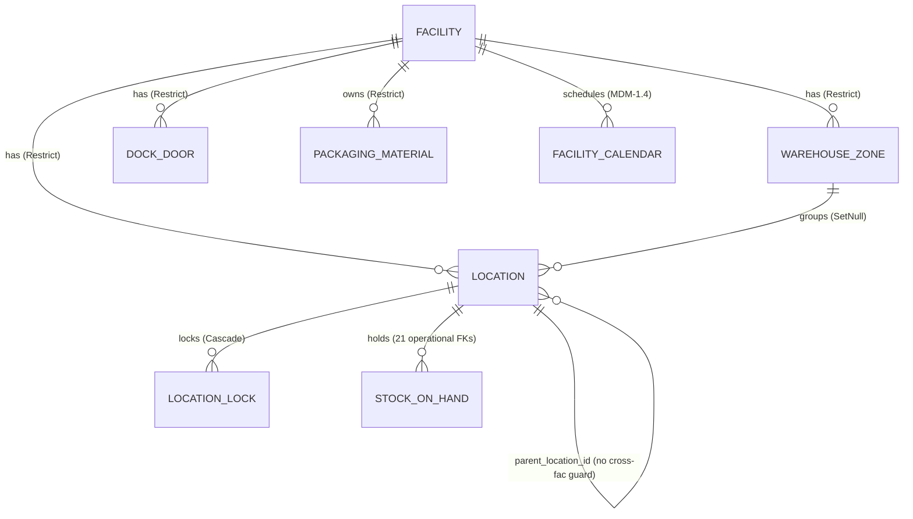
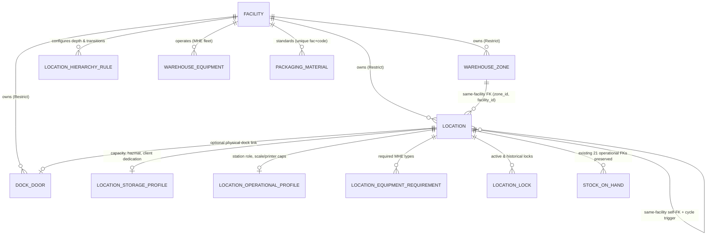
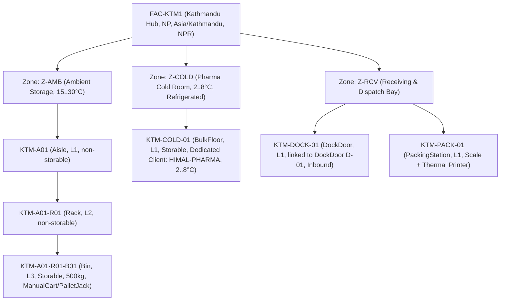
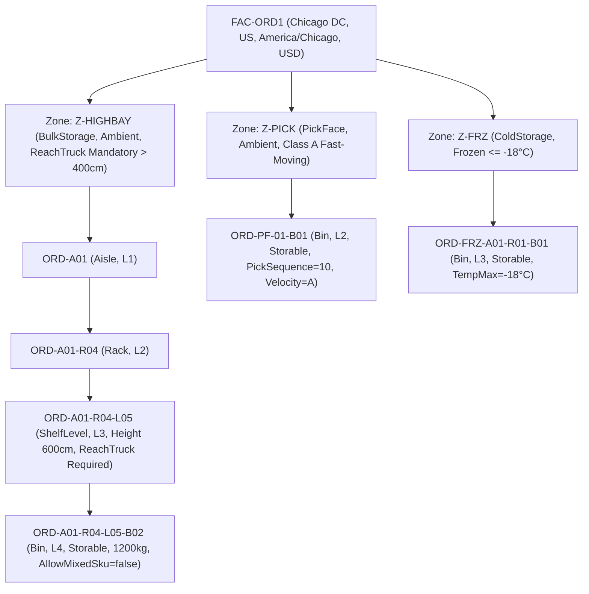

# Nexus3PL — MDM-2.1 Warehouse Master & Location Hierarchy Design Study

**Document Status:** Approved & Implemented (Option C + Mandatory Architectural Conditions **A01–A07**)  
**Workstream:** `MDM-2.0` / `MDM-2.1` — Warehouse Master & Physical Location Hierarchy  
**Branch:** `feature/phase-7-enterprise-frontend`  
**Authoritative Accepted Baseline SHA:** `c1723711be66c8f5e0d882b8d9c5d359d881d039`  
**Companion Documents:**
- [MDM_2_0_Discovery_And_Gap_Audit.md](MDM_2_0_Discovery_And_Gap_Audit.md)
- [MDM_2_Implementation_Plan_And_Design.md](MDM_2_Implementation_Plan_And_Design.md)
- [MDM_2_1_Warehouse_Master_And_Location_Hierarchy_Implementation_Report.md](MDM_2_1_Warehouse_Master_And_Location_Hierarchy_Implementation_Report.md)  
**Date:** November 27, 2026

---

## 1. Executive Summary & Architectural Recommendation

The current Nexus3PL database already stores physical locations in `locations` (with a self-referencing `parent_location_id` FK and `zone_id` FK to `warehouse_zones`) and has **21 enforced operational tables** referencing `locations.location_id` plus **3 enforced tables** (`locations`, `cycle_counts`, `pick_waves`) referencing `warehouse_zones.zone_id` (plus 7 analytics tables).

After comparing **Option A (Separate `WarehouseZone` + Flat/Legacy `Location`)**, **Option B (Pure Unified Self-Referencing Hierarchy replacing `WarehouseZone`)**, and **Option C (Hybrid Model: Operational `WarehouseZone` + Evolved Self-Referencing Physical `Location` Hierarchy + Separated Profile Tables)**, this design recommends **Option C**:

- **Honors the User's Clean Self-Referencing Hierarchy Preference:** Evolves the existing `locations` table cleanly with `location_name`, `remarks`, `status` (`LocationStatus` enum), `hierarchy_level`, `hierarchy_path`, and composite cross-facility parent isolation — without dropping `locations.location_id` or rewriting 21 operational foreign keys.
- **Retains `warehouse_zones` as First-Class Operational & Thermal Control Boundaries:** Preserves `pick_waves.zone_id`, `cycle_counts.zone_id`, `slotting_policies.zone_id`, `labor_standard_profiles.zone_id`, and zone-level temperature bands (`temp_min_c`, `temp_max_c`, `storage_temp_class`, hazmat/bonded flags) without forcing every logical operational zone to duplicate physical rack/floor hierarchy semantics.
- **Prevents God-Table Bloat:** Keeps `locations` focused on structural identity, coordinates, and fast picking/putaway indexing, while placing specialized storage compatibility, station/operational capabilities, hierarchy transition rules, and MHE equipment requirements into clean, dedicated companion tables.

---

## 2. Comparative Design Study (Option A vs. Option B vs. Option C)

| Evaluation Criterion | Option A: Existing Separate `WarehouseZone` + `Location` | Option B: Pure Unified Self-Referencing Hierarchy (Retire `WarehouseZone`) | **Option C (Recommended): Hybrid Operational `WarehouseZone` + Evolved Self-Referencing `Location` + Separated Profiles** |
| :--- | :--- | :--- | :--- |
| **Preserves Existing 21 `location_id` & 3 `zone_id` FKs** | Yes | **No** — requires migrating `pick_waves.zone_id`, `cycle_counts.zone_id`, `slotting_policies.zone_id`, `labor_standard_profiles.zone_id`, and 5 analytics tables to `location_id` | **Yes — 100% backward-compatible** with zero FK rewrites on closed Phase 7.3/7.4 tables |
| **Supports Arbitrary Configurable Depth (e.g., Floor → Zone → Aisle → Rack → Level → Bin)** | Weak — `BatchGenerateLocations` skips `ShelfLevel`; no hierarchy rules or cycle/cross-facility DB guards | Strong — arbitrary N-level tree | **Strong** — arbitrary configurable depth via `locations.parent_location_id` + `location_hierarchy_rules` + `hierarchy_path` |
| **Operational Zone Semantics (Pick Waves, Cycle Counts, Temp Bands, Labor Standards)** | Native via `warehouse_zones` | Awkward — mixes logical pick/thermal zones with physical containers; a physical aisle cannot easily belong to a logical cycle-count/pick-wave zone without overloading tree ancestry | **Native & Clean** — `warehouse_zones` governs operational/thermal boundaries; `locations.zone_id` binds any physical subtree to its operational zone |
| **Minimal Self-Referencing Structural Clarity** | Cluttered — `Location` mixes 5 boolean flags, capacities, and coordinates without `Name`/`Remarks`/`Status` | Clean structural core, but loses `WarehouseZone` operational separation | **Clean** — adds `location_name`, `remarks`, `status`, `hierarchy_level`, `hierarchy_path` to `locations` and moves specialized compatibility/station/equipment rules to companion tables |
| **Cross-Facility Isolation & Cycle Prevention** | **Missing today** (`CreateLocationCommand` skips both!) | Requires composite FK + trigger | **Enforced in PostgreSQL** via composite FK `(parent_location_id, facility_id) -> (location_id, facility_id)`, `CHECK (parent_location_id <> location_id)`, and cycle-prevention trigger |
| **Migration & Rollback Risk** | Low, but leaves structural gaps unresolved | **High** — destructive zone table retirement & multi-table FK migration | **Low / Additive** — zero destructive drops; existing rows backfilled deterministically with clean `Down()` rollback |

---

## 3. Evaluation of User's Minimal Self-Referencing Table & Property Separation

The user's preference for a clean self-referencing hierarchy core (`Id`, `FacilityId`, `ParentLocationId`, `LocationCode`, `LocationName`, `LocationType/Level`, `Remarks`, `Status`) is architecturally sound for **structural hierarchy navigation**. However, **not every operational property belongs in the same hierarchy table**: packing hazmat compatibility, temperature tolerances, printer/scale hardware, and MHE certification requirements into `locations` creates sparse nullable columns and violates Single Responsibility.

### Property Placement Matrix

| Property Category | Authoritative Table | Exact Columns / Ownership | Rationale |
| :--- | :--- | :--- | :--- |
| **1. Structural Hierarchy & Identity** | `locations` *(existing, extended)* | `location_id` (PK), `facility_id` (FK), `zone_id` (nullable FK), `parent_location_id` (self-FK), `location_code`, `location_name`, `barcode`, `location_type`, `hierarchy_level`, `hierarchy_path`, `is_storable`, `status` (`LocationStatus`), `remarks`, `aisle_code`, `rack_code`, `shelf_level`, `bin_number`, `x_coord`, `y_coord`, `z_coord`, `pick_sequence`, `is_deleted` | Core physical tree, fast pick-path sorting (`pick_sequence`), and spatial coordinates (`SerpentineRouteOptimizer`) stay single-table without extra joins on hot RF paths. |
| **2. Configurable Hierarchy Rules** | `location_hierarchy_rules` *(new)* | `rule_id`, `facility_id` (nullable = global default), `parent_location_type`, `child_location_type`, `max_depth`, `is_storable_leaf`, `is_active` | Governs valid parent→child transitions (e.g., `Zone -> Aisle -> Rack -> ShelfLevel -> Bin` or `Building -> Floor -> BulkFloor`) per facility without hardcoding C# switches. |
| **3. Location Capacity & Dimensions** | `locations` *(existing canonical metric columns retained for hot Putaway/Slotting queries)* + optional `location_capacity_profiles` *(if multi-HU/pallet/weight-tier limits needed)* | Retained on `locations`: `length_cm`, `width_cm`, `height_cm`, `max_vol_cm3`, `max_weight_kg`. Added in `location_storage_profiles`: `max_handling_units`, `max_sku_count`, `allow_mixed_sku`, `allow_mixed_lot` | Retaining existing `max_weight_kg`/`max_vol_cm3` on `locations` preserves zero-join speed in `PutawayLocationSelector` and `SlottingOptimizationService`, while moving policy/capacity caps (`MaxHandlingUnits`, `AllowMixedSku`, `AllowMixedLot`) to `location_storage_profiles`. |
| **4. Storage Compatibility & Temperature Controls** | `warehouse_zones` *(existing, extended)* + `location_storage_profiles` *(new, 1:0..1 with `locations`)* | `warehouse_zones`: `zone_type`, `storage_temp_class`, `temp_min_c`, `temp_max_c` (`CHECK temp_max_c >= temp_min_c`), `is_hazmat_approved`, `is_bonded`, `dedicated_client_id`. `location_storage_profiles`: `storage_temp_class_override`, `temp_min_c_override`, `temp_max_c_override`, `allowed_hazard_classes_csv`, `velocity_class`, `dedicated_client_id`, `is_putaway_allowed` | Zone sets the thermal/regulatory envelope; `location_storage_profiles` allows bin/rack-level restrictions (e.g., hazmat cage, dedicated client rack) that can only **tighten**, never weaken, zone safety bounds. |
| **5. Operational Usage & Stations** | `dock_doors` *(existing + nullable `location_id` FK)* + `location_operational_profiles` *(new, 1:0..1 for stations/docks)* | `location_operational_profiles`: `location_id` (PK/FK), `station_role` (`Receiving`, `Packing`, `Dispatch`, `QualityInspection`, `Returns`), `supports_scale`, `supports_label_printer`, `max_concurrent_sessions`, `default_staging_location_id` | Cleanly models Receiving/Packing/Dispatch station capabilities without cluttering storage bin rows; links `DockDoor` to its physical `Location` node. |
| **6. Inventory & Stock Relationships** | Existing operational tables (`stock_on_hand`, `handling_units`, `inventory_transactions`, `inventory_allocations`, `inventory_serials`, `putaway_tasks`, `pick_tasks`, etc.) | All **21 existing `location_id` FKs** remain untouched | Inventory facts live strictly in inventory tables; `locations` never embeds mutable stock totals. |
| **7. Equipment & Access Requirements** | `warehouse_equipment` *(new)* + `location_equipment_requirements` *(new)* | `warehouse_equipment`: `equipment_id`, `facility_id`, `equipment_code`, `name`, `equipment_type` (`WarehouseEquipmentType`), `max_lift_height_cm`, `max_load_kg`, `requires_certification`, `status`. `location_equipment_requirements`: `location_id`, `equipment_type`, `is_mandatory` | Decouples MHE fleet assets and high-bay/reach-truck aisle requirements from `locations`. |

---

## 4. Verification of All 11 Mandatory Invariants

1. **Cross-Facility Parent-Child Isolation:** Add unique constraint `uq_locations_id_facility (location_id, facility_id)` on `locations` and enforce composite self-FK `fk_locations_parent_same_facility FOREIGN KEY (parent_location_id, facility_id) REFERENCES locations (location_id, facility_id) ON DELETE RESTRICT`. PostgreSQL itself makes cross-facility parenting **physically impossible**. Similarly enforce `fk_locations_zone_same_facility (zone_id, facility_id) -> warehouse_zones (zone_id, facility_id)`.
2. **Cycle Prevention:**
   - Immediate self-cycle blocked by `CHECK (parent_location_id IS NULL OR parent_location_id <> location_id)`.
   - Multi-hop cycle (`A -> B -> C -> A`) blocked by PostgreSQL `BEFORE INSERT OR UPDATE OF parent_location_id` trigger using `WITH RECURSIVE` ancestry traversal (and mirrored in C# domain/command validation) + maximum depth guard (`<= 10` levels).
3. **Valid Hierarchy Relationships:** Enforced in `CreateLocationCommand` / `UpdateLocationCommand` / `MoveLocationCommand` against `location_hierarchy_rules` (facility override -> global default), rejecting invalid parent→child combinations (e.g., `Bin -> Aisle`) with `422 Unprocessable Entity`.
4. **Configurable Hierarchy Depth:** `location_hierarchy_rules` allows Facility A (e.g., Kathmandu 4-level `Zone -> Aisle -> Rack -> Bin`) and Facility B (e.g., Chicago 6-level `Building -> Zone -> Aisle -> Rack -> ShelfLevel -> Bin`) to coexist cleanly in the same schema.
5. **Unique Location Codes:** Replace unfiltered `ix_locations_facility_id_location_code` with partial unique index `WHERE is_deleted = false` on `(facility_id, UPPER(BTRIM(location_code)))` and `(facility_id, UPPER(BTRIM(barcode)))` (when `barcode IS NOT NULL`).
6. **Active / Inactive Lifecycle:** Introduce `LocationStatus` (`Active = 1`, `Inactive = 2`, `Maintenance = 3`, `Blocked = 4`, `Decommissioned = 5`) synchronized with legacy `IsActive`/`IsLocked`/`IsDamaged` booleans so existing Phase 7.3/7.4 queries continue working seamlessly.
7. **Prevention of Unsafe Deletion / Deactivation:** Deactivating or soft-deleting a `Location` or `WarehouseZone` returns `409 Conflict` if any of the following exist:
   - Active `StockOnHand` (`QtyOnHand > 0 || QtyAllocated > 0 || QtyQuarantined > 0 || QtyOnHold > 0 || QtyDamaged > 0`),
   - Active `HandlingUnit` (`Status != Consumed && Status != Shipped`),
   - Open `PutawayTask`, `PickTask`, `CrossDockTask`, `PackingSession`, `CycleCountItem`, or `InventoryAllocation`,
   - Active child `Location` rows (must deactivate/move children first).
8. **Inventory References & Stock Preservation:** All 21 existing `location_id` FKs remain `DeleteBehavior.Restrict`; historical `InventoryTransaction`, `DailyInventorySnapshotRecord`, and `SlottingRecommendation` records remain immutable and readable even if a location is later `Decommissioned`.
9. **Directed Putaway & Picking Compatibility:** `PutawayLocationSelector`, `PutawaySafetyValidator`, `AllocationCandidateFilter`, and `SerpentineRouteOptimizer` continue reading `locations` (`zone_id`, `pick_sequence`, `x/y/z`, `max_weight_kg`, `max_vol_cm3`, `is_active`, `is_pickable`, `is_locked`, `is_damaged`) with zero breaking changes, while gaining `is_storable` and `location_storage_profiles` enforcement.
10. **Existing Location IDs, Foreign Keys & Historical Transactions:** Zero `location_id` or `zone_id` UUIDs are regenerated or remapped.
11. **Migration & Rollback Safety:** Purely additive columns with safe defaults (`status = 'Active'`, `location_name = location_code`, `is_storable` derived from `location_type`), deterministic `hierarchy_level` / `hierarchy_path` backfill via recursive CTE, and clean `Down()` dropping only newly added columns/tables/constraints.

---

## 5. Existing vs. Proposed ER Diagrams

### 5.1 Existing Warehouse Layout ER Diagram (`c1723711`)



### 5.2 Proposed MDM-2.1 Hybrid Warehouse Master & Location Hierarchy ER Diagram



---

## 6. Proposed PostgreSQL Table Definitions (Additive DDL)

### 6.1 Evolved `locations` Table (Additive Columns & Constraints)
```sql
ALTER TABLE locations
    ADD COLUMN location_name VARCHAR(200) NOT NULL DEFAULT '',
    ADD COLUMN status VARCHAR(30) NOT NULL DEFAULT 'Active',
    ADD COLUMN hierarchy_level INT NOT NULL DEFAULT 1,
    ADD COLUMN hierarchy_path VARCHAR(600) NOT NULL DEFAULT '',
    ADD COLUMN is_storable BOOLEAN NOT NULL DEFAULT true,
    ADD COLUMN remarks VARCHAR(500) NULL;

-- Backfill existing rows deterministically
UPDATE locations
SET location_name = CASE WHEN BTRIM(location_name) = '' THEN location_code ELSE location_name END,
    status = CASE
        WHEN NOT is_active THEN 'Inactive'
        WHEN is_damaged THEN 'Maintenance'
        WHEN is_locked THEN 'Blocked'
        ELSE 'Active'
    END,
    is_storable = (location_type IN ('Bin', 'BulkFloor', 'Mezzanine', 'Cantilever', 'StagingLane'));

-- Same-facility composite uniqueness & cross-facility parent isolation
ALTER TABLE locations ADD CONSTRAINT uq_locations_id_facility UNIQUE (location_id, facility_id);
ALTER TABLE warehouse_zones ADD CONSTRAINT uq_warehouse_zones_id_facility UNIQUE (zone_id, facility_id);

ALTER TABLE locations ADD CONSTRAINT ck_locations_no_self_parent
    CHECK (parent_location_id IS NULL OR parent_location_id <> location_id);
ALTER TABLE locations ADD CONSTRAINT ck_locations_hierarchy_level
    CHECK (hierarchy_level BETWEEN 1 AND 10);
ALTER TABLE locations ADD CONSTRAINT fk_locations_parent_same_facility
    FOREIGN KEY (parent_location_id, facility_id) REFERENCES locations (location_id, facility_id) ON DELETE RESTRICT;
ALTER TABLE locations ADD CONSTRAINT fk_locations_zone_same_facility
    FOREIGN KEY (zone_id, facility_id) REFERENCES warehouse_zones (zone_id, facility_id) ON DELETE RESTRICT;
```

### 6.2 New Companion Tables (`MDM-2.1`)
```sql
CREATE TABLE location_hierarchy_rules (
    rule_id UUID PRIMARY KEY,
    facility_id UUID NULL REFERENCES facilities(facility_id) ON DELETE RESTRICT,
    parent_location_type VARCHAR(50) NULL,
    child_location_type VARCHAR(50) NOT NULL,
    max_depth INT NOT NULL DEFAULT 6 CHECK (max_depth BETWEEN 1 AND 10),
    is_storable_leaf BOOLEAN NOT NULL DEFAULT false,
    is_active BOOLEAN NOT NULL DEFAULT true,
    config_revision BIGINT NOT NULL DEFAULT 1,
    created_at TIMESTAMPTZ NOT NULL,
    created_by VARCHAR(100) NULL,
    updated_at TIMESTAMPTZ NULL,
    updated_by VARCHAR(100) NULL
);

CREATE TABLE location_storage_profiles (
    location_id UUID PRIMARY KEY REFERENCES locations(location_id) ON DELETE CASCADE,
    facility_id UUID NOT NULL REFERENCES facilities(facility_id) ON DELETE RESTRICT,
    storage_temp_class_override VARCHAR(30) NULL,
    temp_min_c_override NUMERIC(5,2) NULL,
    temp_max_c_override NUMERIC(5,2) NULL,
    allowed_hazard_classes_csv VARCHAR(200) NULL,
    velocity_class VARCHAR(10) NULL,
    dedicated_client_id UUID NULL REFERENCES clients(client_id) ON DELETE RESTRICT,
    max_handling_units INT NULL CHECK (max_handling_units IS NULL OR max_handling_units > 0),
    max_sku_count INT NULL CHECK (max_sku_count IS NULL OR max_sku_count > 0),
    allow_mixed_sku BOOLEAN NOT NULL DEFAULT true,
    allow_mixed_lot BOOLEAN NOT NULL DEFAULT true,
    is_putaway_allowed BOOLEAN NOT NULL DEFAULT true,
    config_revision BIGINT NOT NULL DEFAULT 1,
    CONSTRAINT ck_loc_storage_temp_band CHECK (temp_min_c_override IS NULL OR temp_max_c_override IS NULL OR temp_max_c_override >= temp_min_c_override)
);

CREATE TABLE location_operational_profiles (
    location_id UUID PRIMARY KEY REFERENCES locations(location_id) ON DELETE CASCADE,
    facility_id UUID NOT NULL REFERENCES facilities(facility_id) ON DELETE RESTRICT,
    station_role VARCHAR(40) NOT NULL,
    supports_scale BOOLEAN NOT NULL DEFAULT false,
    supports_label_printer BOOLEAN NOT NULL DEFAULT false,
    supports_conveyor BOOLEAN NOT NULL DEFAULT false,
    max_concurrent_sessions INT NOT NULL DEFAULT 1 CHECK (max_concurrent_sessions >= 1),
    default_staging_location_id UUID NULL,
    FOREIGN KEY (default_staging_location_id, facility_id) REFERENCES locations(location_id, facility_id) ON DELETE RESTRICT
);

CREATE TABLE warehouse_equipment (
    equipment_id UUID PRIMARY KEY,
    facility_id UUID NOT NULL REFERENCES facilities(facility_id) ON DELETE RESTRICT,
    equipment_code VARCHAR(50) NOT NULL,
    name VARCHAR(150) NOT NULL,
    equipment_type VARCHAR(40) NOT NULL,
    serial_number VARCHAR(100) NULL,
    max_lift_height_cm NUMERIC(10,2) NULL,
    max_load_kg NUMERIC(10,2) NULL,
    requires_certification BOOLEAN NOT NULL DEFAULT false,
    status VARCHAR(30) NOT NULL DEFAULT 'Active',
    remarks VARCHAR(500) NULL,
    is_deleted BOOLEAN NOT NULL DEFAULT false,
    created_at TIMESTAMPTZ NOT NULL,
    updated_at TIMESTAMPTZ NULL
);
CREATE UNIQUE INDEX uq_warehouse_equipment_fac_code ON warehouse_equipment (facility_id, UPPER(BTRIM(equipment_code))) WHERE is_deleted = false;

CREATE TABLE location_equipment_requirements (
    requirement_id UUID PRIMARY KEY,
    location_id UUID NOT NULL REFERENCES locations(location_id) ON DELETE CASCADE,
    equipment_type VARCHAR(40) NOT NULL,
    is_mandatory BOOLEAN NOT NULL DEFAULT true,
    UNIQUE (location_id, equipment_type)
);
```
*(Plus additive `warehouse_zones` columns: `storage_temp_class`, `is_hazmat_approved`, `is_bonded`, `dedicated_client_id`, `config_revision`, `CHECK (temp_min_c IS NULL OR temp_max_c IS NULL OR temp_max_c >= temp_min_c)`; additive `dock_doors.location_id` nullable FK; additive `packaging_materials.currency_code` + filtered unique `(facility_id, UPPER(BTRIM(code)))`.)*

---

## 7. Concrete Multi-Facility Examples

### 7.1 Kathmandu Facility (`FAC-KTM1`, `NP` — 4-Level Compact Urban 3PL Hierarchy)


### 7.2 Chicago Facility (`FAC-ORD1`, `US` — 5-Level High-Bay Distribution Hierarchy)


---

## 8. Decisions Requiring Independent Approval Before `MDM-2.1` Implementation

| ID | Decision | Proposed Default |
| :-: | :--- | :--- |
| **`MDM21-D01`** | **Location Hierarchy Architecture** | Approve **Option C (Hybrid)**: retain `warehouse_zones` + evolve `locations` self-referencing hierarchy with composite same-facility FK, cycle-prevention trigger, `location_hierarchy_rules`, and separated companion profile tables (`location_storage_profiles`, `location_operational_profiles`, `warehouse_equipment`, `location_equipment_requirements`). |
| **`MDM21-D02`** | **Legacy Flag Synchronization** | Keep `Location.IsActive`, `IsLocked`, `IsDamaged` synchronized with the new `LocationStatus` enum during `MDM-2` so all Phase 7.3/7.4 queries remain zero-breaking. |
| **`MDM21-D03`** | **`WarehouseZone.OnDelete` Hardening** | Change `locations.zone_id` FK from `SetNull` to `Restrict` (after verifying zero orphaned rows) so zones with active locations cannot be silently orphaned. |
| **`MDM21-D04`** | **DockDoor Length Units** | Retain `dock_doors.max_trailer_length_feet` for backward compatibility while adding canonical `max_trailer_length_cm` (converted via canonical `30.48 cm/ft` factor). |

---

## 9. Approved Mandatory Architectural Conditions (A01–A07)

The independent design review approved **Option C** subject to mandatory conditions **A01–A07**, which supersede any draft details in Sections 3–6 above:

- **A01 — Orthogonal Lifecycle, Locks & Damage:** `LocationStatus` is strictly administrative (`Active`, `Inactive`, `Decommissioned`) and synchronized only with `IsActive`. Operational locks (`LocationLock` / `IsLocked`) and physical damage (`IsDamaged`) are orthogonal; administrative reactivation (`Inactive -> Active`) **never** implicitly releases locks or clears damage. Individual locks can be released independently via `POST /api/v1/locations/{id}/locks/{lockId}/release`, recomputing `IsLocked` from remaining active locks. `IsPickable`, `IsReceiving`, and `IsStorable` remain independent.
- **A02 — Database & Concurrency-Safe Hierarchy Integrity:** Composite same-facility FKs `(parent_location_id, facility_id)` and `(zone_id, facility_id)`, `CHECK (parent_location_id IS NULL OR parent_location_id <> location_id)`, PostgreSQL recursive trigger `trg_locations_prevent_cycle` (`BEFORE INSERT OR UPDATE OF parent_location_id`), per-facility transactional advisory lock (`pg_advisory_xact_lock`) serializing concurrent opposite reparenting (`A->B` vs `B->A`), server-derived `hierarchy_level` (1..10) and stable ID-based `hierarchy_path` (`/{id:N}/...`) with atomic descendant recalculation, and 4 partial unique indexes on `location_hierarchy_rules` covering nullable `facility_id` and nullable `parent_location_type` with deterministic facility-over-global precedence.
- **A03 — Permanent Normalized Code & Barcode Uniqueness:** Facility-scoped unique indexes on `normalized_location_code`, `normalized_barcode`, `normalized_zone_code`, `normalized_door_number`, and `normalized_equipment_code` are **permanent** (not `WHERE is_deleted = false`), preventing reuse of soft-deleted codes/barcodes. Codes are immutable by default.
- **A04 — Configurable Topologies Over Existing `LocationType`:** Existing `LocationType` enum values are preserved; `hierarchy_level` is the derived tree depth (1..10), not the enum integer value. Seeded global rules support both compact layouts (`FAC-KTM1`) and deep high-bay layouts (`FAC-ORD1`), with facility-specific overrides.
- **A05 — Cross-Facility, Tenant & Scope Isolation:** Same-facility composite FKs enforced across parent locations, zones, `location_storage_profiles`, `location_operational_profiles` (including `default_staging_location_id`), `location_equipment_requirements`, and `dock_doors.location_id`. `DedicatedClientId` and client-owned `PackagingMaterial.ClientId` require an active `Client` with active `ClientFacilityAccess`. `PackagingMaterial` uses deterministic partial unique indexes for facility-wide (`client_id IS NULL`) vs client-specific (`client_id IS NOT NULL`). Server-side `WarehouseMasterAuthorization` enforces DB-verified Staff/SuperAdmin/AssignedFacility and rejects conflicting `X-Facility-Id` header vs request `FacilityId` with `400`.
- **A06 — Active Operational Enforcement Only (No Dead Fields):** `location_storage_profiles` exposes only fields actively enforced by `PutawayLocationSelector` and `PutawaySafetyValidator` (`DedicatedClientId`, `MaxHandlingUnits`, `AllowMixedSku`, `AllowMixedLot`, `IsPutawayAllowed`), alongside `Location.IsStorable`, `Location.Status == Active`, and `WarehouseZone.DedicatedClientId`. Thermal/hazmat bin overrides are deferred to `MDM-2.4` (no CSV hazard strings), and `MDM-0.4` temperature safety floors are never weakened.
- **A07 — Fail-Closed Migration, Concurrency Guards & FK Preservation:** Pre-cutover `DO $$` guard fails closed on cycles, cross-facility links, orphans, normalized collisions, invalid zone temperature bounds, or stock in non-storable structural nodes before altering schema. All 21 existing `location_id` FKs and 3 `zone_id` FKs are preserved. Location deactivation is serialized via `ExecuteWithLocationLifecycleLockAsync` (`pg_advisory_xact_lock` + `SELECT ... FOR UPDATE`) against concurrent stock/HU/task placement.

---

## 10. Independent Acceptance Remediation Clarifications (MDM21-R01–R06)

Following independent source and CI review of `9ae6644b0c4f5068dac293b2add8bae05fe4412e`, six targeted hardening refinements were applied via additive corrective migration `20261127150334_MDM2_1_R01_R06_ConcurrencyAndLifecycleGuards`:

- **R01 — Complete 6-Bucket Stock & Operational Dependency Guard:** Centralized `WarehouseInventoryDependencyGuard` evaluates all six `StockOnHand` quantity buckets (`QtyAvailable`, `QtyAllocated`, `QtyReserved`, `QtyQuarantined`, `QtyDamaged`, `QtyOnHold`) plus all physically present non-deleted `HandlingUnits` (including `Damaged`), open `PutawayTasks` (source/suggested/actual), open `PickTasks` (source/destination), open `CrossDockTasks` (source/destination/actual), open `PackingSessions`, unreconciled open `CycleCountItems`, active `InventoryAllocations`, and active child locations across location deactivation, `IsStorable = false`, zone deactivation, facility deactivation, and migration preflight.
- **R02 — Full Subtree Rule & `MaxDepth` Enforcement + Serialized Rule Mutations:** `MoveLocationCommandHandler` validates **every** affected descendant against its effective `LocationHierarchyRule` and configurable `MaxDepth`. `LocationHierarchyRuleEvaluator` enforces `IsStorableLeaf` (`StagingLane` aligned as storable leaf alongside `Bin`, `BulkFloor`, `Cantilever`). Rule mutations acquire `pg_advisory_xact_lock('GLOBAL_HIERARCHY_RULES')` (global) or `pg_advisory_xact_lock_shared('GLOBAL_HIERARCHY_RULES')` + `pg_advisory_xact_lock('FACILITY_HIERARCHY:' || facilityId)` (facility) and reject any rule change that would silently invalidate existing locations.
- **R03 — Active Operational Enforcement & Deferred Unsupported Mandatory Settings:** `AllocationCandidateFilter` enforces `Location.IsStorable`; `TransferInventoryCommand` acquires destination lifecycle locks and validates `PutawaySafetyValidator` (active, unlocked, undamaged, storable, zone/location dedicated client, `IsPutawayAllowed`, `AllowMixedSku`, `AllowMixedLot`, `MaxHandlingUnits`); `ConfirmCrossDockTaskCommand` validates active/unlocked/undamaged destination under lock; profile/zone dedication changes contradicting existing stock, HUs, or zone dedication are rejected. `LocationEquipmentRequirement.IsMandatory = true` and `LocationOperationalProfile.MaxConcurrentSessions != 1` are explicitly rejected (`400`) until equipment/session runtime enforcement is implemented; advisory `IsMandatory = false` and `MaxConcurrentSessions = 1` remain supported.
- **R04 — Canonical Lock Ordering & Database Trigger Hardening:** All concurrent hierarchy/lifecycle/stock operations follow strict canonical order `GlobalHierarchyRules -> FacilityHierarchy(facilityId) -> LocationLifecycle(locationId) -> StockOnHand(stockId)`. Active children under inactive/decommissioned parents/ancestors and bindings to inactive zones are rejected. `GeneratePutawayTasksCommand` locks and re-verifies each destination location inside a transaction before creating `PutawayTask`. `fn_locations_prevent_cycle()` acquires `pg_advisory_xact_lock('FACILITY_HIERARCHY:' || NEW.facility_id)` to serialize direct-SQL opposite reparenting.
- **R05 — Permanent Barcode Identity:** Existing location barcodes are immutable by default (`LOCATION_IMMUTABLE_BARCODE`), allowing only case/whitespace-normalized identical values while preserving permanent normalized uniqueness including soft-deleted rows.
- **R06 — Active Facility Scope & Historical Read Separation:** `WarehouseMasterAuthorization.ResolveAuthorizedFacilityAsync` enforces `Facility.IsActive == true` (`FACILITY_INACTIVE`) on all mutations while `ResolveAuthorizedFacilityReadAsync` preserves authorized historical reads on inactive facilities. `DefaultStagingLocationId` requires an active same-facility `StagingLane`/`IsReceiving` location, and `DockDoor.LocationId` requires an active same-facility `DockDoor` location.

