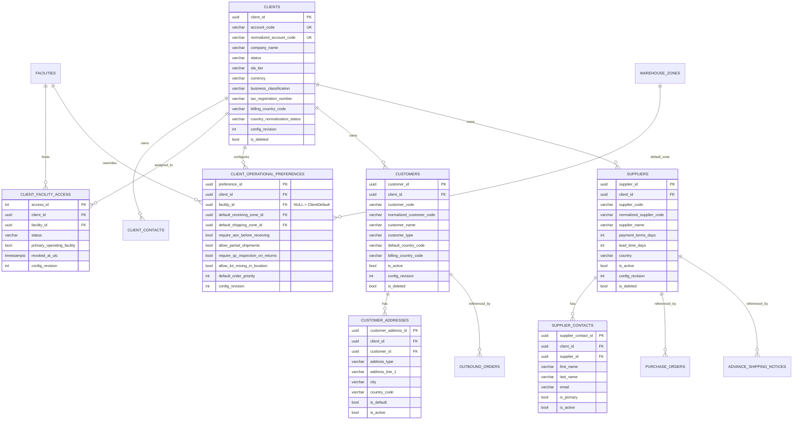
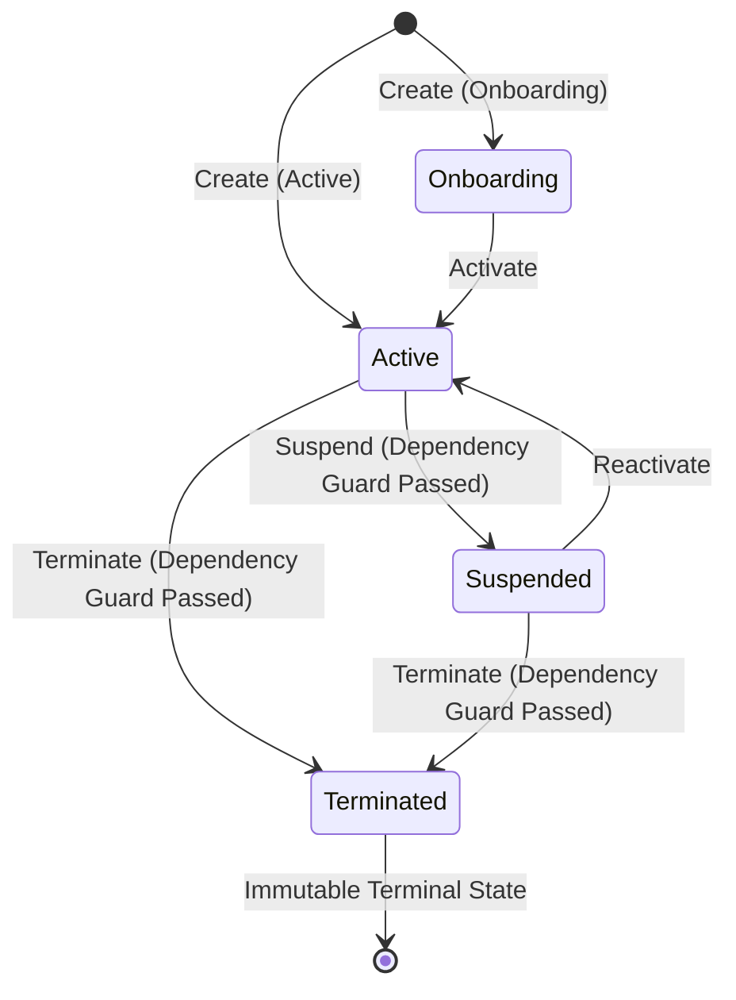
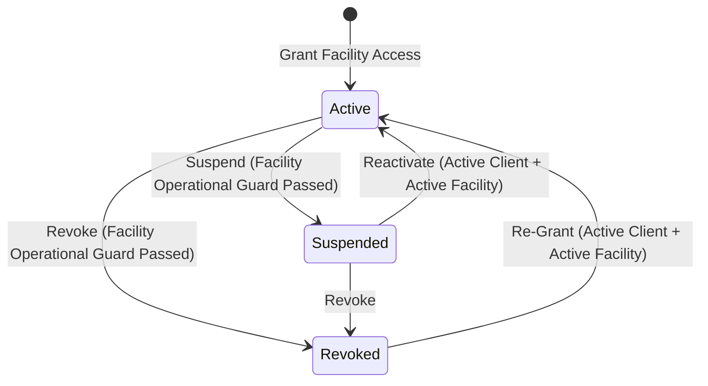

# MDM-2.2 — Client, Customer & Supplier Master Data Specification

**Workstream:** Nexus3PL Enterprise Master Data Management (MDM-2)  
**Stage:** MDM-2.2 — Client, Customer & Supplier Master Data  
**Authoritative Baseline:** `3c1a03ba7c1fc8cf67ca6ca244be75c5475d45d6` (MDM-2.1 Accepted Closure)  
**Additive Migration:** `20261128061719_MDM2_2_ClientCustomerSupplierAndPreferences`

---

## 1. Domain Scope & Entity Relationship Diagram (ERD)

MDM-2.2 completes the authoritative master data layer for 3PL Tenants (`Client`), Client Contacts (`ClientContact`), Client-Facility Assignments (`ClientFacilityAccess`), Structured Operational Preferences (`ClientOperationalPreference`), Client-Owned Customers (`Customer` + `CustomerAddress`), and Client-Owned Suppliers (`Supplier` + `SupplierContact`), while preserving all existing primary keys, foreign keys, and historical operational snapshots.

---

## 2. Ownership, Uniqueness & Immutability Rules

| Entity | Ownership Scope | Permanent Unique Key | Immutability Rule |
|---|---|---|---|
| `Client` | Platform Root Tenant (`client_id`) | `ux_clients_normalized_account_code` (`UPPER(BTRIM(account_code))`, includes soft-deleted rows) | `AccountCode` immutable after creation (`CLIENT_CODE_IMMUTABLE`); `Terminated` cannot be reactivated |
| `ClientContact` | Owned by `Client` (`client_id`) | PK `contact_id` | Soft-deletable (`is_deleted = true`, `is_active = false`); optimistic concurrency via `config_revision` |
| `ClientFacilityAccess` | Platform assignment (`client_id`, `facility_id`) | `UNIQUE (client_id, facility_id)` + partial `ux_client_facility_access_primary_active` (`WHERE primary_operating_facility = TRUE AND status = 'Active'`) | At most one active `PrimaryOperatingFacility` per client; serialized under `ExecuteWithClientFacilityAccessLockAsync` |
| `ClientOperationalPreference` | Owned by `Client`, optional `FacilityId` override | `ux_client_op_prefs_client_default` (`WHERE facility_id IS NULL`) + `ux_client_op_prefs_client_facility` (`WHERE facility_id IS NOT NULL`) | Structured operational columns only (no generic key-value bag; does not duplicate RateCards, Billing, or SLA contracts) |
| `Customer` | Tenant-owned (`client_id`) | `ux_customers_client_normalized_code` (`(client_id, UPPER(BTRIM(customer_code)))`, includes archived rows) | `CustomerCode` immutable after creation (`CUSTOMER_CODE_IMMUTABLE`); historical order/shipping address snapshots preserved |
| `CustomerAddress` | Tenant + Customer owned (`client_id`, `customer_id`) | PK `customer_address_id` | Normalized via MDM-1 `CountryProfile` + `AdministrativeDivision` + postal regex |
| `Supplier` | Tenant-owned (`client_id`) | `ux_suppliers_client_normalized_code` (`(client_id, UPPER(BTRIM(supplier_code)))`, includes archived rows) | `SupplierCode` immutable after creation (`SUPPLIER_CODE_IMMUTABLE`); fixes prior case-sensitivity defect; historical POs/ASNs preserved |
| `SupplierContact` | Tenant + Supplier owned (`client_id`, `supplier_id`) | PK `supplier_contact_id` | Soft-deletable; optimistic concurrency via `config_revision` |

---

## 3. API Contracts

### 3.1 Client Master (`/api/v1/clients`)
- `GET /api/v1/clients` — Paged list (SuperAdmin: all; Facility Staff: clients in assigned facility; Client: own record only; Driver: `403`).
- `GET /api/v1/clients/{id}` — Detail view with contacts and billing/classification fields.
- `POST /api/v1/clients` — Create client (Staff `clients:create`; validates active `CurrencyMaster`, billing address via MDM-1, permanent normalized `AccountCode`).
- `PUT /api/v1/clients/{id}` — Update client (immutable `AccountCode`, concurrency `ExpectedConfigRevision`, lifecycle dependency guard on `Suspended`/`Terminated`).
- `PATCH /api/v1/clients/{id}/status` — Explicit lifecycle transition (`Onboarding`, `Active`, `Suspended`, `Terminated`).
- `DELETE /api/v1/clients/{id}` — Safe soft-deactivation (`clients:delete`, guarded by `PartnerMasterDependencyGuard`).

### 3.2 Client Contacts (`/api/v1/clients/{clientId}/contacts`)
- `GET`, `POST`, `PUT /{contactId}`, `DELETE /{contactId}` — Post-create contact lifecycle management.

### 3.3 Client-Facility Access (`/api/v1/clients/{clientId}/facilities`)
- `GET /api/v1/clients/{clientId}/facilities` — List facility assignments.
- `POST /api/v1/clients/{clientId}/facilities` — Grant active access (`clients:manage-access`; validates active Client + active Facility; atomic primary designation).
- `PATCH /api/v1/clients/{clientId}/facilities/{facilityId}/status` — Transition `Active` / `Suspended` / `Revoked` or switch `PrimaryOperatingFacility` (dependency-guarded on `Suspended`/`Revoked`).

### 3.4 Client Operational Preferences (`/api/v1/clients/{clientId}/preferences`)
- `GET /api/v1/clients/{clientId}/preferences` — List ClientDefault + FacilityOverride preferences.
- `GET /api/v1/clients/{clientId}/preferences/effective/{facilityId}` — Resolve effective preference (`FacilityOverride` -> fallback `ClientDefault`).
- `PUT /api/v1/clients/{clientId}/preferences` — Upsert ClientDefault (`facilityId = null`) or FacilityOverride (`facilityId != null`; validates active `ClientFacilityAccess` & active same-facility zones).
- `DELETE /api/v1/clients/{clientId}/preferences/{preferenceId}` — Remove preference.

### 3.5 Customer Master (`/api/v1/customers`)
- `GET /api/v1/customers`, `GET /api/v1/customers/{id}`, `POST /api/v1/customers`, `PUT /api/v1/customers/{id}`, `PATCH /api/v1/customers/{id}/status`
- `POST /api/v1/customers/{id}/addresses`, `PUT /api/v1/customers/{id}/addresses/{addressId}`, `DELETE /api/v1/customers/{id}/addresses/{addressId}`

### 3.6 Supplier Master (`/api/v1/suppliers`)
- `GET /api/v1/suppliers`, `GET /api/v1/suppliers/{id}`, `POST /api/v1/suppliers`, `PUT /api/v1/suppliers/{id}`, `PATCH /api/v1/suppliers/{id}/status`
- `POST /api/v1/suppliers/{id}/contacts`, `PUT /api/v1/suppliers/{id}/contacts/{contactId}`, `DELETE /api/v1/suppliers/{id}/contacts/{contactId}`

---

## 4. RBAC & Tenant Isolation Matrix

Enforced centrally via DB-authoritative `PartnerMasterAuthorization`:

| Caller Identity | Clients (List/Get) | Clients (Create/Lifecycle/Access) | Client Preferences (Write) | Contacts / Customers / Suppliers | Cross-Tenant / Header Conflict |
|---|---|---|---|---|---|
| Unauthenticated | `401` | `401` | `401` | `401` | `401` |
| `Driver` | `403` | `403` | `403` | `403` | `403` |
| `Client` (no DB `ClientId`) | `403` (fail-closed) | `403` | `403` | `403` | `403` |
| `Client` (own tenant) | Own only (`200`) | `403` (read-only access/prefs) | `403` | Own tenant CRUD (`200`/`201`) | `403` cross-client; `400` conflicting `X-Tenant-Id` |
| Facility `Staff` (DB-verified perms) | Assigned facility's clients only | Assigned facility only (`clients:*`) | Assigned facility only (`clients:manage-preferences` / `clients:edit`) | Assigned facility's clients only | `403` out-of-facility; `400` conflicting `X-Tenant-Id`/`X-Facility-Id` |
| `SuperAdmin` (DB-verified role) | All (`200`) | All (`200`/`201`) | All (`200`) | All (`200`/`201`) | `400` conflicting headers; forged claim -> `403` |

---

## 5. Lifecycle Transition Diagrams

---

## 6. Operational Consumer Matrix

| Operational Writer | Master Data Validated | Enforcement Rule | Historical Preservation |
|---|---|---|---|
| `CreatePurchaseOrderCommand` | `Supplier` | Rejects deleted or inactive supplier (`SUPPLIER_INACTIVE`) | Existing POs retain `SupplierId` FK |
| `CreateAsnCommand` | `Supplier` | Rejects deleted or inactive supplier (`SUPPLIER_INACTIVE`) | Existing ASNs retain `SupplierId` FK |
| `CreateOutboundOrderCommand` | `Customer` | Rejects deleted or inactive customer (`CUSTOMER_INACTIVE`) | Existing `OutboundOrder` + `ShippingAddress` snapshots remain immutable |
| `PartnerMasterDependencyGuard` (Client & Facility Access) | `StockOnHand` (all 6 buckets), `HandlingUnit`, `OutboundOrder`, `PurchaseOrder`, `AdvanceShippingNotice`, `PutawayTask`, `PickTask`, `CrossDockTask`, `PackingSession`, `InventoryAllocation`, `ClientFacilityAccess` | Blocks `Client` deactivation/termination and `ClientFacilityAccess` suspension/revocation while active operational commitments exist | All historical records preserved; zero cascading hard deletes |
| MDM-1.5 `ConfigurationScopeMapper` | `Client`, `ClientContact`, `ClientFacilityAccess`, `ClientOperationalPreference`, `Customer`, `CustomerAddress`, `Supplier`, `SupplierContact` | Atomically increments `ConfigurationScopeEpoch` and emits `ConfigurationInvalidationEvent` outbox rows for original and destination scopes | Full multi-instance cache consistency |

---

## 7. Migration Strategy

Migration `20261128061719_MDM2_2_ClientCustomerSupplierAndPreferences` is strictly additive and reversible:
1. Adds new columns to `clients`, `client_contacts`, `client_facility_access`, `customers`, `suppliers` and creates `client_operational_preferences`, `customer_addresses`, `supplier_contacts`.
2. Executes fail-closed `DO $$` preflight collision detection across `clients` (`normalized_account_code`), `customers` (`(client_id, normalized_customer_code)`), `suppliers` (`(client_id, normalized_supplier_code)`), and `client_facility_access` (multiple active `primary_operating_facility = TRUE`).
3. Deterministically backfills `normalized_account_code`, `normalized_customer_code`, `normalized_supplier_code` via `UPPER(BTRIM(...))`.
4. Creates permanent unique indexes and partial unique indexes.
5. `Down()` cleanly reverts all MDM-2.2 tables, indexes, and columns without data loss to pre-existing tables.
