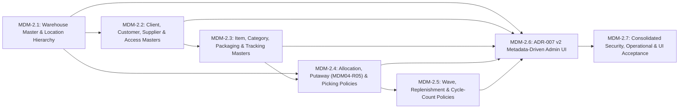
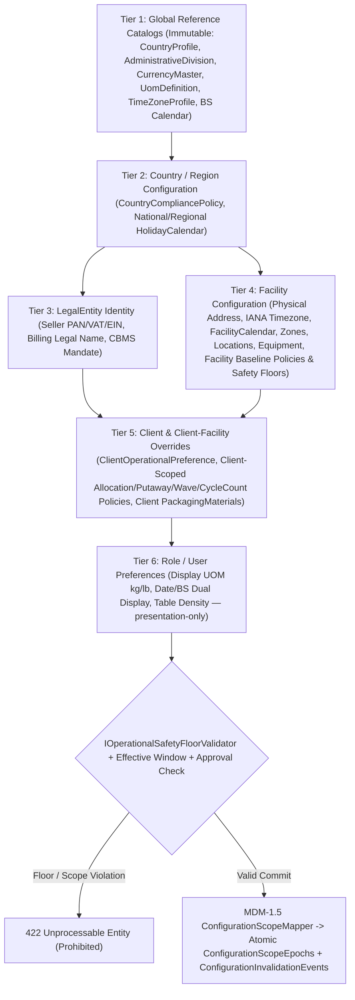

# Nexus3PL — MDM-2 Implementation Plan & Enterprise Architecture Design

**Document Status:** Architecture & Implementation Plan Only — **Do not begin `MDM-2.1` implementation until independently approved**  
**Workstream:** `MDM-2` — Warehouse, Client, Item, Operations Policies & ADR-007 v2 Metadata Administration  
**Branch:** `feature/phase-7-enterprise-frontend`  
**Authoritative Accepted Baseline SHA:** `c1723711be66c8f5e0d882b8d9c5d359d881d039`  
**Protected `main` / `origin/main`:** `a198f02090194ce4d59dec2941c89d519757f4b4`  
**Companion Documents:**
- [MDM_2_0_Discovery_And_Gap_Audit.md](MDM_2_0_Discovery_And_Gap_Audit.md)
- [MDM_2_1_Warehouse_Master_And_Location_Hierarchy_Design.md](MDM_2_1_Warehouse_Master_And_Location_Hierarchy_Design.md)  
**Date:** November 27, 2026

---

## 1. Executive Architecture & Stage Dependency Graph

`MDM-2` completes the operational master-data, operations-policy, and metadata-driven administration layers on top of accepted `MDM-0` and `MDM-1` foundations — **without duplicating existing tables, rewriting closed Phase 7.3/7.4 workflows, or replacing hand-crafted execution workstations**.

---

## 2. Typed Configuration Hierarchy & `MDM-1.5` Consistency Integration

Nexus3PL strictly forbids collapsing unrelated masters into a single generic key-value `Settings` table. Every configuration domain uses typed, schema-enforced entities resolved through domain-specific resolvers returning `ResolvedConfigurationResult<T>` (`ExplicitValue | Inherited | ExplicitNull | Disabled | Prohibited`).

### Configuration Governance Rules
1. **Strict Ownership Separation:**
   - **Platform-Managed Reference Catalogs:** Immutable (`CountryProfile`, `AdministrativeDivision`, `CurrencyMaster`, `UomDefinition`, `BikramSambatCalendarMonth`); zero facility/client overrides.
   - **Facility-Owned Operational Configuration:** `Facility`, `WarehouseZone`, `Location`, `LocationHierarchyRule`, `DockDoor`, `WarehouseEquipment`, `FacilityCalendar`, and Facility-Baseline Operations Policies (`Putaway`, `Allocation`, `Picking`, `Wave`, `Replenishment`, `CycleCount`).
   - **Client / Client-Facility Overrides:** Bounded strictly within facility safety floors (`MinDaysBeforeExpiry`, unified `StorageTempClass` bands, `MaxWeightKg`, hazmat segregation, `MaxOverReceiveRatio`).
   - **Role / User Preferences:** Presentation-only (`DisplayUom`, `DualBsDate`, `DefaultPageSize`); never alter physical storage units (`kg`/`cm`/`cm³`) or safety rules.
2. **Effective Dating, Approval Status & `MDM-1.5` Epoch Invalidation:**
   - All mutable operations policies carry `EffectiveFromUtc`, `EffectiveToUtc`, `ApprovalStatus` (`Draft | Active | Superseded` or `IsActive` + `ConfigRevision`), and PostgreSQL `btree_gist` non-overlap constraints on active windows.
   - **Mandatory `MDM-2.1`–`MDM-2.5` Wiring:** Register `WarehouseZone`, `LocationHierarchyRule`, `LocationStorageProfile`, `ClientOperationalPreference`, `AllocationPolicy`, `PutawayStrategyRule`, `SlottingPolicy`, `ProductAffinityPolicy`, `PickingPolicy`, `WavePolicy`, `ReplenishmentPolicy`, and `CycleCountPolicy` in **`ConfigurationScopeMapper.cs`** so every mutation atomically increments `ConfigurationScopeEpochs` (`Facility`, `Client`, `Global`) and writes a `ConfigurationInvalidationEvent` outbox row in the same PostgreSQL transaction.
3. **Centralized `IOperationalSafetyFloorValidator` (Resolves Temperature & Hazmat Drift):**
   - Unifies thermal bands across Putaway, Allocation, and Slotting (`Frozen <= -18°C` hard floor, `Refrigerated 2°C..8°C`, `TemperatureControlled 15°C..25°C`, `Ambient` zone rules) and enforces `Item.HazardClass` compatibility against `WarehouseZone.IsHazmatApproved` and `LocationStorageProfile.AllowedHazardClassesCsv`.

---

## 3. Operations Policy Schema Dependency (`MDM04-R05`) Design Study

### Root Cause
`PutawayStrategyRule.ClientId` (`putaway_strategy_rules.client_id`) is currently `Guid` (non-nullable) with FK `fk_putaway_strategy_rules_clients_client_id -> clients(client_id)` (`Restrict`), and `PutawayStrategyRule` implements `ITenantEntity` (causing `ApplicationDbContext` global query filter `BypassTenantFilter || e.ClientId == CurrentTenantId`). `CreatePutawayStrategyCommandHandler` currently rejects `Guid.Empty` (`400 Bad Request`). The exact same non-nullable `ClientId` constraint also affects `AllocationPolicy`.

### Comparative Options

| Criterion | **Option 1 (Recommended): Nullable `ClientId` (`Guid?`) + Explicit `PolicyScope` Enum (`FacilityDefault = 1`, `ClientOverride = 2`)** | Option 2: Separate `facility_default_putaway_strategy_rules` Table | Option 3: Unified `putaway_policies` Header + Child Rules Table |
| :--- | :--- | :--- | :--- |
| **Eliminates Fake `Guid.Empty` Client IDs** | Yes (`ClientId IS NULL` when `PolicyScope = FacilityDefault`, enforced by DB `CHECK`) | Yes | Yes |
| **Schema & Code Reuse** | High — reuses existing `putaway_strategy_rules` and `allocation_policies` tables, DTOs, and evaluators | Medium — duplicates columns, validation, and queries across 2 tables | Low — breaks existing `PutawayStrategyRule` table & Phase 7.3/MDM-0.4 tests |
| **`ITenantEntity` Filter Safety** | Replace `ITenantEntity` with `IOptionalTenantEntity` (`Guid? ClientId`) so global filter enforces `BypassTenantFilter || e.ClientId == null || e.ClientId == CurrentTenantId` (read) while **mutations** enforce Staff-only `FacilityDefault` | Native (no `ITenantEntity` on default table) | Requires `IOptionalTenantEntity` on header |
| **Deterministic Uniqueness & Precedence** | PostgreSQL partial unique indexes: `(facility_id, sequence) WHERE client_id IS NULL AND is_deleted = false` and `(facility_id, client_id, sequence) WHERE client_id IS NOT NULL AND is_deleted = false` | Separate unique indexes per table | Header-scoped unique indexes |
| **Consistency Across All Policies** | Matches existing `SlottingPolicy` & `ProductAffinityPolicy` (which already use nullable `ClientId`!) and applies identically to `AllocationPolicy`, `PickingPolicy`, `WavePolicy`, `ReplenishmentPolicy`, `CycleCountPolicy` | Inconsistent with `SlottingPolicy` & `ProductAffinityPolicy` | Heavy migration |

### Recommended Design (`MDM24-D01` — Held for Approval)
Adopt **Option 1** consistently for `PutawayStrategyRule` and `AllocationPolicy` (plus all new `MDM-2.4`/`MDM-2.5` policies):
- Introduce `PolicyScope` (`FacilityDefault = 1`, `ClientOverride = 2`) and `IOptionalTenantEntity` (`Guid? ClientId`).
- DB constraint: `CHECK ((policy_scope = 'FacilityDefault' AND client_id IS NULL) OR (policy_scope = 'ClientOverride' AND client_id IS NOT NULL))`.
- Fix `AllocationPolicy` NULL uniqueness gap using PostgreSQL `UNIQUE NULLS NOT DISTINCT (facility_id, client_id, item_category_id) WHERE is_active = true`.
- **Do not enable facility-default policy creation until `MDM24-D01` is explicitly approved.**

---

## 4. ADR-007 v2 Metadata-Driven Administration Architecture

Specialized execution workstations (Receiving, Putaway RF, StockOnHand, Outbound Orders, Pick Waves, Picking RF, Packing, Shipping Consolidation, Dispatch/Courier) **remain hand-crafted React pages**. ADR-007 v2 powers **Master Data & Policy Administration** screens cleanly.

### 4.1 Backend Metadata Contract (`SchemasController` & `EntitySchemaDto` v2)
- **Endpoints:**
  - `GET /api/v1/schemas` — returns authorized admin schema registry (`EntityName`, `DisplayName`, `Module`, `Version`, `Icon`, `Route`, `Permissions`) filtered by caller `UserType` + DB-verified permissions.
  - `GET /api/v1/schemas/{entityName}?facilityId=&clientId=` — resolves `EffectiveSchema` via **`Base Schema -> Country/Facility/Tenant Overlay -> Role & UserType Pruning`**.
- **Server-Side Enhancements:**
  - Prune hidden fields not only on `Fields` but also from `Views.List.Columns` and `Views.Form.Sections`.
  - Add `ETag` (`SHA-256(entityName + version + overlayRevision + rolePermHash + facilityId + countryCode)`) + `IMemoryCache` for parsed base JSON + `MDM-1.5` epoch invalidation.
  - Extend `FieldDefinitionDto` with: `ImmutableOnEdit`, `Precision`, `Scale`, `Step`, `UnitSuffix`, `Lookup` (`Endpoint`, `ValueField`, `LabelField`, `SearchParam`, `DependsOnField`, `HierarchyParentField`, `DisplayMode`: `Select | Combobox | TreeSelect`), `Repeater` (`Fields`, `MinItems`, `MaxItems`, `AddLabel`), `CustomWidget`, `VisibleWhen`, `ReadOnlyWhen`.
  - Extend `ActionDefinitionDto` with: `Endpoint`, `HttpMethod`, `WorkflowConstraint` / `VisibleWhen`, `DisabledWhen`, `ConfirmPrompt`, `RequiresReason`.
  - Extend `EntitySchemaDto` with: `ConcurrencyField` (e.g. `"version"` or `"configRevision"`), `Filters` (structured filter definitions), `DefaultPageSize`, `AllowedPageSizes`.

### 4.2 Frontend Engine Enhancements (`Nexus3PLFrontend/src/components/dynamic/`)
1. **Decouple `DynamicEntityPage.tsx`:** Remove all hardcoded `entityName === 'client'` branches and Client-specific copy; execute generic CRUD & lifecycle actions directly against `schema.endpoints` and `action.endpoint` / `action.httpMethod`, honoring `action.confirmPrompt` and `loadingDetail` modal guard.
2. **Scope-Aware Metadata Caching (`schemaService.ts`):**
   - Cache key: `${userId}:${userType}:${tenantId}:${facilityId}:${countryCode}:${sortedRoles}:${sortedPerms}:${entityName}`.
   - Clear cache on `login()`, `logout()`, passive `401` expiry (`AuthContext.tsx`), **and `FacilityContext` `activeFacility` switch**; add in-flight request deduplication and `If-None-Match` ETag support.
3. **Field Renderers & Validation (`DynamicForm.tsx` & `DynamicList.tsx`):**
   - Fix numeric `min`/`max` validation to compare numeric values (not `valStr.length`) and allow nullable/empty numeric inputs without `|| 0` coercion; apply `step` / `precision` / `tabular-nums`.
   - Implement `date` & `datetime` inputs using facility IANA timezone (`formatters.ts`) + optional Bikram Sambat dual display (`bikramSambat.ts`).
   - Implement `lookup` / `dependentOn` cascading selects (auto-resetting dependent child fields, e.g., `Country -> AdministrativeDivision` or `Facility -> WarehouseZone -> ParentLocation`) and `TreeSelect` hierarchical location picker.
   - Implement `repeater` child collection editor (e.g. `ClientContacts`, `ItemBarcodes`, `PackagingUnits`).
   - Add `boolean` badge cell renderer in `DynamicList`, `target: 'form'` actions, and `customWidget` registry hook.
4. **Conflict Handling, Accessibility & Mobile Reflow:**
   - Send `If-Match` / `version` on `PUT`/`PATCH`; map `400`/`422` `ValidationProblemDetails.errors` to per-field inline errors and surface `409 Conflict` with a reload-latest banner.
   - Move `role="button"` from `<th>` to an inner `<button>` inside `<th>`, replace `Math.random()` row keys, add `aria-required`, auto-focus first invalid field on submit failure, unique `Modal` title IDs, real `position: sticky` form footer, and responsive mobile card layout (`<= 640px`) in `DynamicList`.

---

## 5. RBAC & Tenant / Facility Isolation Matrix

| Domain / Endpoint Group | Platform `SuperAdmin` / Global Staff | Facility Manager (`facilities:manage` / scoped perm) | Unprivileged Staff | Client User (`UserType.Client`) | Driver (`UserType.Driver`) |
| :--- | :--- | :--- | :--- | :--- | :--- |
| **Facilities & Calendars** (`/api/v1/facilities`, `/api/v1/calendars`) | Full CRUD across all facilities | Read/Manage **assigned active facility only** (`403` foreign facility) | `403` on mutations (`facilities:view` read-only) | Read authorized facilities only (`403` mutations/config) | `403` |
| **Zones, Locations, Hierarchy Rules, Docks, Equipment, Packaging Materials** | Full CRUD across facilities | Full CRUD for **assigned active facility only** (`403` foreign facility) | `403` on mutations | Read-only PackagingMaterials (own/facility); `403` on layout mutations | `403` |
| **Clients, Contacts & `ClientFacilityAccess`** | Full CRUD + Grant/Revoke access (`clients:manage-access`) | Read authorized clients for assigned facility; `403` on foreign client or access grant | `403` | Read/Edit own `Client` contacts/prefs only (`403` foreign `ClientId`, `403` `ClientFacilityAccess`) | `403` |
| **Customers & Suppliers** (`/api/v1/customers`, `/api/v1/suppliers`) | Full CRUD (scoped by `ClientId`) | Full CRUD for clients with active `ClientFacilityAccess` to assigned facility | `403` on mutations | CRUD strictly for own `TenantId` (**never** caller-supplied foreign `ClientId`) | `403` |
| **Items, Categories, Barcodes, PackagingUnits, Lot QA** | Full CRUD (Categories platform-managed; Items client-scoped) | Manage Items/Lot QA for authorized facility clients; Read Categories | `403` on mutations | CRUD own `TenantId` Items/Barcodes/PackagingUnits (`403` foreign `ClientId`, `403` Category mutations) | `403` |
| **Operations Policies (`Putaway`, `Allocation`, `Picking`, `Wave`, `Replenishment`, `CycleCount`, `Slotting`, `Affinity`)** | Full CRUD (FacilityDefault & ClientOverride) | Manage **assigned facility** defaults & authorized client overrides (`422` on safety-floor breach) | `403` on mutations | Read own effective policies; optional bounded `ClientOverride` only if granted policy perm (`403` FacilityDefault, `422` floor breach) | `403` |
| **Metadata Schemas (`/api/v1/schemas/*`)** | Full registry + overlays | Pruned to caller's DB-verified permissions & assigned facility overlay | Pruned / `403` if missing entity `View` perm | Pruned to Client-allowed entities & fields only | `403` |

---

## 6. Reconciled Implementation Stages (`MDM-2.1` through `MDM-2.7`)

| Stage | Scope & Deliverables | Migrations | Key Test Requirements & Independent Acceptance Gate |
| :--- | :--- | :--- | :--- |
| **`MDM-2.1`** *Warehouse Master & Location Hierarchy* | Implement Option C hybrid hierarchy (`locations` additive columns + composite same-facility FK + cycle trigger + `location_hierarchy_rules`, `location_storage_profiles`, `location_operational_profiles`, `warehouse_equipment`, `location_equipment_requirements`), `ZonesController`, complete `LocationsController` (`GET/{id}`, paged list, `PUT`, `PATCH status`, single-lock release, lock history), complete `DockDoorsController` (`PUT`, `location_id` link, `max_trailer_length_cm`), `EquipmentController`, `PackagingMaterialsController` (`POST`/`PUT`/`PATCH`, `currency_code`, unique `(facility_id, code)`), fix missing facility-scope auth checks, wire `ConfigurationScopeMapper`. | `MDM2_1_WarehouseMasterAndLocationHierarchy` (additive, backfill `hierarchy_path`/`status`, clean `Down()`) | Live PG tests: cross-facility parent FK rejection, self & multi-hop cycle trigger rejection, `409` delete/deactivate guard with active stock/open tasks/children, `FAC-KTM1` (`NP`) & `FAC-ORD1` (`US`) hierarchy depth coexistence, facility-scope `403` isolation, all 21 operational FKs + Phase 7.3/7.4 intact. |
| **`MDM-2.2`** *Client, Customer, Supplier & Access Masters* | Complete `ClientsController` (validate `CurrencyMaster`, add `CountryCode`/`BusinessClassification`/billing address/lifecycle stock guard), expose `ClientContactsController` (post-create CRUD), `ClientFacilityAccessController` (`clients:manage-access` Grant/Update/Revoke/SetPrimary + epoch invalidation), new `CustomersController` (full CRUD + `CountryNormalizationWriteHelper` + `AdministrativeDivision`), complete `SuppliersController` (`GET/{id}`, `PUT`, deactivate + fix case-sensitivity bug), add `ClientOperationalPreference`. | `MDM2_2_ClientCustomerPreferencesAndAccess` (additive) | Unit + HTTP + live PG tests: Client tenant isolation (`403` foreign `ClientId`), `ClientFacilityAccess` revocation immediately reflected in authorization & quarantine diagnostics (`MDM-1.5` epoch), `Customer` country normalization & postal validation, `409` client termination guard with active inventory/orders. |
| **`MDM-2.3`** *Item, Category, Packaging & Tracking Masters* | Fix `GetItemsQuery`/`CreateItemCommand` tenant-isolation fail-open bug & SKU case-sensitivity bug; map `AllowPlanarRotation`; add `BaseUomCode` (FK `uom_definitions`), `UnitPriceCurrencyCode` (`CurrencyMaster`), `CountryOfOrigin` (`CountryProfile`), `HsTariffCode`, structured `HazardClass`, `MinReceivingShelfLifeDays`/`MinShippingShelfLifeDays`; complete `ItemsController` (`GET/{id}`, `PUT`, `PATCH status`, barcode & `PackagingUnit` sub-resources), new `ItemCategoriesController` (CRUD + cycle prevention + mapping), Lot QA Hold/Release endpoints; tracking-flag mutation guard when `StockOnHand > 0`. | `MDM2_3_ItemCatalogUomAndTrackingHardening` (additive) | Unit + HTTP + live PG tests: non-staff `request.ClientId` spoof rejected (`403`), SKU case-insensitive uniqueness, `UomDefinition` FK & conversion validation, tracking-flag change blocked (`409`) when stock exists, `ItemCategory` cycle prevention, Lot QA Hold blocks allocation. |
| **`MDM-2.4`** *Allocation, Putaway (`MDM04-R05`) & Picking Policies* | Implement approved `MDM04-R05` schema (`IOptionalTenantEntity`, nullable `ClientId`, `PolicyScope`, partial unique indexes) on `PutawayStrategyRule` and `AllocationPolicy`; wire `AllocationPolicy.AllowMixedLots`; implement centralized `IOperationalSafetyFloorValidator` (unifying temperature bands & adding hazmat segregation to `PutawaySafetyValidator`); complete `PutawayStrategyController`, add `AllocationPoliciesController`, `PickingPoliciesController` (`PickingPolicy` entity), `ProductAffinityPoliciesController`, and complete `SlottingOptimizationController` CRUD; wire all into `ConfigurationScopeMapper`. | `MDM2_4_AllocationPutawayMdm04R05AndPickingPolicies` (additive + `CHECK` + partial unique indexes) | Live PG tests: `FacilityDefault` (`ClientId IS NULL`) vs `ClientOverride` precedence without `Guid.Empty`, `AllowMixedLots = false` enforcement, unified temp & hazmat safety-floor `422` rejection, 2-context `MDM-1.5` epoch invalidation on policy update, all `MDM-0.4` concurrency tests green. |
| **`MDM-2.5`** *Wave, Replenishment & Cycle-Count Policies* | Implement `WavePolicy` (`WavePoliciesController` wired to `PickWaveGenerator`), `ReplenishmentPolicy` (`ReplenishmentPoliciesController`, Min/Max & forward-pick triggers), and `CycleCountPolicy` (`CycleCountPoliciesController` wired to `CreateCycleCountCommand` & `ReconcileCycleCountCommand` variance tolerance / blind count / recount thresholds); register all in `ConfigurationScopeMapper`. | `MDM2_5_WaveReplenishmentAndCycleCountPolicies` (additive) | Unit + HTTP + live PG tests: wave sizing/grouping honors active `WavePolicy`, cycle-count variance exceeding policy tolerance blocks silent auto-adjustment / triggers recount, safety-floor `422` checks, `MDM-1.5` epoch propagation. |
| **`MDM-2.6`** *ADR-007 v2 Metadata-Driven Admin UI* | Upgrade `SchemasController` (`GET /api/v1/schemas` + ETag + Country/Facility/Tenant overlays + server-side column/section pruning), ship JSON schemas for `Facility`, `WarehouseZone`, `Location`, `DockDoor`, `PackagingMaterial`, `WarehouseEquipment`, `Client`, `Customer`, `Supplier`, `Item`, `ItemCategory`, and Operations Policies; upgrade `DynamicEntityPage`, `DynamicList`, `DynamicForm`, `schemaService` (scope-aware cache + facility-switch invalidation + lookup/dependent/tree/date/BS/numeric/repeater/lifecycle/409-422/a11y/mobile cards); keep all execution workstations hand-crafted. | None (or additive `entity_schema_overlays` table if DB-persisted tenant overlays approved) | Vitest metadata UI suite + `tsc --noEmit` + Vite build + Playwright multi-viewport (`1440`/`768`/`375`/`320px`) E2E covering dynamic CRUD, cascading lookups, repeaters, facility-switch cache invalidation, RBAC pruning, and zero overflow. |
| **`MDM-2.7`** *Consolidated Security, Operational & UI Acceptance* | Cross-module end-to-end verification (Kathmandu `FAC-KTM1` + Chicago `FAC-ORD1` dual-facility lifecycle from Master Setup → Receiving → Putaway → Allocation → Wave → Pick → Pack → Dispatch), full security/isolation matrix audit, Playwright visual audit screenshots, and `MDM-2` Closure Report. | None | Full `.NET` + Live PostgreSQL 16 + Real Redis 7 + Vitest + Playwright green on CI; zero regressions on Phase 7.3/7.4, `MDM-0`, or `MDM-1`; independent acceptance gate prior to `MDM-3`. |

---

## 7. Migration Safety Strategy, Risks & Mitigations

1. **Additive-Only Schema Evolution:** Every `MDM-2.1`–`MDM-2.5` migration adds nullable or safely defaulted columns/tables without dropping or rewriting existing Phase 7.3/7.4 or `MDM-1` tables/migrations; all upgrades execute through the supported `--migrate-db` entry point.
2. **Pre-Cutover Duplicate/Orphan Guards:** Before enabling filtered unique indexes (`locations`, `packaging_materials`, `allocation_policies`, `putaway_strategy_rules`) or `fk_locations_parent_same_facility`, each migration executes a fail-closed PostgreSQL `DO $$` precheck that aborts cleanly if conflicting rows exist.
3. **Global Query Filter Safety (`IOptionalTenantEntity`):** Introducing nullable `ClientId` on `PutawayStrategyRule` and `AllocationPolicy` carries the risk of accidentally exposing FacilityDefault rules to client mutations or hiding them from client reads. Mitigated by dedicated `IOptionalTenantEntity` filter (`BypassTenantFilter || ClientId == null || ClientId == CurrentTenantId`) paired with explicit Staff-only mutation guards and unit + live PG negative RBAC tests.
4. **Hot-Path Performance Risk:** Adding profile tables (`location_storage_profiles`) must not slow RF Putaway/Picking. Mitigated by keeping `max_weight_kg`, `max_vol_cm3`, `pick_sequence`, and coordinates on `locations` and loading optional profile rows via single indexed batch `LEFT JOIN` / `Dictionary<Guid, LocationStorageProfile>` per facility.

---

## 8. Decisions Requiring Independent Approval Before `MDM-2.1`

| ID | Decision Topic | Recommended Choice | Approval Impact |
| :-: | :--- | :--- | :--- |
| **`MDM21-D01`** | Warehouse Location Hierarchy Model | **Option C (Hybrid):** Retain `warehouse_zones` + evolve `locations` self-referencing hierarchy + composite same-facility FK + cycle trigger + separated profile tables (`location_storage_profiles`, `location_operational_profiles`, `warehouse_equipment`, `location_equipment_requirements`, `location_hierarchy_rules`) | Gates `MDM-2.1` migration |
| **`MDM24-D01`** | `MDM04-R05` Facility-Default Policy Schema | **Option 1:** Nullable `ClientId` (`Guid?`) + explicit `PolicyScope` (`FacilityDefault` / `ClientOverride`) + `IOptionalTenantEntity` filter + partial unique indexes (zero `Guid.Empty`) on `PutawayStrategyRule`, `AllocationPolicy`, and new `MDM-2.4`/`MDM-2.5` policies | Gates `MDM-2.4` migration |
| **`MDM24-D02`** | Unified Thermal Safety Floor | Standardize Frozen `<= -18°C`, Refrigerated `2°C..8°C`, TemperatureControlled `15°C..25°C` across Putaway, Allocation, and Slotting via `IOperationalSafetyFloorValidator` (verifying existing Phase 7.4/MDM-0 fixtures remain compatible) | Gates `MDM-2.4` safety validator |
| **`MDM26-D01`** | ADR-007 v2 Tenant/Facility Overlay Storage | Code-embedded Country/Facility/Role schema overlays in `MDM-2.6` (zero extra runtime schema-mutation attack surface), deferring optional DB-persisted custom tenant field overlays (`entity_schema_overlays`) unless explicitly required | Gates `MDM-2.6` schema engine |
| **`MDM20-D01`** | Stage Sequencing & Approval Gate | Approve `MDM-2.1` through `MDM-2.7` decomposition and authorize **`MDM-2.1`** as the first implementation unit | Opens `MDM-2.1` implementation |

---

**Ready Gate:** Work is stopped cleanly at the **`MDM-2.0` Independent Design Acceptance Gate**. No production code, migrations, business rules, or frontend components have been modified.
