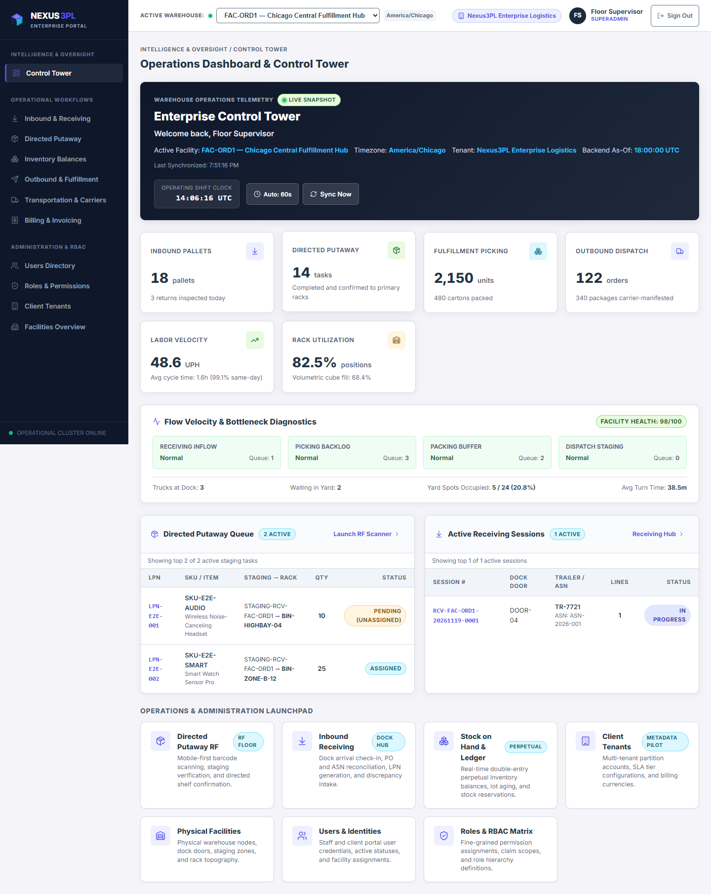
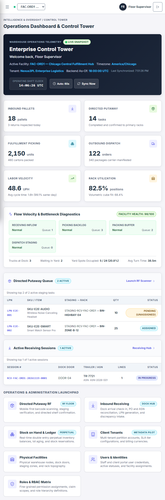
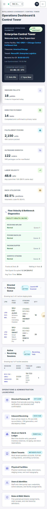

# Nexus3PL — Enterprise Control Tower Visual Audit Evidence

This directory contains inspectable, multi-viewport visual audit captures of the **Nexus3PL Enterprise Control Tower** dashboard, published directly to the repository for independent auditor review.

---

## 1. Audit Context & Environment

| Property | Value | Notes |
| :--- | :--- | :--- |
| **Audited Commit SHA** | `e15e83f` (and follow-up `feature/phase-7-enterprise-frontend` HEAD) | Nexus3PL Control Tower baseline |
| **Data Mode** | **Mocked Demonstration Data (E2E Test Fixtures)** | Captured via Playwright automated browser test suite using authoritative schema and backend contract test fixtures |
| **Capture Engine** | Playwright Chromium (Headless) | Built and served via production preview server (`vite build` + `vite preview`) |
| **Test Command** | `npx playwright test e2e/visual-audit.spec.ts` | 16/16 tests passing across Desktop, Tablet, and Mobile viewports |
| **Capture Date** | November 21, 2026 | Captured under Phase 7.3 Control Tower acceptance review |

---

## 2. Multi-Viewport Control Tower Screenshots

### A. Desktop Viewport (1440 × 900)
- **Viewport Dimensions:** 1440px wide × 900px high
- **Description:** Full enterprise dashboard displaying 6-metric throughput KPI grid, flow velocity diagnostics with 4-stage bottleneck analysis, dock/yard capacity telemetry, dual active work queues (Directed Putaway and Inbound Receiving), operating shift clock, and administration launchpad.



---

### B. Tablet Viewport (768 × 1024)
- **Viewport Dimensions:** 768px wide × 1024px high
- **Description:** Balanced two-column responsive layout with stacked diagnostic cards and horizontally scrollable operational queue tables.



---

### C. Mobile Viewport (375 × 812)
- **Viewport Dimensions:** 375px wide × 812px high
- **Description:** Single-column touch-optimized layout with $\ge 44\times 44\text{px}$ operational touch targets, zero horizontal page overflow (`scrollWidth <= innerWidth`), collapsible navigation drawer, and direct mobile RF scanner execution links.



---

## 3. Playwright Test Execution Summary

```text
Running 16 tests using 1 worker

  ok  1 [chromium] › e2e/accessibility-audit.spec.ts: zero horizontal overflow on mobile viewport (375x812, WCAG 2.1 Reflow 1.4.10)
  ok  2 [chromium] › e2e/accessibility-audit.spec.ts: mobile operational touch targets meet or exceed 44x44px target standard (WCAG 2.2 Target Size)
  ok  3 [chromium] › e2e/accessibility-audit.spec.ts: keyboard Tab traversal maintains computed focus outline and visibility across dashboard controls (WCAG 2.1 Criteria 2.1.1 & 2.4.7)
  ok  4 [chromium] › e2e/accessibility-audit.spec.ts: browser regression: execution-only deep-link from Control Tower opens RF mode without unauthorized list requests (P-CT-02 & Section B)
  ok  5 [chromium] › e2e/auth-rbac.spec.ts: login validation, session setup, backend admin pages, and logout flow
  ok  6 [chromium] › e2e/auth-rbac.spec.ts: refresh does not restore logged-out session during late network race
  ok  7 [chromium] › e2e/inbound-inventory.spec.ts: receiving intake, complete guard, directed putaway dual-scan, and stock query
  ok  8 [chromium] › e2e/landing-modal.spec.ts: zero horizontal page overflow at 320x568
  ok  9 [chromium] › e2e/landing-modal.spec.ts: modal buttons are within viewport, accept real pointer clicks, and body scrolls at 320x568
  ok 10 [chromium] › e2e/landing-modal.spec.ts: keyboard trapping and focus restoration at 320x568
  ok 11 [chromium] › e2e/landing-modal.spec.ts: zero horizontal page overflow at 568x320
  ok 12 [chromium] › e2e/landing-modal.spec.ts: modal buttons are within viewport, accept real pointer clicks, and body scrolls at 568x320
  ok 13 [chromium] › e2e/landing-modal.spec.ts: keyboard trapping and focus restoration at 568x320
  ok 14 [chromium] › e2e/visual-audit.spec.ts: desktop (1440x900) full multi-viewport capture
  ok 15 [chromium] › e2e/visual-audit.spec.ts: tablet (768x1024) full multi-viewport capture
  ok 16 [chromium] › e2e/visual-audit.spec.ts: mobile (375x812) full multi-viewport capture

  16 passed (1.4m)
```
