# Nexus3PL — Receiving & RF Putaway Enterprise UI Audit Evidence

This directory contains inspectable, multi-viewport visual audit captures of the **Nexus3PL Inbound Goods Receiving & RF Directed Putaway Workstations**, published directly to the repository for independent auditor review.

---

## 1. Audit Context & Environment

| Property | Value | Notes |
| :--- | :--- | :--- |
| **Branch** | `feature/phase-7-enterprise-frontend` | Phase 7.3 Enterprise Frontend Refinements |
| **Accepted Baseline** | `1a67a71640df28dfbd1c5cdd5363f2a0e77a45c5` | CI Run `44923374233` passed; Receiving & RF Putaway UI refined & accepted |
| **Data Mode** | **Mocked Demonstration Data (E2E Test Fixtures)** | Captured via Playwright automated browser test suite using authoritative schema and backend contract test fixtures |
| **Capture Engine** | Playwright Chromium (Headless) | Built and served via production preview server (`vite build` + `vite preview`) |
| **Test Command** | `npx playwright test e2e/receiving-putaway-audit.spec.ts` | 5/5 suites passing across Desktop, Tablet, Mobile, and Retry Viewports |
| **Capture Date** | November 21, 2026 | Captured under Phase 7.3 Receiving & RF Putaway refinement review |

---

## 2. Inbound Goods Receiving Workstation

### A. Desktop Viewport (1440 × 900)
- **Sessions List:** Overview of dock doors, trailers, ASN links, status badges, and direct action triggers.
- **Intake Workstation:** Dedicated 3-group input hierarchy:
  1. Item Identification & Quantity (`#scan-item-id`, `#scan-qty`) with $\ge 52\text{px}$ input height and monospace font.
  2. Container Pallet LPN & Lot Traceability (`#scan-lpn`, `#scan-lot`).
  3. Condition & Ingestion Actions (`#scan-condition`, outer carton notes).
  - Hardware keyboard-wedge scanner single-flight guard prevents duplicate line ingestion.
  - Predictable focus restoration immediately returns cursor to `#scan-item-id` for continuous scanning.
- **Discrepancy Resolution:** Accessible modal with Escape dismissal, focus trapping, and supervisor review actions (Approve, Quarantine, Reject).

| View | Screenshot |
| :--- | :--- |
| **Sessions Overview** | 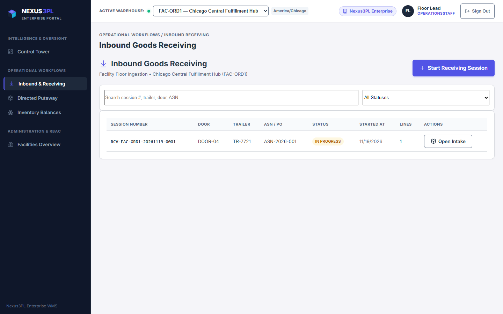 |
| **Intake Scanner Workstation** | 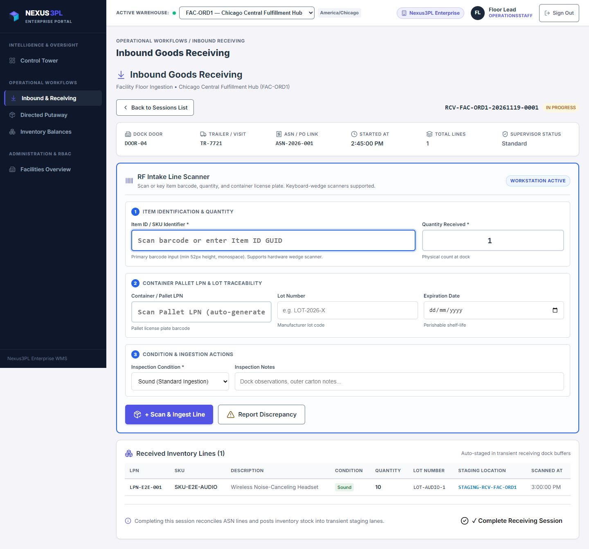 |
| **Discrepancy Reporting Modal** | 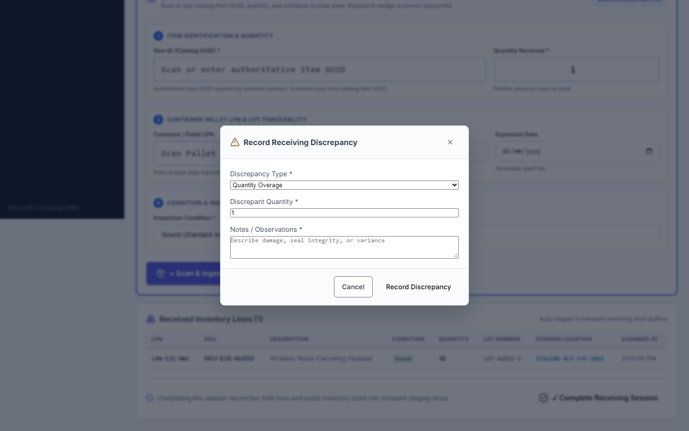 |

---

### B. Tablet Viewport (768 × 1024)
- Contained horizontal scrolling for received line tables.
- Touch-friendly action buttons ($\ge 44\times 44\text{px}$) and balanced summary cards.

| View | Screenshot |
| :--- | :--- |
| **Sessions Overview** | 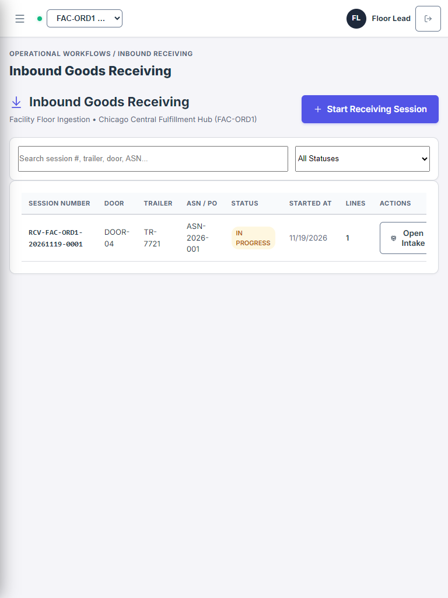 |
| **Intake Scanner Workstation** | 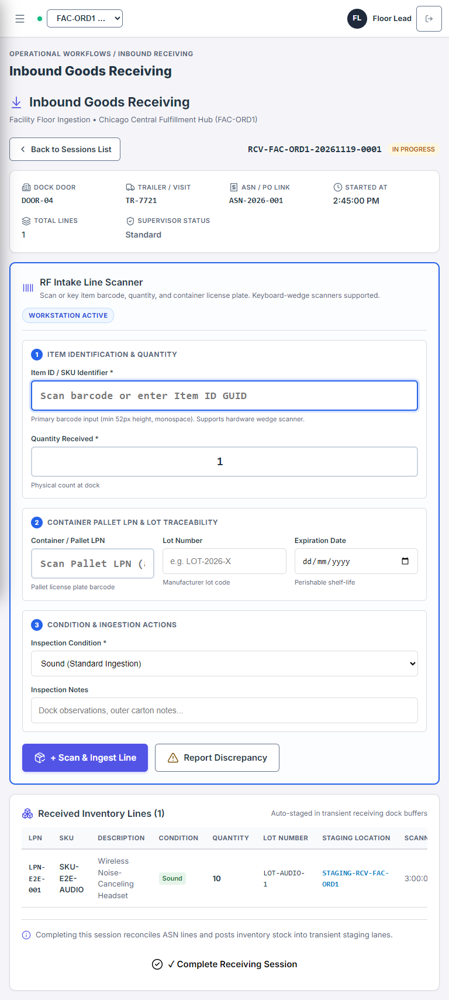 |
| **Discrepancy Reporting Modal** | 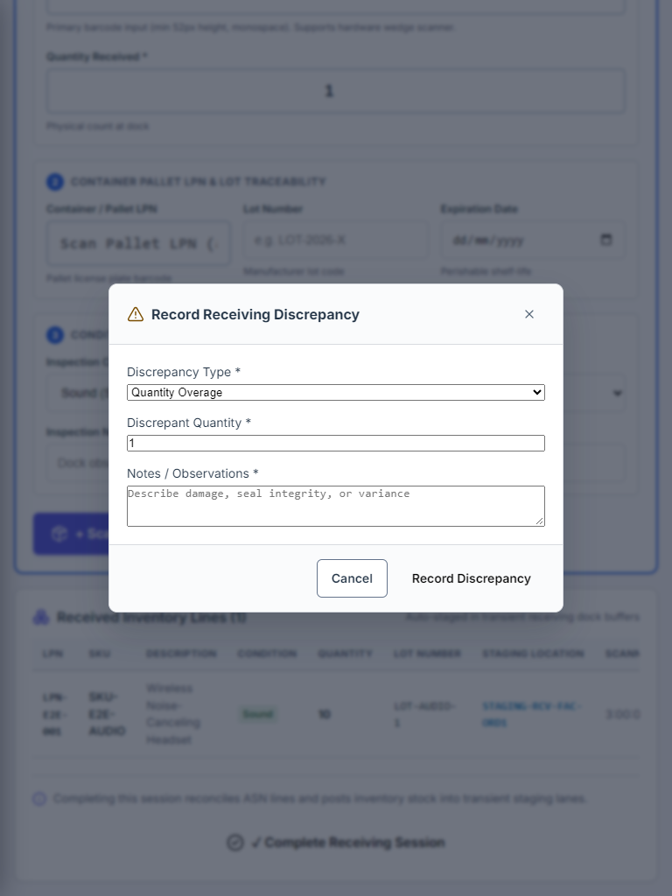 |

---

### C. Mobile Viewport (375 × 812)
- Zero horizontal page overflow (`scrollWidth <= innerWidth`).
- Vertically stacked scanner input fields with $\ge 52\text{px}$ height and prominent touch targets.

| View | Screenshot |
| :--- | :--- |
| **Sessions Overview** | 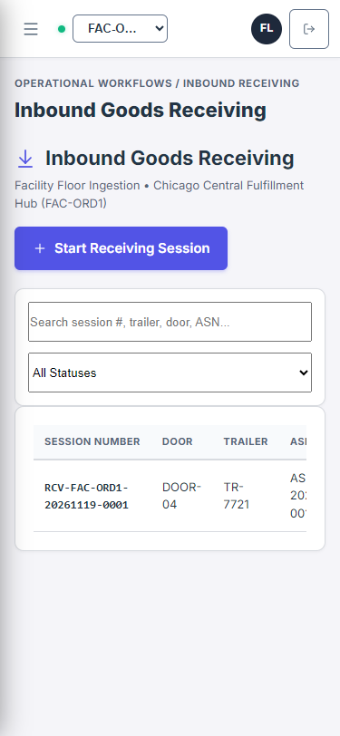 |
| **Intake Scanner Workstation** | 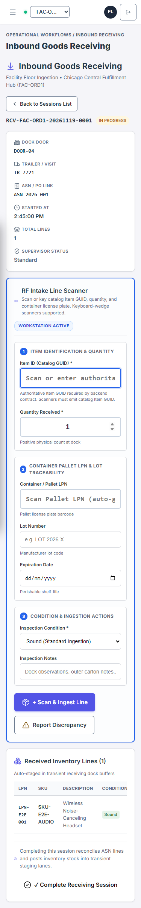 |
| **Discrepancy Reporting Modal** | 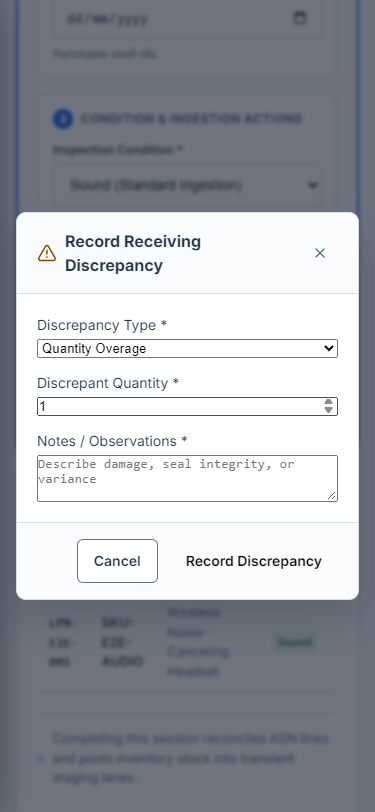 |

---

## 3. RF Directed Putaway Workstation

### A. Desktop Viewport (1440 × 900)
- **High Legibility Task Card:** Prominent item SKU (24px bold), description, priority pill, and current status.
- **Visual Routing Separation:**
  - Source Staging Lane: Slate container with `ArrowDownToLine` icon and location code.
  - Directional Arrow: Prominent transition indicator.
  - Destination Shelf Bin: Emerald green container with `MapPin` icon, 2px border, bold location code, and high-contrast barcode hint.
- **Numbered Two-Step Scanning Guidance:**
  - **Step 1:** Container Pallet LPN Barcode (`#scan-lpn-input`, $\ge 52\text{px}$ monospace).
  - **Step 2:** Destination Bin Tag Barcode (`#scan-bin-input`, $\ge 52\text{px}$ monospace).
- **Duplicate Submit Protection:** Single-flight ref guard (`inFlightConfirmRef`) prevents duplicate confirmation requests.
- **Haptic Vibration:** Automatically triggers device vibration (`navigator.vibrate([100, 50, 100])`) when supported and confirmed.

| View | Screenshot |
| :--- | :--- |
| **RF Directed Scanner** | 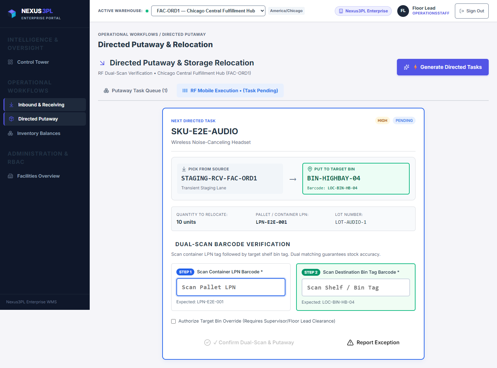 |
| **Exception Modal** | 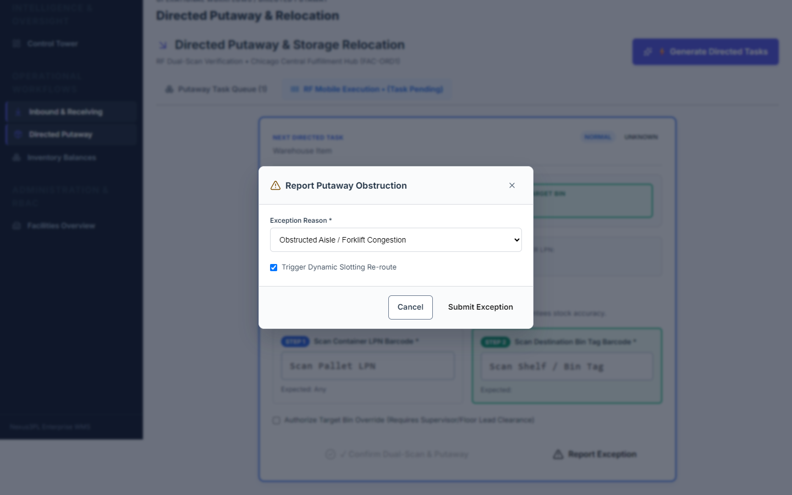 |
| **Task Management Workstation (Manage-Only)** | 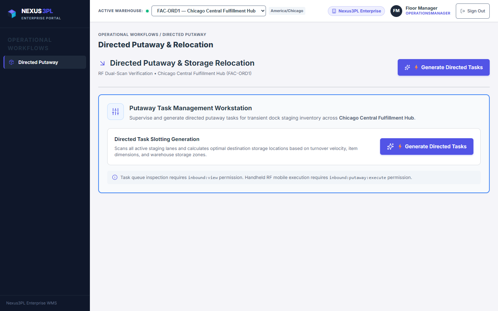 |

---

### B. Tablet Viewport (768 × 1024)
- Stacked routing indicators and dual-scan controls optimized for iPad/Android warehouse tablets.

| View | Screenshot |
| :--- | :--- |
| **RF Directed Scanner** | 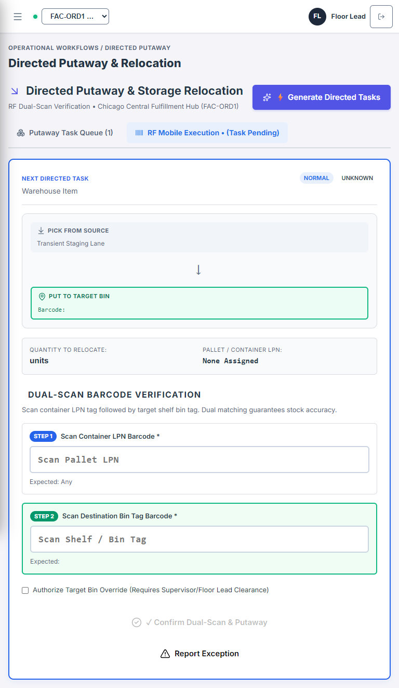 |
| **Exception Modal** | 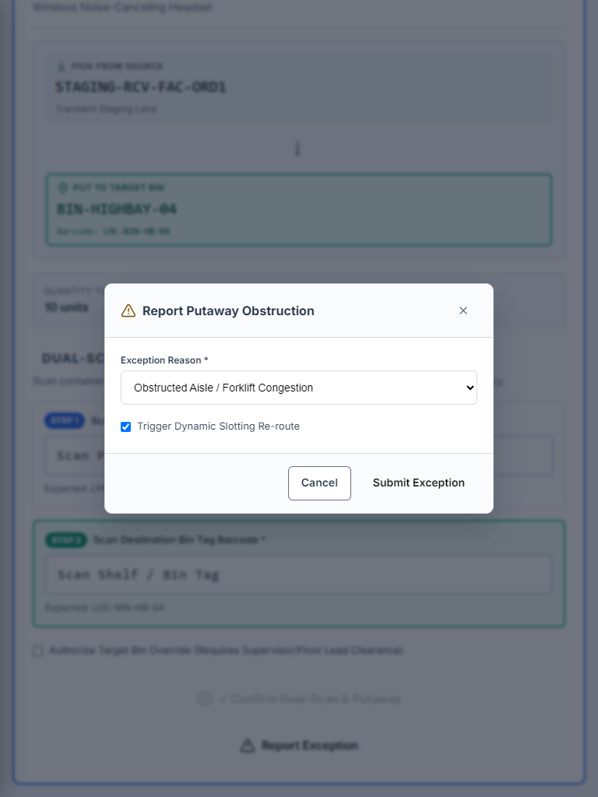 |

---

### C. Mobile Viewport (375 × 812 & 320 × 568)
- Touch-optimized single column layout for rugged RF handheld terminals (Zebra, Honeywell, CipherLab).
- Full reflow verified down to 320px width with 0 horizontal page overflow.

| View | Screenshot |
| :--- | :--- |
| **RF Directed Scanner (375px)** | 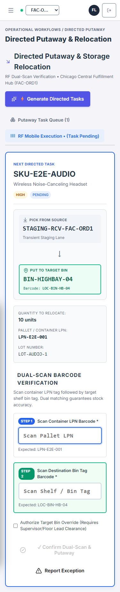 |
| **Exception Modal (375px)** | 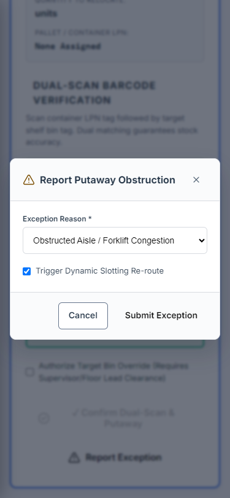 |
| **Task Management Workstation (320px Reflow)** | 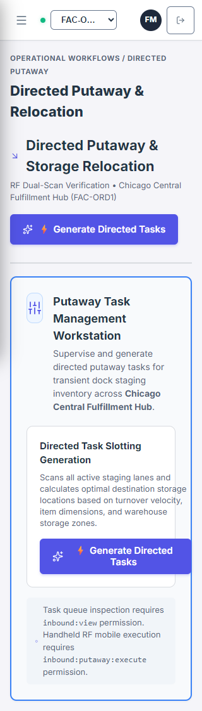 |

---

## 4. Permission Matrix & Manage-Only Verification (Requirement D)

| Role / Permissions Context | Queue View (`inbound:view`) | RF Execute (`inbound:putaway:execute`) | Task Manage (`inbound:putaway:manage`) | UI Rendered Behavior |
| :--- | :---: | :---: | :---: | :--- |
| **View-Only Operator** | Yes | No | No | Renders queue table; hides RF tab and Generate button; never invokes `/next`. |
| **RF Execution Operator** | No | Yes | No | Defaults directly to RF mode; executes `/next`; never invokes queue listing. |
| **Operations Manager (Manage-Only)** | No | No | Yes | **Renders dedicated "Putaway Task Management Workstation"** with "⚡ Generate Directed Tasks" button enabled. Does NOT show misleading "Authorization Required" error banner. |
| **Full Lead / SuperAdmin** | Yes | Yes | Yes | Full dual-tab access with task generation, queue inspection, and RF execution. |

---

## 5. Playwright Test Execution Summary

```text
Running 5 tests using 1 worker

  ok 1 [chromium] › e2e\receiving-putaway-audit.spec.ts:103:5 › captures multi-viewport visual evidence for desktop (1440x900) (6.7s)
  ok 2 [chromium] › e2e\receiving-putaway-audit.spec.ts:103:5 › captures multi-viewport visual evidence for tablet (768x1024) (6.3s)
  ok 3 [chromium] › e2e\receiving-putaway-audit.spec.ts:103:5 › captures multi-viewport visual evidence for mobile (375x812) (5.8s)
  ok 4 [chromium] › e2e\receiving-putaway-audit.spec.ts:350:3 › captures manage-only workstation experience and verifies 320x568 reflow (2.9s)
  ok 5 [chromium] › e2e\receiving-putaway-audit.spec.ts:440:3 › distinguishes RF task load errors from completed work and supports retry action (P-RF-02) (1.7s)

  5 passed (23.4s)
```
